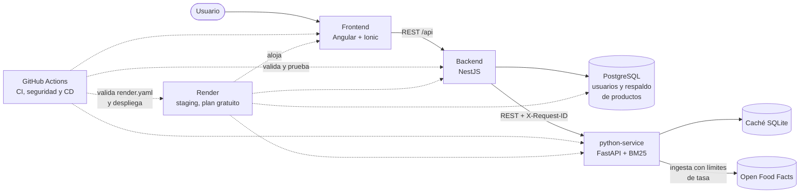

# FoodAware

FoodAware es una aplicación web multiplataforma para ayudar a las personas con
alergias, intolerancias o dietas específicas a elegir alimentos procesados.
Busca productos reales vendidos en Chile, revisa su lista de ingredientes y
muestra qué alérgenos contienen y cuáles pueden venir como trazas.

Integrantes:

- Ignacio Reyes
- Joaquín Muñoz

## Problema

Las personas con restricciones alimentarias (alergias, intolerancias o
dietas como la vegana o sin gluten) tienen problemas para saber si un
producto procesado es apto para ellas. Las etiquetas usan nombres técnicos
("caseinato", "lactosuero"), esconden alérgenos dentro de subingredientes o
los mencionan solo como "puede contener". Equivocarse es un riesgo para la
salud, y revisar cada etiqueta en el supermercado es lento.

### Usuarios objetivo

- Personas con alergias o intolerancias alimentarias, que necesitan saber
  qué tiene cada producto para evitar problemas de salud.
- Consumidores con dietas específicas: veganos, vegetarianos o sin gluten.
- Personas interesadas en conocer mejor lo que comen.

### Objetivos

- Objetivo general: desarrollar una herramienta que analice los ingredientes
  de productos reales y determine si son aptos según el perfil de la persona.
- EP1: arquitectura base (frontend, backend, servicio de Python y base de
  datos), autenticación (JWT y bcrypt) y pipeline DevSecOps.
- EP2: integrar una fuente web real (Open Food Facts), limpiar y preparar sus
  datos, detectar alérgenos y trazas, buscar con BM25, medir la calidad de los
  datos y de la búsqueda, y desplegar un ambiente de staging.

## Qué hace hoy

- Busca productos por texto (por ejemplo "galletas de avena") en un corpus de
  385 productos chilenos de Open Food Facts, ordenados por relevancia con
  BM25.
- Muestra los alérgenos y las trazas de cada producto, detectados en el texto
  de ingredientes y unidos con lo que declara Open Food Facts.
- Actualiza los datos solo: una ingesta cada 24 horas, con limitadores de
  tasa y reintentos para no abusar de la fuente.
- Mide la calidad de los datos (porcentaje de válidos, duplicados, cobertura
  de ingredientes, antigüedad y fallas de la fuente) y de la búsqueda
  (Precision@5 y Recall@5).
- Sigue respondiendo si un servicio falla: si el python-service no contesta,
  el backend responde desde su propia base y el frontend lo avisa.
- Registro de usuarios con su perfil de alergias y, con sesión iniciada, el
  veredicto "Apto para ti" o "No apto" en cada producto.
- Análisis manual de ingredientes (de la EP1).

## Capacidad adaptativa

La idea es que FoodAware clasifique cada producto como apto o no apto según
el perfil de alergias de la persona, en vez de dejar que ella revise los
alérgenos uno por uno. La necesidad salió de la evaluación de la búsqueda.
Las consultas de producto ("pan integral") rinden bien, con Precision@5 de
0,75. Las consultas con restricción se quedan en 0,20: en "chocolate sin
leche" los 5 primeros resultados tienen leche, y en "galletas sin gluten" el
tercero es una galleta con gluten que sube solo porque su nombre dice "sin
sal". Un buscador por palabras no entiende el "sin". Para responder bien hay
que usar los alérgenos y trazas que ya detectamos en cada producto y filtrar
según el perfil. La especificación preliminar, con lo que ya está
implementado en la EP2, está en
[docs/capacidad-adaptativa.md](docs/capacidad-adaptativa.md).

## Arquitectura



| Componente | Tecnología | Responsabilidad |
|---|---|---|
| Frontend | Angular 22, Ionic 9, Capacitor; nginx en Docker | Interfaz de búsqueda y de análisis |
| Backend | NestJS 10, TypeORM, pino | API principal, usuarios y autenticación, proxy de la búsqueda y respaldo |
| python-service | Python 3.11, FastAPI, Pydantic, httpx | Ingesta desde Open Food Facts, preparación de datos, alérgenos, búsqueda BM25 y métricas |
| Base de datos | PostgreSQL 15 | Datos del backend |
| Caché | SQLite | Productos de Open Food Facts con su payload crudo y procedencia |
| CI/CD | GitHub Actions | Lint, pruebas, integración, seguridad, infraestructura y despliegue a staging |
| Staging | Render (Blueprint `render.yaml`) | Ambiente de staging en el plan gratuito |

Los diagramas de contexto, contenedores y despliegue, junto con las
decisiones de arquitectura, están en [docs/Arquitectura.md](docs/Arquitectura.md).

## Levantar el proyecto en local

Requisitos: Docker Desktop y Git. No hace falta instalar Node ni Python para
levantar la app.

1. Clonar el repositorio:

   ```powershell
   git clone https://github.com/Nachetao/FoodAware-Project.git
   cd FoodAware-Project
   ```

2. Crear el `.env` a partir del ejemplo y completarlo:

   ```powershell
   Copy-Item .env.example .env
   ```

   Como mínimo hay que cambiar `DB_USER`, `DB_PASSWORD`, `JWT_SECRET` y
   `OFF_USER_AGENT` (con un correo real de contacto, por ejemplo
   `FoodAware/1.0 (correo@del-equipo)`). Si se quiere lanzar ingestas a mano,
   también `INGESTA_CLAVE`; en `.env.example` está el comando de PowerShell
   para generarla.

3. Levantar todo:

   ```powershell
   docker compose up --build -d
   docker compose ps
   ```

   La primera vez tarda varios minutos porque construye las imágenes. Las
   migraciones de PostgreSQL corren solas al iniciar el backend, y el
   python-service carga la semilla del corpus (385 productos y el historial
   de las 5 ingestas que los trajeron) si su caché está vacía, sin llamar a
   Open Food Facts.

4. Probar:

   | Qué | URL |
   |---|---|
   | Frontend | http://localhost:4200 |
   | Backend | http://localhost:3000/api/health |
   | Swagger del backend | http://localhost:3000/docs |
   | python-service | http://localhost:8000/health |
   | Swagger del python-service | http://localhost:8000/docs |

   ```powershell
   Invoke-RestMethod "http://localhost:3000/api/products/search?q=galletas&limit=3"
   ```

Para bajar todo: `docker compose down` (con `-v` se borran también los
volúmenes de PostgreSQL y de la caché).

## Variables de entorno

Todas están en [`.env.example`](.env.example), con comentarios. El `.env` real
no se sube al repositorio.

| Variable | Servicio | Para qué | Por defecto |
|---|---|---|---|
| `DB_HOST`, `DB_PORT` | backend | Host y puerto de PostgreSQL (`db` dentro de Docker Compose) | `db`, `5432` |
| `DB_USER`, `DB_PASSWORD`, `DB_NAME` | backend, db | Credenciales y nombre de la base | se definen en `.env` |
| `PORT` | backend | Puerto del backend | `3000` |
| `JWT_SECRET` | backend | Firma de los tokens de autenticación | se define en `.env` |
| `PYTHON_API_URL` | backend | URL del python-service (`http://python-service:8000` en Docker) | |
| `PYTHON_API_TIMEOUT_MS`, `PYTHON_API_REINTENTOS` | backend | Timeout por intento y reintentos al python-service | `2000`, `2` |
| `CORS_ORIGINS` | backend | Orígenes permitidos por CORS, separados por comas (en staging, la URL del frontend) | `http://localhost:4200`, `http://localhost:8100` |
| `API_URL` | frontend (al compilar) | URL del backend que queda en el build (en staging, la URL pública del backend) | `http://localhost:3000` |
| `LOG_LEVEL` | python-service | Nivel de los logs JSON | `INFO` |
| `SIMULAR_ERRORES_HABILITADO` | python-service | Habilita el header `X-Simular-Error` (solo desarrollo) | `false` |
| `OFF_BASE_URL`, `OFF_USER_AGENT`, `OFF_TIMEOUT_SEGUNDOS` | python-service | Open Food Facts: URL, identificación obligatoria y timeout | `https://world.openfoodfacts.org`, sin valor, `10` |
| `LIMITADOR_ESPERA_MAX_SEGUNDOS` | python-service | Máximo que una petición espera al limitador de tasa | `3` |
| `CACHE_DB_PATH` | python-service | Ruta de la caché SQLite | `/data/foodaware-cache.sqlite3` |
| `INGESTA_CLAVE` | python-service | Clave de `POST /ingest/runs`; vacía, el endpoint queda cerrado | vacía |
| `CARGAR_SEMILLA_SI_VACIA` | python-service | Cargar la semilla del corpus si la caché está vacía | `true` |
| `INGESTA_AL_INICIAR`, `INGESTA_INTERVALO_HORAS`, `CACHE_TTL_HORAS` | python-service | Estrategia de actualización | `true`, `24`, `72` |
| `INGESTA_CATEGORIAS`, `INGESTA_MAX_PRODUCTOS` | python-service | Categorías y tope de productos de cada ingesta | 7 categorías, `500` |

El detalle de las variables del python-service está en
[docs/contratos/README.md](docs/contratos/README.md#estrategia-de-actualización).
En staging, Render genera los secretos (`JWT_SECRET`, `INGESTA_CLAVE` y la
contraseña de la base); ver [docs/despliegue-staging.md](docs/despliegue-staging.md#secretos-y-configuración).

## Documentación

| Documento | Contenido | Estado |
|---|---|---|
| [docs/Arquitectura.md](docs/Arquitectura.md) | Diagramas de contexto, contenedores y despliegue; modelo de datos; decisiones de arquitectura | Actualizado a la EP2 (modelo de BD pendiente del backend) |
| [docs/Flujo de Datos.md](docs/Flujo%20de%20Datos.md) | Flujo de búsqueda (EP2) y de análisis manual (EP1) | Actualizado a la EP2 |
| [docs/contratos/README.md](docs/contratos/README.md) | API FastAPI: endpoints, errores, headers, búsqueda y métricas ([OpenAPI](docs/contratos/fastapi-openapi.json)) | Listo |
| [docs/backend.md](docs/backend.md) | API NestJS: endpoints, persistencia, robustez frente a FastAPI y seguridad | Listo |
| [docs/frontend.md](docs/frontend.md) | Frontend: páginas, servicios, manejo de errores, sesión y atribución | Listo |
| [docs/observabilidad.md](docs/observabilidad.md) | Logs, request id y salud del backend | Listo |
| [docs/capacidad-adaptativa.md](docs/capacidad-adaptativa.md) | Especificación preliminar de la capacidad adaptativa y lo ya implementado | Listo (preliminar, como pide la EP2) |
| [docs/fuente-web.md](docs/fuente-web.md) | Open Food Facts: qué datos usamos, cómo los obtenemos y revisión legal y ética | Listo |
| [docs/extraccion-y-preparacion.md](docs/extraccion-y-preparacion.md) | Extracción, limpieza, alérgenos, calidad, deduplicación y trazabilidad | Listo |
| [docs/recuperacion-y-evaluacion.md](docs/recuperacion-y-evaluacion.md) | Persistencia, índice, BM25 y métricas con sus resultados | Listo |
| [docs/pipeline-devsecops.md](docs/pipeline-devsecops.md) | Workflows, quality gates, Variables y Secrets, pruebas y evidencia | Listo |
| [docs/despliegue-staging.md](docs/despliegue-staging.md) | Despliegue en Render paso a paso y despliegue automático | Listo |
| [docs/limitaciones.md](docs/limitaciones.md) | Limitaciones conocidas, su impacto y su mitigación | Listo |
| [docs/estado-del-proyecto.md](docs/estado-del-proyecto.md) | Lo hecho en la EP2 por persona, correcciones de la EP1 y backlog para la EP3 y el Módulo 3 | Listo |

## Staging

Staging corre en Render con el plan gratuito, declarado en
[`render.yaml`](render.yaml). Son cuatro recursos: el frontend como sitio
estático, el backend y el python-service como web services Docker, y una base
PostgreSQL.

| Servicio | URL |
|---|---|
| Frontend | <https://foodaware-staging-frontend.onrender.com> |
| Backend | <https://foodaware-staging-backend.onrender.com/api/health> (Swagger en [/docs](https://foodaware-staging-backend.onrender.com/docs)) |
| python-service | <https://foodaware-staging-python.onrender.com/health> (Swagger en [/docs](https://foodaware-staging-python.onrender.com/docs)) |

Cada commit de `main` con todo el CI en verde se despliega solo con el
workflow CD Staging (Render), que después prueba las URL públicas.

Los servicios gratuitos se duermen tras 15 minutos sin tráfico, así que la
primera petición puede tardar cerca de un minuto. Para despertarlos antes de
usarlos:

```powershell
.\scripts\despertar-staging.ps1
```

Las instrucciones de despliegue, el despliegue automático, los secretos y las
limitaciones del plan están en
[docs/despliegue-staging.md](docs/despliegue-staging.md).

## Demostración de la EP2

Los 10 puntos de la demostración mínima y dónde se ve cada uno. Los valores
de referencia son los del staging con la semilla del 25 de octubre de 2026:
385 productos, Precision@5 = 0,53, 75,47 % de válidos, 70,96 % de duplicados
y 75,31 % de cobertura de ingredientes. Antes de empezar conviene correr
`.\scripts\despertar-staging.ps1`.

| # | Punto | Qué mostrar | Evidencia |
|---|---|---|---|
| 1 | Recuperación automatizada de información real | Las ingestas desde la API de Open Food Facts, por país y categoría, con límites de tasa, reintentos y segunda ronda. La última que trajo datos al corpus (25 de octubre de 2026, 387 productos recuperados) se ve en [`/ingest/runs/latest`](https://foodaware-staging-python.onrender.com/ingest/runs/latest), con `origen: "semilla"` | [fuente-web.md](docs/fuente-web.md), [extraccion-y-preparacion.md](docs/extraccion-y-preparacion.md) |
| 2 | Validación y preparación | Limpieza de ingredientes, alérgenos y trazas, reglas de calidad y deduplicación. En [`/metrics/quality`](https://foodaware-staging-python.onrender.com/metrics/quality): 75,47 % de válidos | [extraccion-y-preparacion.md](docs/extraccion-y-preparacion.md), [detalle-producto.png](docs/evidencia/detalle-producto.png) |
| 3 | Procesamiento mediante FastAPI | El [Swagger del python-service](https://foodaware-staging-python.onrender.com/docs): `/search` con BM25 y `/products/{codigo_barras}` con alérgenos, calidad y procedencia | [contratos/README.md](docs/contratos/README.md) |
| 4 | Comunicación NestJS-FastAPI | [Búsqueda por el backend](https://foodaware-staging-backend.onrender.com/api/products/search?q=galletas&limit=5) con `X-Fuente-Datos: fastapi`; el mismo `X-Request-ID` aparece en los logs de los dos servicios | [observabilidad.md](docs/observabilidad.md), [backend.md](docs/backend.md), [ep2-cd-staging.png](docs/evidencia/ep2-cd-staging.png) (prueba de búsqueda a través de FastAPI) |
| 5 | Persistencia o indexación | Caché SQLite con el payload crudo y la procedencia, índice invertido BM25 en memoria (385 productos en `detalle.indice` de [`/health`](https://foodaware-staging-python.onrender.com/health)) y tabla `products` de PostgreSQL como respaldo | [recuperacion-y-evaluacion.md](docs/recuperacion-y-evaluacion.md#1-persistencia-e-indexación), [backend.md](docs/backend.md#persistencia) |
| 6 | Consulta y visualización desde el frontend | En el [frontend de staging](https://foodaware-staging-frontend.onrender.com): buscar "galletas de avena", abrir un producto y, con sesión, ver "Apto para ti" o "No apto" | [frontend.md](docs/frontend.md), [detalle-producto.png](docs/evidencia/detalle-producto.png), [apto-para-ti.png](docs/evidencia/apto-para-ti.png), [no-apto.png](docs/evidencia/no-apto.png) |
| 7 | Ejecución del pipeline DevSecOps | La pestaña Actions: los 7 workflows de CI y CD Staging, con los quality gates y los Secrets y Variables | [pipeline-devsecops.md](docs/pipeline-devsecops.md), [ep2-ci-verde.png](docs/evidencia/ep2-ci-verde.png), [ep2-trivy-backend-critical.png](docs/evidencia/ep2-trivy-backend-critical.png), [ep2-github-secrets.png](docs/evidencia/ep2-github-secrets.png), [ep2-github-variables.png](docs/evidencia/ep2-github-variables.png) |
| 8 | Acceso a la versión en staging | Las tres URL de la sección [Staging](#staging) y el despliegue automático del último commit de `main` | [despliegue-staging.md](docs/despliegue-staging.md), [ep2-render-servicios.png](docs/evidencia/ep2-render-servicios.png), [ep2-cd-staging.png](docs/evidencia/ep2-cd-staging.png) |
| 9 | Presentación de una métrica de evaluación | La página [Métricas](https://foodaware-staging-frontend.onrender.com/metricas): Precision@5 = 0,53 sobre 20 consultas (0,75 en las de producto y 0,20 en las de restricción), más las métricas de calidad | [recuperacion-y-evaluacion.md](docs/recuperacion-y-evaluacion.md#7-métricas), [panel-metricas.png](docs/evidencia/panel-metricas.png) (tomada en local, con otra caché: ahí P@5 da 56 %) |
| 10 | Manejo de un escenario de error | Con FastAPI caído, el backend responde desde la base con `X-Fuente-Datos: respaldo` y el frontend lo avisa. En staging, en vivo: un [código de barras inválido](https://foodaware-staging-backend.onrender.com/api/products/123) responde 422 `VALIDATION_ERROR` con su `request_id`, y `POST /ingest/runs` sin la clave responde 403 | [respaldo-chocolate.png](docs/evidencia/respaldo-chocolate.png), [backend.md](docs/backend.md#robustez-frente-a-fastapi), [limitaciones.md](docs/limitaciones.md) |

## Pipeline DevSecOps

Cada push a cualquier rama y cada pull request a `main` corre 7 workflows de
CI en GitHub Actions, y un octavo despliega `main` en staging:

| Workflow | Qué revisa |
|---|---|
| CI Backend (NestJS) | `npm audit`, lint, 192 pruebas unitarias y 36 de integración contra un FastAPI simulado |
| CI Frontend (Angular) | Lint, 121 pruebas unitarias, `npm audit` y compilación |
| CI Python (FastAPI) | flake8, 293 pruebas unitarias, 543 pruebas del proceso de recuperación, contrato OpenAPI al día y `pip-audit` |
| CI Integración | La app completa con Docker Compose y 5 pruebas entre NestJS y FastAPI |
| CI Seguridad | Gitleaks, Bandit, CodeQL (Python y TypeScript) y Trivy sobre las 3 imágenes |
| CI Render Blueprint | `render.yaml` contra el esquema oficial y contra la API de Render |
| Terraform CI | `fmt`, `validate` y `plan` de `terraform/` |
| CD Staging (Render) | Cuando los 7 anteriores pasan en un commit de `main`: lo despliega en Render (python-service, backend y frontend, en ese orden) y corre 5 pruebas de salud contra las URL públicas |

Qué hace fallar a cada uno, cómo correr las pruebas y las Variables y
Secrets que usan están en
[docs/pipeline-devsecops.md](docs/pipeline-devsecops.md).

## Evidencia

Las capturas están en [docs/evidencia/](docs/evidencia/):

| Captura | Qué muestra |
|---|---|
| [ep2-ci-verde.png](docs/evidencia/ep2-ci-verde.png) | Todos los checks del pipeline en verde |
| [ep2-trivy-backend-critical.png](docs/evidencia/ep2-trivy-backend-critical.png) | Trivy bloqueando el CRITICAL de `tar` en la imagen del backend |
| [ep2-github-secrets.png](docs/evidencia/ep2-github-secrets.png) | Los Secrets de GitHub Actions (GitHub solo muestra los nombres) |
| [ep2-github-variables.png](docs/evidencia/ep2-github-variables.png) | Las Variables de GitHub Actions |
| [ep2-render-servicios.png](docs/evidencia/ep2-render-servicios.png) | Los 4 recursos del Blueprint desplegados en Render |
| [ep2-cd-staging.png](docs/evidencia/ep2-cd-staging.png) | CD Staging en verde con la tabla de las pruebas de salud |
| [respaldo-chocolate.png](docs/evidencia/respaldo-chocolate.png) | Búsqueda con FastAPI caído: respuesta desde la base, con aviso |
| [panel-metricas.png](docs/evidencia/panel-metricas.png) | Panel de métricas del frontend |
| [detalle-producto.png](docs/evidencia/detalle-producto.png) | Detalle con alérgenos, procedencia y atribución ODbL |
| [apto-para-ti.png](docs/evidencia/apto-para-ti.png) y [no-apto.png](docs/evidencia/no-apto.png) | Veredicto según las alergias del usuario |
| [compatibles-swagger.png](docs/evidencia/compatibles-swagger.png) | `/compatibles` con alergia a lácteos |

La prueba de la EP1 en que Gitleaks bloqueó un secreto falso está en
[docs/pipeline-devsecops.md](docs/pipeline-devsecops.md#evidencia). Los
resultados de las métricas, con las salidas reales de los scripts, están en
[docs/recuperacion-y-evaluacion.md](docs/recuperacion-y-evaluacion.md#7-métricas).

## Estado del proyecto

Lo que hizo cada integrante en la EP2, lo que corregimos de la EP1 (aunque la
retroalimentación formal todavía no llega) y lo que queda para la EP3 y el
Módulo 3 está en [docs/estado-del-proyecto.md](docs/estado-del-proyecto.md).

## Limitaciones

Las limitaciones conocidas (datos incompletos de la fuente, casos que la
detección de alérgenos no resuelve, la búsqueda léxica con restricciones, el
plan gratuito de Render y las vulnerabilidades pendientes) están en
[docs/limitaciones.md](docs/limitaciones.md). Lo más importante: la
información de alérgenos es orientativa y no reemplaza leer la etiqueta del
producto.

## Prototipo

Diseño interactivo en Figma:
https://www.figma.com/design/5ckGTwcAkx4wRjsVI7VfEw/FoodAware?node-id=0-1&t=bg6G2XpqgT3mjuvQ-1
