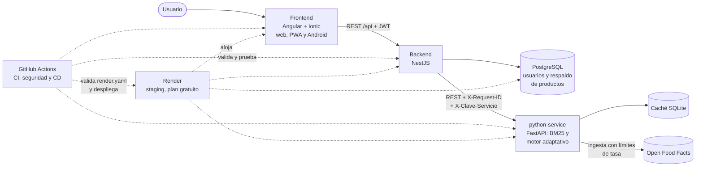

# FoodAware

FoodAware es una aplicación web multiplataforma (web, PWA instalable y app de
Android) para ayudar a las personas con alergias, intolerancias o dietas
específicas a elegir alimentos procesados. Busca productos reales vendidos en
Chile, revisa su lista de ingredientes, muestra qué alérgenos contienen y
cuáles pueden venir como trazas, y clasifica cada producto según el perfil de
la persona: "Apto para ti", "Apto con advertencia" o "No apto".

## Integrantes y responsabilidades

| Integrante | Responsabilidades |
|---|---|
| Ignacio Reyes | python-service (ingesta desde Open Food Facts, preparación de datos, detección de alérgenos, búsqueda BM25, métricas, motor de la capacidad adaptativa y su evaluación), pipeline DevSecOps, staging en Render, Terraform y documentación general (arquitectura, ADR 0001 a 0003, modelo de amenazas) |
| Joaquín Muñoz | Backend NestJS (usuarios, roles, autenticación, límite de peticiones, respaldo e integración con el motor), frontend Angular + Ionic (búsqueda, perfil, veredicto, administración, PWA, app de Android y accesibilidad), ADR 0004 y modelo de datos |

El detalle de lo que hizo cada uno, Pull Request por Pull Request, está en
[docs/estado-del-proyecto.md](docs/estado-del-proyecto.md).

## Problema

Las personas con restricciones alimentarias (alergias, intolerancias o
dietas como la vegana o sin gluten) tienen problemas para saber si un
producto procesado es apto para ellas. Las etiquetas usan nombres técnicos
("caseinato", "lactosuero"), esconden alérgenos dentro de subingredientes o
los mencionan solo como "puede contener". Equivocarse es un riesgo para la
salud, y revisar cada etiqueta en el supermercado es lento.

### Usuarios objetivo

- Personas con alergias o intolerancias alimentarias, que necesitan saber
  qué tiene cada producto para evitar problemas de salud.
- Consumidores con dietas específicas: veganos, vegetarianos, sin gluten o
  sin lactosa.
- Personas interesadas en conocer mejor lo que comen.

### Objetivos

- **Objetivo general:** desarrollar una herramienta que analice los
  ingredientes de productos reales y clasifique si son compatibles con el
  perfil de la persona.
- **EP1:** arquitectura base (frontend, backend, servicio de Python y base de
  datos), autenticación (JWT y bcrypt) y pipeline DevSecOps.
- **EP2:** integrar una fuente web real (Open Food Facts), limpiar y preparar
  sus datos, detectar alérgenos y trazas, buscar con BM25, medir la calidad de
  los datos y de la búsqueda, y desplegar un ambiente de staging.
- **Entrega Final:** la capacidad adaptativa (veredicto y búsqueda
  personalizada según el perfil) con su evaluación; roles de usuario y
  administrador; PWA y app de Android; controles de seguridad (clave entre
  servicios obligatoria, límite de peticiones, modelo de amenazas); y
  despliegue automático con pruebas y rollback.

## Alcance y exclusiones

**Dentro del alcance:**

- Alimentos procesados vendidos en Chile que están en Open Food Facts. En
  staging, un corpus de 385 productos.
- Los 14 alérgenos de declaración obligatoria y las trazas ("puede
  contener"), y 4 dietas: vegana, vegetariana, sin gluten y sin lactosa.
- Web, PWA instalable y app de Android (APK de depuración, probada en
  emulador).
- Un ambiente de staging en Render, con despliegue automático.

**Fuera del alcance:**

- **Garantizar que un producto sea seguro.** FoodAware clasifica; no es un
  dispositivo médico ni reemplaza leer la etiqueta (ver
  [Clasificación, no garantía de seguridad](#clasificación-no-garantía-de-seguridad)).
- Productos que no están en Open Food Facts, alimentos frescos o a granel,
  y la contaminación cruzada que la etiqueta no menciona.
- Escanear códigos de barras con la cámara: el producto se busca por texto.
- Recomendaciones nutricionales o de salud.
- iOS y la publicación en tiendas de aplicaciones.
- Un ambiente de producción: solo hay staging, en el plan gratuito.
- Un modelo de IA entrenado: la detección de alérgenos y el veredicto usan
  reglas explicables (ver [ADR 0002](docs/adr/0002-python-fastapi.md)).

## Funcionalidades

- **Búsqueda** por texto (por ejemplo "galletas de avena") en el corpus de
  Open Food Facts, ordenada por relevancia con BM25.
- **Detalle del producto** con alérgenos y trazas (detectados en el texto de
  ingredientes y unidos con lo que declara la fuente), dietas, ingredientes,
  procedencia y atribución ODbL.
- **Registro e inicio de sesión** con perfil de alergias, dietas y modo
  estricto. La cuenta se puede borrar.
- **Veredicto personalizado** en cada producto ("Apto para ti", "Apto con
  advertencia" o "No apto"), con explicación, confianza y el aviso orientativo.
- **Búsqueda personalizada**: ordena los resultados según el perfil, entiende
  restricciones escritas en la consulta ("chocolate sin leche") y puede
  ocultar los no aptos, diciendo cuántos ocultó y por qué.
- **Panel de métricas** de la calidad de los datos y de la búsqueda
  (Precision@5 y Recall@5).
- **Administración:** los administradores ven los usuarios (sin contraseñas
  ni datos de salud) y los alimentos analizados.
- **PWA instalable**, que sigue mostrando lo ya visitado sin conexión, y
  **app de Android** con Capacitor.
- **Resiliencia:** si el python-service no contesta, el backend responde desde
  su propia base y el frontend lo avisa.
- **Actualización de datos** con ingestas por lotes, con límites de tasa y
  reintentos para no abusar de la fuente.
- **Análisis manual de ingredientes** (de la EP1).

## Capacidad adaptativa

FoodAware adapta la búsqueda y el detalle del producto al perfil de cada
persona. La necesidad salió de la evaluación de la búsqueda: las consultas de
producto ("pan integral") rinden bien, con Precision@5 de 0,75, pero las
consultas con restricción se quedan en 0,20. En "chocolate sin leche" los 5
primeros resultados tenían leche: un buscador por palabras no entiende el
"sin".

El motor (en el python-service) cruza los alérgenos, trazas y dietas de cada
producto con el perfil, interpreta las restricciones escritas en la consulta,
decide un veredicto con reglas conservadoras y reordena los resultados. Con
eso, **la Precision@5 de las consultas con restricción sube de 0,20 a 0,83**,
y la evaluación sobre productos etiquetados a mano dio **0 falsos "apto"** en
6 perfiles y 2 modos
([docs/recuperacion-y-evaluacion.md](docs/recuperacion-y-evaluacion.md#8-evaluación-de-la-capacidad-adaptativa)).

Cómo la usan el backend y el frontend está en
[docs/capacidad-adaptativa.md](docs/capacidad-adaptativa.md), y las reglas del
veredicto, en el [contrato](docs/contratos/README.md#capacidad-adaptativa).

## Clasificación, no garantía de seguridad

FoodAware **clasifica** la compatibilidad de un producto con el perfil de la
persona; **no garantiza** que sea seguro comerlo.

- **Qué decide:** compara los alérgenos, las trazas y las dietas del producto
  con las alergias, las dietas y el modo estricto del perfil, y responde
  "Apto para ti", "Apto con advertencia" o "No apto", con su explicación y
  una confianza según la calidad de los datos.
- **Qué no garantiza:** los datos vienen de Open Food Facts, una base
  colaborativa que puede tener alérgenos sin declarar, errores o recetas
  desactualizadas. Tampoco ve la contaminación cruzada que la etiqueta no
  menciona. No reemplaza leer la etiqueta del envase ni es un dispositivo
  médico.
- **Aviso permanente:** el frontend muestra siempre en el inicio, y junto a
  cada veredicto, el texto "Clasificación orientativa según tu perfil y los
  datos de Open Food Facts. No es una garantía de que el producto sea seguro
  para ti: revisa siempre la etiqueta del envase."
- **El error más grave es un falso "apto",** porque puede llevar a una
  persona a comer su alérgeno; un falso "no apto" solo le quita una opción.
  Por eso "apto" sale solo cuando no hay ninguna duda, el respaldo del
  backend nunca dice "apto", y la evaluación con productos etiquetados a
  mano (0 falsos "apto") se repite en cada despliegue a staging.

El detalle está en
[docs/Arquitectura.md](docs/Arquitectura.md#clasificación-de-compatibilidad-no-garantía-de-seguridad).

## Fuente web

Los productos vienen de [Open Food Facts](https://world.openfoodfacts.org),
una base de datos abierta y colaborativa de alimentos, con licencia
[ODbL](https://opendatacommons.org/licenses/odbl/1-0/).

- El python-service la consulta con su API (v3 para un producto y v2 para las
  búsquedas de la ingesta), se identifica con un `User-Agent` con el correo
  del equipo y respeta límites propios de 12 lecturas y 8 búsquedas por
  minuto, con reintentos.
- Las ingestas traen productos vendidos en Chile por categoría, y los guardan
  en una caché SQLite con el payload crudo y su procedencia. La búsqueda nunca
  consulta la fuente en vivo.
- En staging, el servicio arranca con una semilla del corpus (385 productos),
  porque el disco del plan gratuito se borra en cada reinicio.
- Cada producto muestra su procedencia y la atribución a Open Food Facts.
  Nunca escribimos en la fuente.

Qué datos usamos, cómo los obtenemos y la revisión legal y ética están en
[docs/fuente-web.md](docs/fuente-web.md).

## Arquitectura



Usamos servicios separados por responsabilidad, no microservicios completos:
un backend principal y un servicio especializado en datos
([ADR 0001](docs/adr/0001-estilo-servicios-separados.md)). Los diagramas de
contexto (con los actores y los sistemas externos), contenedores y
despliegue, junto con las decisiones de arquitectura, están en
[docs/Arquitectura.md](docs/Arquitectura.md), y las cuatro decisiones de fondo
tienen su ADR en [docs/adr/](docs/adr/README.md).

### Tecnologías

| Componente | Tecnología | Responsabilidad |
|---|---|---|
| Frontend | Angular 22, Ionic 9, Capacitor (Android); service worker de Angular (PWA); nginx en Docker | Interfaz de búsqueda, perfil, veredicto, métricas y administración |
| Backend | NestJS 10, TypeORM, pino, `@nestjs/throttler` | API principal, usuarios, roles y autenticación, límite de peticiones, proxy de la búsqueda y respaldo |
| python-service | Python 3.11, FastAPI, Pydantic, httpx | Ingesta desde Open Food Facts, preparación de datos, alérgenos, búsqueda BM25, métricas y motor adaptativo |
| Base de datos | PostgreSQL 15 | Datos del backend |
| Caché | SQLite | Productos de Open Food Facts con su payload crudo y procedencia |
| CI/CD | GitHub Actions | Lint, pruebas, integración, seguridad, infraestructura, despliegue a staging y rollback |
| Infraestructura | Render (Blueprint `render.yaml`) y Terraform (configuración de GitHub, estado en HCP Terraform) | Staging en el plan gratuito y protección de `main` |

## Instalación y ejecución con Docker

Requisitos: Docker Desktop y Git. No hace falta instalar Node ni Python para
levantar la app.

1. Clonar el repositorio:

   ```powershell
   git clone https://github.com/Nachetao/FoodAware-Project.git
   cd FoodAware-Project
   ```

2. Crear el `.env` a partir del ejemplo y completarlo:

   ```powershell
   Copy-Item .env.example .env
   ```

   Como mínimo hay que cambiar `DB_USER`, `DB_PASSWORD`, `JWT_SECRET`,
   `CLAVE_SERVICIO` y `OFF_USER_AGENT` (con un correo real de contacto, por
   ejemplo `FoodAware/1.0 (correo@del-equipo)`). Sin `CLAVE_SERVICIO`,
   FastAPI rechaza al backend y la app funciona solo con el respaldo. Si se
   quiere lanzar ingestas a mano, también `INGESTA_CLAVE`. En `.env.example`
   está el comando de PowerShell para generar las claves.

3. Levantar todo:

   ```powershell
   docker compose up --build -d
   docker compose ps
   ```

   La primera vez tarda varios minutos porque construye las imágenes. Las
   migraciones de PostgreSQL corren solas al iniciar el backend, y el
   python-service carga la semilla del corpus (385 productos y el historial
   de las 5 ingestas que los trajeron) si su caché está vacía, sin llamar a
   Open Food Facts.

4. Probar:

   | Qué | URL |
   |---|---|
   | Frontend | http://localhost:4200 |
   | Backend | http://localhost:3000/api/health |
   | Swagger del backend | http://localhost:3000/docs |
   | python-service | http://localhost:8000/health |
   | Swagger del python-service | http://localhost:8000/docs |

   ```powershell
   Invoke-RestMethod "http://localhost:3000/api/products/search?q=galletas&limit=3"
   ```

Para bajar todo: `docker compose down` (con `-v` se borran también los
volúmenes de PostgreSQL y de la caché). Para dar el rol de administrador a
una cuenta ya registrada: `cd backend` y `npm run admin:asignar -- correo@ejemplo.cl`.

La PWA se prueba como se publica con `npm run pwa:local` en `frontend/`, y la
app de Android se compila con `npm run android:apk`
([docs/frontend.md](docs/frontend.md#pwa)).

## Variables de entorno

Todas están en [`.env.example`](.env.example), con comentarios. El `.env` real
no se sube al repositorio.

| Variable | Servicio | Para qué | Por defecto |
|---|---|---|---|
| `DB_HOST`, `DB_PORT` | backend | Host y puerto de PostgreSQL (`db` dentro de Docker Compose) | `db`, `5432` |
| `DB_USER`, `DB_PASSWORD`, `DB_NAME` | backend, db | Credenciales y nombre de la base | se definen en `.env` |
| `PORT` | backend | Puerto del backend | `3000` |
| `JWT_SECRET` | backend | Firma de los tokens de autenticación | se define en `.env` |
| `PYTHON_API_URL` | backend | URL del python-service (`http://python-service:8000` en Docker) | |
| `PYTHON_API_TIMEOUT_MS`, `PYTHON_API_REINTENTOS` | backend | Timeout por intento y reintentos al python-service | `2000`, `2` |
| `CORS_ORIGINS` | backend | Orígenes permitidos por CORS, separados por comas (en staging, la URL del frontend y `https://localhost` para Android) | `http://localhost:4200`, `http://localhost:8100` |
| `LIMITE_LOGIN_POR_MINUTO`, `LIMITE_PUBLICO_POR_MINUTO` | backend | Límite de peticiones por IP: login y rutas públicas que gastan recursos | `5`, `30` |
| `IP_DESDE_CLOUDFLARE`, `SALTOS_PROXY`, `DIAGNOSTICO_PROXY` | backend | Cómo se obtiene la IP real del cliente detrás de Render ([docs/backend.md](docs/backend.md#seguridad)) | `true`, `2`, `false` |
| `API_URL` | frontend (al compilar) | URL del backend que queda en el build (en staging, la URL pública del backend) | `http://localhost:3000` |
| `LOG_LEVEL` | python-service | Nivel de los logs JSON | `INFO` |
| `SIMULAR_ERRORES_HABILITADO` | python-service | Habilita el header `X-Simular-Error` (solo desarrollo) | `false` |
| `OFF_BASE_URL`, `OFF_USER_AGENT`, `OFF_TIMEOUT_SEGUNDOS` | python-service | Open Food Facts: URL, identificación obligatoria y timeout | `https://world.openfoodfacts.org`, sin valor, `10` |
| `LIMITADOR_ESPERA_MAX_SEGUNDOS` | python-service | Máximo que una petición espera al limitador de tasa | `3` |
| `CACHE_DB_PATH` | python-service | Ruta de la caché SQLite | `/data/foodaware-cache.sqlite3` |
| `INGESTA_CLAVE` | python-service | Clave de `POST /ingest/runs`; vacía, el endpoint queda cerrado | vacía |
| `CLAVE_SERVICIO` | python-service, backend | Clave compartida del header `X-Clave-Servicio`, que FastAPI exige en los endpoints que consume el backend | vacía |
| `CLAVE_SERVICIO_OBLIGATORIA` | python-service | `true`: sin la clave, o con una incorrecta, 403. `false`: solo como vuelta atrás (sin header se acepta con una advertencia) | `true` en el código, `.env.example`, `docker-compose.yml` y Render |
| `CARGAR_SEMILLA_SI_VACIA` | python-service | Cargar la semilla del corpus si la caché está vacía | `true` |
| `INGESTA_AL_INICIAR`, `INGESTA_INTERVALO_HORAS`, `CACHE_TTL_HORAS` | python-service | Estrategia de actualización | `true`, `24`, `72` |
| `INGESTA_CATEGORIAS`, `INGESTA_MAX_PRODUCTOS` | python-service | Categorías y tope de productos de cada ingesta | 7 categorías, `500` |

El detalle de las variables del python-service está en
[docs/contratos/README.md](docs/contratos/README.md#estrategia-de-actualización),
y el de las del backend, en [docs/backend.md](docs/backend.md). En staging,
Render genera los secretos (`JWT_SECRET`, `INGESTA_CLAVE`, `CLAVE_SERVICIO` y
la contraseña de la base); ver
[docs/despliegue-staging.md](docs/despliegue-staging.md#secretos-y-configuración).

## Uso

1. **Buscar sin cuenta:** en el inicio, escribir un producto (por ejemplo
   "galletas de avena"). Cada resultado muestra sus alérgenos y trazas, y
   abrirlo lleva al detalle, con ingredientes, procedencia y atribución.
2. **Crear una cuenta:** en "Registrarse", con nombre, correo, una contraseña
   de al menos 8 caracteres y las alergias.
3. **Completar el perfil:** en "Mi perfil", las alergias, las dietas y el
   modo estricto (que también trata como "no apto" las trazas y los datos
   incompletos).
4. **Ver el veredicto:** con sesión, cada detalle muestra "Apto para ti",
   "Apto con advertencia" o "No apto para ti", con su explicación, la
   confianza y el aviso orientativo.
5. **Buscar según el perfil:** en la búsqueda, "Personalizar según mi
   perfil" ordena los resultados por compatibilidad, y "Ocultar no aptos" los
   deja fuera, diciendo cuántos ocultó y por qué. También se puede escribir la
   restricción en la consulta: "chocolate sin leche".
6. **Métricas:** la página "Métricas" muestra la calidad de los datos y de la
   búsqueda.
7. **Instalar la app:** en Chrome, Edge o Android, el inicio ofrece "Instalar
   FoodAware". Instalada, sigue mostrando lo ya visitado sin conexión.
8. **Administrar:** una cuenta con rol de administrador ve el panel con los
   usuarios y los alimentos analizados.

Las capturas de cada pantalla están en
[docs/frontend.md](docs/frontend.md#evidencia).

## Pruebas

| Grupo | Comando | Cantidad | Dónde corre |
|---|---|---:|---|
| python-service, unitarias | `pytest -m "not recuperacion"` (en `python-service/`) | 488 | CI Python |
| python-service, proceso de recuperación y capacidad adaptativa | `pytest -m recuperacion` | 636 | CI Python |
| Backend, unitarias | `npm test` (en `backend/`) | 432 | CI Backend |
| Backend, integración contra un FastAPI simulado | `npm run test:integration` | 99 | CI Backend |
| Backend, con PostgreSQL real | `npm run test:postgres` | 30 | CI Backend |
| Frontend, unitarias | `npm test` (en `frontend/`) | 378 | CI Frontend |
| Frontend, scripts de Node (servidor de `pwa:local` e `index.html`) | `npm run test:scripts` | 6 | CI Frontend |
| Integración de la app completa con Docker Compose | workflow CI Integración | 6 | CI Integración |
| Posteriores al despliegue, contra staging | workflow CD Staging | 10 | CD Staging y Rollback staging |

En total, 2069 pruebas automatizadas, más las 6 de integración y las 10
posteriores al despliegue. Ninguna llama a Open Food Facts. Cómo correr cada
grupo en local (también con Docker, sin instalar Python) y de cuándo es cada
cifra está en [docs/pipeline-devsecops.md](docs/pipeline-devsecops.md#pruebas).

## Despliegue y staging

Staging corre en Render con el plan gratuito, declarado en
[`render.yaml`](render.yaml). Son cuatro recursos: el frontend como sitio
estático, el backend y el python-service como web services Docker, y una base
PostgreSQL.

| Servicio | URL |
|---|---|
| Frontend | <https://foodaware-staging-frontend.onrender.com> |
| Backend | <https://foodaware-staging-backend.onrender.com/api/health> |
| python-service | <https://foodaware-staging-python.onrender.com/health> |

Cada commit de `main` con todo el CI en verde se despliega solo con el
workflow CD Staging (Render), que después prueba las URL públicas. Si algo
sale mal, "Rollback staging" vuelve a la última versión verificada.

Los servicios gratuitos se duermen tras 15 minutos sin tráfico, así que la
primera petición puede tardar cerca de un minuto. Para despertarlos antes de
usarlos:

```powershell
.\scripts\despertar-staging.ps1
```

**La base gratuita de staging vence el 24 de noviembre de 2026.** Si se
revisa después de esa fecha, hay que recrearla
([docs/despliegue-staging.md](docs/despliegue-staging.md#recrear-la-base-cada-30-días)).
Las instrucciones de despliegue, el despliegue automático, el rollback, los
secretos y las limitaciones del plan están en
[docs/despliegue-staging.md](docs/despliegue-staging.md).

## Documentación de la API

| API | Documentación interactiva (Swagger) | Referencia |
|---|---|---|
| Backend (NestJS), la que usa el frontend | [staging](https://foodaware-staging-backend.onrender.com/docs) y `http://localhost:3000/docs` | [docs/backend.md](docs/backend.md): endpoints, roles, errores, respaldo y seguridad |
| python-service (FastAPI), interna | [staging](https://foodaware-staging-python.onrender.com/docs) y `http://localhost:8000/docs` | [docs/contratos/README.md](docs/contratos/README.md) y su [OpenAPI](docs/contratos/fastapi-openapi.json): contrato entre los servicios, que CI verifica contra el código |

Los endpoints del python-service, salvo `/health`, exigen el header
`X-Clave-Servicio`: desde Swagger se ven, pero para llamarlos hace falta la
clave.

## Pipeline DevSecOps

Cada push a cualquier rama y cada pull request a `main` corre 7 workflows de
CI en GitHub Actions; un octavo despliega `main` en staging y un noveno hace
rollback a mano. `main` exige los 15 checks en verde antes de un merge.

| Workflow | Qué revisa |
|---|---|
| CI Backend (NestJS) | `npm audit`, lint, 432 pruebas unitarias, 99 de integración contra un FastAPI simulado y 30 con PostgreSQL real |
| CI Frontend (Angular) | Lint, 378 pruebas unitarias, 6 de los scripts de Node, `npm audit` y compilación |
| CI Python (FastAPI) | flake8, 488 pruebas unitarias, 636 pruebas del proceso de recuperación y de la capacidad adaptativa, contrato OpenAPI al día y `pip-audit` |
| CI Integración | La app completa con Docker Compose y 6 pruebas entre NestJS y FastAPI, incluida la clave entre servicios |
| CI Seguridad | Gitleaks, Bandit, CodeQL (Python y TypeScript) y Trivy sobre las 3 imágenes |
| CI Render Blueprint | `render.yaml` contra el esquema oficial y contra la API de Render |
| Terraform CI | `fmt` y `validate` de `terraform/` (la configuración de GitHub: ruleset de `main` y Environment `staging`), y `plan` de solo lectura contra GitHub; el `apply` es solo local |
| CD Staging (Render) | Cuando los 7 anteriores pasan en un commit de `main`: lo despliega en Render (python-service, backend y frontend, en ese orden) y corre 10 pruebas contra las URL públicas (salud, los commits desplegados y un recorrido funcional que incluye la evaluación sin falsos "apto"). Si pasan, marca el commit como versión verificada |
| Rollback staging | A mano: vuelve staging a la última versión verificada y corre las mismas pruebas |

Qué hace fallar a cada uno, cómo correr las pruebas, las Variables y Secrets
que usan, y el caso real en que Trivy bloqueó el pipeline están en
[docs/pipeline-devsecops.md](docs/pipeline-devsecops.md).

## Demostración de la Entrega Final

Los 8 puntos de la demostración y dónde se ve cada uno. Antes de empezar
conviene correr `.\scripts\despertar-staging.ps1`. Los valores de referencia
son los de staging, con la semilla de 385 productos.

| # | Punto | Qué mostrar | Evidencia |
|---|---|---|---|
| 1 | **Funcionamiento normal** | En el [frontend de staging](https://foodaware-staging-frontend.onrender.com), sin sesión: buscar "leche" o "galletas de avena", ver los alérgenos de cada resultado y abrir un producto con su procedencia y atribución. La misma app instalada como PWA y en Android | [busqueda.png](docs/evidencia/busqueda.png), [producto.png](docs/evidencia/producto.png), [detalle-producto.png](docs/evidencia/detalle-producto.png), [pwa-instalada.png](docs/evidencia/pwa-instalada.png), [android-home.png](docs/evidencia/android-home.png) |
| 2 | **Capacidad adaptativa** | Registrarse con alergia a lácteos y gluten; buscar "chocolate" con "Personalizar según mi perfil" y "Ocultar no aptos" (aptos primero y resumen de los ocultos); abrir un producto con lácteos y ver "No apto para ti" con su confianza y el aviso. La evaluación: P@5 de las consultas con restricción de 0,20 a 0,83 y 0 falsos "apto" | [busqueda-personalizada.png](docs/evidencia/busqueda-personalizada.png), [no-apto.png](docs/evidencia/no-apto.png), [apto-para-ti.png](docs/evidencia/apto-para-ti.png), [android-con-advertencia.png](docs/evidencia/android-con-advertencia.png), [evaluación versión 4](docs/evidencia/evaluacion-adaptativa/version-4.md), [capacidad-adaptativa.md](docs/capacidad-adaptativa.md) |
| 3 | **Información recuperada desde la web** | Los productos vienen de Open Food Facts con su procedencia (URL de la fuente, fecha de recuperación y licencia ODbL). La última de las ingestas por categoría que armaron el corpus (con límites de tasa y reintentos), por el backend: [`/api/ingesta/ultima`](https://foodaware-staging-backend.onrender.com/api/ingesta/ultima), y la calidad del corpus en [`/api/metricas/calidad`](https://foodaware-staging-backend.onrender.com/api/metricas/calidad) | [detalle-producto.png](docs/evidencia/detalle-producto.png), [fuente-web.md](docs/fuente-web.md), [extraccion-y-preparacion.md](docs/extraccion-y-preparacion.md) |
| 4 | **Pipeline** | La pestaña Actions: los 7 workflows de CI y CD Staging en verde para el último commit de `main`, con la tabla de las pruebas posteriores al despliegue; el ruleset de `main`; y el caso real en que Trivy bloqueó una CVE CRITICAL y cómo se corrigió | [ep2-ci-verde.png](docs/evidencia/ep2-ci-verde.png), [ep2-cd-staging.png](docs/evidencia/ep2-cd-staging.png), [ep2-trivy-backend-critical.png](docs/evidencia/ep2-trivy-backend-critical.png), [fallo de seguridad y corrección](docs/pipeline-devsecops.md#fallo-de-seguridad-detectado-bloqueo-del-pipeline-y-corrección) |
| 5 | **Pruebas** | 2069 pruebas automatizadas en CI (python-service, backend con FastAPI simulado y con PostgreSQL real, y frontend), las 6 de CI Integración con la app completa y las 10 posteriores al despliegue | [Pruebas](#pruebas), [pipeline-devsecops.md](docs/pipeline-devsecops.md#pruebas), [backend.md](docs/backend.md#pruebas) |
| 6 | **Controles de seguridad** | En vivo (comandos abajo): FastAPI responde 403 sin `X-Clave-Servicio`; el sexto login en un minuto responde 429; una ruta privada sin token responde 401; un registro con contraseña de menos de 8 caracteres responde 400. En la app: el panel de administración solo aparece con rol de administrador. Y el modelo de amenazas con sus controles | [limite-login.png](docs/evidencia/limite-login.png), [admin.png](docs/evidencia/admin.png), [modelo-amenazas.md](docs/modelo-amenazas.md), [ep2-github-secrets.png](docs/evidencia/ep2-github-secrets.png) |
| 7 | **Salud y métricas** | [`/api/health`](https://foodaware-staging-backend.onrender.com/api/health) del backend (PostgreSQL, FastAPI y el commit desplegado) y [`/health`](https://foodaware-staging-python.onrender.com/health) del python-service (caché, índice con 385 productos y última ingesta). La página [Métricas](https://foodaware-staging-frontend.onrender.com/metricas): Precision@5 = 53 % y Recall@5 = 48,2 % sobre 20 consultas, más las métricas de calidad | [panel-metricas.png](docs/evidencia/panel-metricas.png), [observabilidad.md](docs/observabilidad.md), [recuperacion-y-evaluacion.md](docs/recuperacion-y-evaluacion.md#7-métricas) |
| 8 | **Escenario de error** | Con FastAPI caído, el backend responde desde su base con `X-Fuente-Datos: respaldo` y el frontend lo avisa (CI Integración lo prueba en cada push). Sin conexión, la PWA sigue mostrando lo ya visitado. En vivo: un [código de barras inválido](https://foodaware-staging-backend.onrender.com/api/products/123) responde 422 `VALIDATION_ERROR` con su `request_id` | [respaldo-chocolate.png](docs/evidencia/respaldo-chocolate.png), [pwa-sin-conexion.png](docs/evidencia/pwa-sin-conexion.png), [pwa-sin-conexion-busqueda-nueva.png](docs/evidencia/pwa-sin-conexion-busqueda-nueva.png), [backend.md](docs/backend.md#robustez-frente-a-fastapi) |

Comandos para los controles de seguridad (punto 6), en Windows PowerShell
5.1 (en PowerShell 7.3 o superior, las comillas del JSON van sin `\`):

```powershell
$py = "https://foodaware-staging-python.onrender.com"
$be = "https://foodaware-staging-backend.onrender.com"

# FastAPI sin la clave entre servicios: 403.
curl.exe -s -o NUL -w '%{http_code}\n' "$py/metrics/quality"

# Ruta privada sin token: 401.
curl.exe -s -o NUL -w '%{http_code}\n' "$be/api/usuarios/me"

# Registro con contraseña corta: 400.
curl.exe -s -o NUL -w '%{http_code}\n' -X POST "$be/api/users" -H "Content-Type: application/json" `
  -d '{\"nombre\":\"Demo\",\"correo\":\"demo@ejemplo.cl\",\"password\":\"corta\"}'

# Seis logins fallidos seguidos: los cinco primeros 401 y el sexto 429.
1..6 | ForEach-Object {
  curl.exe -s -o NUL -w '%{http_code}\n' -X POST "$be/api/auth/login" -H "Content-Type: application/json" `
    -d '{\"correo\":\"nadie@ejemplo.cl\",\"password\":\"incorrecta\"}'
}
```

La demostración de la EP2, con sus 10 puntos, quedó en
[docs/estado-del-proyecto.md](docs/estado-del-proyecto.md#demostración-de-la-ep2).

## Imágenes, diagramas y evidencia

- **Diagramas:** contexto, contenedores y despliegue en
  [docs/Arquitectura.md](docs/Arquitectura.md); flujos de datos en
  [docs/Flujo de Datos.md](docs/Flujo%20de%20Datos.md); límites de confianza en
  [docs/modelo-amenazas.md](docs/modelo-amenazas.md); el pipeline en
  [docs/pipeline-devsecops.md](docs/pipeline-devsecops.md).
- **Capturas** en [docs/evidencia/](docs/evidencia/):

| Captura | Qué muestra |
|---|---|
| [busqueda.png](docs/evidencia/busqueda.png) y [producto.png](docs/evidencia/producto.png) | Búsqueda y detalle sin sesión, con los alérgenos en neutro |
| [busqueda-personalizada.png](docs/evidencia/busqueda-personalizada.png) y [chips-alergenos.png](docs/evidencia/chips-alergenos.png) | Búsqueda personalizada con los no aptos ocultos, y los alérgenos del perfil destacados |
| [apto-para-ti.png](docs/evidencia/apto-para-ti.png) y [no-apto.png](docs/evidencia/no-apto.png) | Veredicto según las alergias del usuario |
| [detalle-producto.png](docs/evidencia/detalle-producto.png) | Detalle con alérgenos, procedencia y atribución ODbL |
| [perfil.png](docs/evidencia/perfil.png) y [admin.png](docs/evidencia/admin.png) | Perfil con alergias, dietas y modo estricto; panel de administración |
| [panel-metricas.png](docs/evidencia/panel-metricas.png) | Panel de métricas (Precision@5 = 53 %) |
| [limite-login.png](docs/evidencia/limite-login.png) | Login bloqueado por el límite de peticiones |
| [respaldo-chocolate.png](docs/evidencia/respaldo-chocolate.png) | Búsqueda con FastAPI caído: respuesta desde la base, con aviso |
| [pwa-instalada.png](docs/evidencia/pwa-instalada.png), [pwa-sin-conexion.png](docs/evidencia/pwa-sin-conexion.png) y [pwa-sin-conexion-busqueda-nueva.png](docs/evidencia/pwa-sin-conexion-busqueda-nueva.png) | PWA instalada y sin conexión |
| [android-home.png](docs/evidencia/android-home.png), [android-registro.png](docs/evidencia/android-registro.png), [android-busqueda-personalizada.png](docs/evidencia/android-busqueda-personalizada.png), [android-con-advertencia.png](docs/evidencia/android-con-advertencia.png), [android-no-apto.png](docs/evidencia/android-no-apto.png) y [android-admin.png](docs/evidencia/android-admin.png) | La app de Android en un emulador contra staging |
| [ep2-ci-verde.png](docs/evidencia/ep2-ci-verde.png) | Todos los checks del pipeline en verde |
| [ep2-trivy-backend-critical.png](docs/evidencia/ep2-trivy-backend-critical.png) | Trivy bloqueando el CRITICAL de `tar` en la imagen del backend |
| [ep2-github-secrets.png](docs/evidencia/ep2-github-secrets.png) y [ep2-github-variables.png](docs/evidencia/ep2-github-variables.png) | Los Secrets (solo los nombres) y las Variables de GitHub Actions |
| [ep2-render-servicios.png](docs/evidencia/ep2-render-servicios.png) | Los 4 recursos del Blueprint desplegados en Render |
| [ep2-cd-staging.png](docs/evidencia/ep2-cd-staging.png) | CD Staging en verde con la tabla de las pruebas posteriores al despliegue |
| [compatibles-swagger.png](docs/evidencia/compatibles-swagger.png) | `/compatibles` con alergia a lácteos |
| [evaluacion-adaptativa/](docs/evidencia/evaluacion-adaptativa/) | Los reportes de la evaluación adaptativa de las versiones 2, 3 y 4 del procesamiento |

La prueba de la EP1 en que Gitleaks bloqueó un secreto falso está en
[docs/pipeline-devsecops.md](docs/pipeline-devsecops.md#evidencia).

## Documentación

| Documento | Contenido |
|---|---|
| [docs/Arquitectura.md](docs/Arquitectura.md) | Diagrama de contexto con actores y sistemas externos; clasificación frente a garantía de seguridad; contenedores y despliegue; modelo de datos; decisiones de arquitectura |
| [docs/adr/](docs/adr/README.md) | Registros de decisiones de arquitectura: estilo de servicios, Python y FastAPI, REST entre servicios, PostgreSQL y TypeORM |
| [docs/Flujo de Datos.md](docs/Flujo%20de%20Datos.md) | Flujos de búsqueda, búsqueda personalizada y veredicto, y análisis manual |
| [docs/contratos/README.md](docs/contratos/README.md) | API FastAPI: endpoints, errores, headers, búsqueda, métricas y capacidad adaptativa ([OpenAPI](docs/contratos/fastapi-openapi.json)) |
| [docs/backend.md](docs/backend.md) | API NestJS: endpoints, roles, persistencia, robustez frente a FastAPI, seguridad y pruebas |
| [docs/frontend.md](docs/frontend.md) | Frontend: páginas, roles, veredicto, PWA, Android, accesibilidad y capturas |
| [docs/observabilidad.md](docs/observabilidad.md) | Logs, request id y salud del backend |
| [docs/capacidad-adaptativa.md](docs/capacidad-adaptativa.md) | La capacidad adaptativa: qué se adapta, variables, decisión, mecanismo y evaluación |
| [docs/fuente-web.md](docs/fuente-web.md) | Open Food Facts: qué datos usamos, cómo los obtenemos y revisión legal y ética |
| [docs/extraccion-y-preparacion.md](docs/extraccion-y-preparacion.md) | Extracción, limpieza, alérgenos, calidad, deduplicación y trazabilidad |
| [docs/recuperacion-y-evaluacion.md](docs/recuperacion-y-evaluacion.md) | Persistencia, índice, BM25, métricas y evaluación de la capacidad adaptativa, con sus resultados |
| [docs/pipeline-devsecops.md](docs/pipeline-devsecops.md) | Workflows, quality gates, Variables y Secrets, pruebas, fallos controlados y evidencia |
| [docs/despliegue-staging.md](docs/despliegue-staging.md) | Despliegue en Render paso a paso, despliegue automático y rollback |
| [docs/modelo-amenazas.md](docs/modelo-amenazas.md) | Modelo de amenazas con STRIDE: activos, límites de confianza, controles con su evidencia, riesgos del dominio y riesgos pendientes |
| [docs/limitaciones.md](docs/limitaciones.md) | Limitaciones conocidas, su impacto y su mitigación |
| [docs/estado-del-proyecto.md](docs/estado-del-proyecto.md) | Lo hecho en cada entrega por persona, la retroalimentación de la EP1 y el backlog |

## Estado del proyecto

Lo que hizo cada integrante en cada entrega, lo que corregimos de la EP1 y
cómo respondimos la retroalimentación de la profesora están en
[docs/estado-del-proyecto.md](docs/estado-del-proyecto.md).

## Limitaciones

Lo más importante: la información de alérgenos es orientativa y no
reemplaza leer la etiqueta del producto. Las demás limitaciones conocidas
(datos incompletos de la fuente, casos que la detección de alérgenos no
resuelve, la búsqueda léxica, el plan gratuito de Render con su base que vence
y su disco efímero, y las vulnerabilidades pendientes) están en
[docs/limitaciones.md](docs/limitaciones.md), y los riesgos de seguridad que
quedan, en [docs/modelo-amenazas.md](docs/modelo-amenazas.md#5-riesgos-pendientes).

## Trabajo futuro

- **Capacidad adaptativa:** evaluarla con usuarios reales (prueba A/B entre la
  búsqueda normal y la personalizada) y ampliar el conjunto etiquetado; si
  hay datos suficientes, probar un clasificador entrenado.
- **Datos:** ampliar el corpus (más categorías y productos), corregir errores
  de tipeo en la búsqueda y que `/analizar` (de la EP1) use la misma detección
  de alérgenos que la búsqueda.
- **Seguridad:** verificar el correo al registrarse, comparar contra un hash
  falso en el login, agregar una Content-Security-Policy, compartir el
  contador del límite de peticiones (Redis), una clave por consumidor entre
  servicios y proteger los tags de las versiones verificadas.
- **Infraestructura:** pasar a un plan con red privada, disco persistente y
  una base que no venza, y agregar logs centralizados.
- **Producto:** escaneo de códigos de barras con la cámara, iOS y la
  publicación de la app.

El backlog con más detalle está en
[docs/estado-del-proyecto.md](docs/estado-del-proyecto.md#pendiente-después-de-la-entrega-final).

## Prototipo y gestión del proyecto

| Qué | Enlace |
|---|---|
| Prototipo interactivo en Figma | <https://www.figma.com/design/5ckGTwcAkx4wRjsVI7VfEw/FoodAware?node-id=0-1&t=bg6G2XpqgT3mjuvQ-1> |
| Tablero de gestión | **Pendiente:** falta agregar el enlace al tablero |

## Licencia

El código de FoodAware se publica con la [licencia MIT](LICENSE).

Los datos de los productos son de [Open Food Facts](https://world.openfoodfacts.org)
y están bajo la licencia
[Open Database License (ODbL)](https://opendatacommons.org/licenses/odbl/1-0/);
la app muestra la atribución y la procedencia de cada producto.
