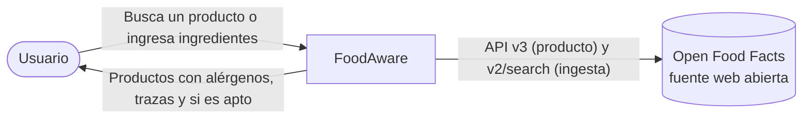
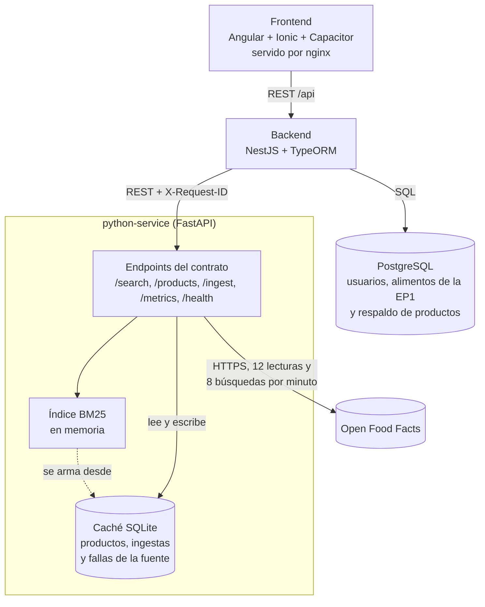
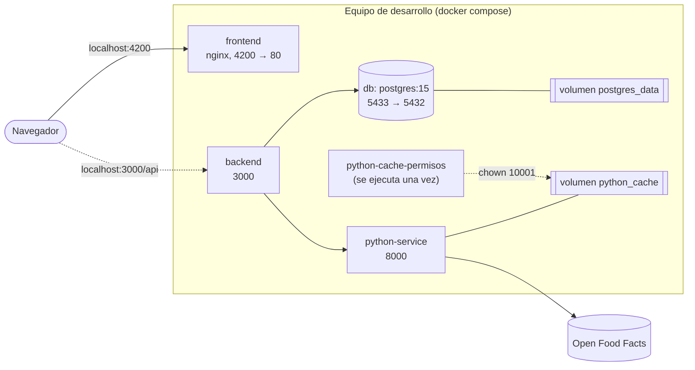
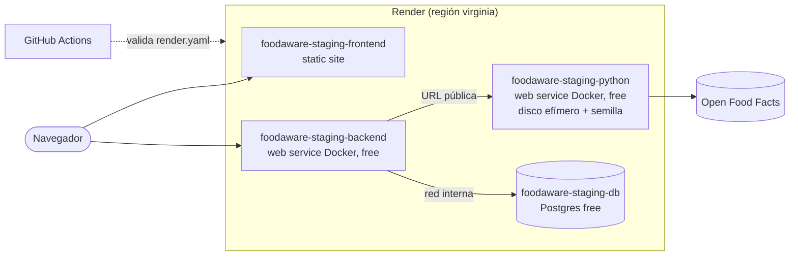
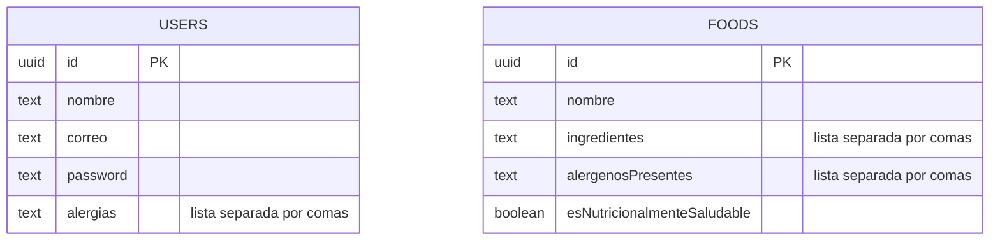

# Arquitectura

Este documento partió en la EP1 y lo actualizamos para la EP2. Los cambios
principales son que la fuente web ya no está planificada (es Open Food Facts,
integrada de verdad), que el python-service tiene su propia caché y su
buscador, y que staging ya no es Docker Compose sino Render.

## Diagrama de contexto

## Diagrama de contenedores

El frontend solo habla con el backend. El backend es el único que habla con
el python-service y con PostgreSQL. El python-service es el único que habla
con Open Food Facts y el único dueño de la caché SQLite. El contrato entre
backend y python-service está en [contratos/README.md](contratos/README.md).

## Diagramas de despliegue

### Local (Docker Compose)

Los contenedores arrancan en orden con healthchecks: el backend espera a que
`db` y `python-service` estén sanos, y el frontend espera al backend. El
navegador llama directo al backend en el puerto 3000, porque el frontend se
compila con esa URL.

### Staging (Render, plan gratuito)

Los detalles (por qué el backend llama al python-service por su URL pública,
qué se pierde cuando Render duerme el servicio, cómo se despliega) están en
[despliegue-staging.md](despliegue-staging.md).

## Modelo de base de datos

> Pendiente de actualizar por backend: este modelo es el de la EP1. Falta la
> tabla `products`, que el backend agregó en la EP2 con la migración
> `CreateProducts` (producto del contrato con procedencia y calidad en
> columnas, listas como `text[]`). Ver [backend.md](backend.md).

La caché del python-service no está en este modelo porque vive en otra base
(SQLite). Su diagrama está en
[recuperacion-y-evaluacion.md](recuperacion-y-evaluacion.md#la-caché-sqlite).

## Decisiones de arquitectura

### De la EP1

**Servicio Python separado:** el análisis de alérgenos va en un microservicio
aparte con FastAPI, pensando en que a futuro podamos usar algo más
sofisticado que reglas simples. El costo es una llamada HTTP extra entre
NestJS y Python. En la EP2 la decisión se mantuvo: el python-service ahora
también hace la ingesta, la preparación de datos y la búsqueda.

**Reglas en vez de un modelo de IA:** la detección de alérgenos no usa un
modelo entrenado. En la EP1 comparaba ingredientes contra una lista conocida;
en la EP2 la ampliamos a un diccionario de sinónimos en español e inglés para
los 14 alérgenos, con excepciones ("leche de coco"), nombres de sabor ("sabor
leche"), negaciones ("sin gluten") y frases de trazas ("puede contener"). Lo
mantenemos con reglas porque cada marca se puede explicar y probar, y porque
no tenemos datos etiquetados para entrenar. El límite es que solo detecta lo
que el diccionario conoce. Ver
[extraccion-y-preparacion.md](extraccion-y-preparacion.md#7-detección-de-alérgenos-y-trazas).

**Listas guardadas como texto separado por comas:** ingredientes y alérgenos
se guardan con `simple-array` de TypeORM en vez de tablas relacionadas aparte.
Es más simple de implementar, pero hace las búsquedas por ingrediente menos
eficientes a futuro.

> Pendiente de actualizar por backend: la tabla `products` de la EP2 ya usa
> `text[]` en vez de `simple-array`, porque admite comas dentro de cada
> valor. Las tablas `users` y `foods` siguen con texto separado por comas.

**IDs tipo UUID:** se usan en vez de números correlativos (como 1, 2, 3) para
que no se puedan adivinar ni usar para acceder a otro registro cambiando un
número en la URL. Los productos son la excepción: su clave es el código de
barras, que es público y no da acceso a nada.

**Comunicación entre contenedores por nombre de servicio:** NestJS habla con
la base de datos y con Python usando los nombres de servicio de Docker Compose
(`db`, `python-service`), no `localhost`. Aprendimos esto arreglando un bug
real donde `localhost` apuntaba al contenedor equivocado. En Render no hay
nombres de servicio en el plan gratuito: el backend usa la URL pública del
python-service.

**Pipeline que bloquea errores:** el lint, los tests y la auditoría de
dependencias detienen el pipeline si fallan. En la EP2 agregamos más quality
gates (ver más abajo y [pipeline-devsecops.md](pipeline-devsecops.md)).

### De la EP2

**Caché SQLite propia del python-service:** los productos de Open Food Facts
se guardan en un archivo SQLite que solo usa el python-service, no en el
PostgreSQL del backend. Así cada servicio es dueño de sus datos y el contrato
entre ellos es solo HTTP. El costo es que hay dos copias parciales de los
productos (la caché y la tabla `products` del backend) que no se sincronizan
directamente.

**La búsqueda nunca consulta la fuente en vivo:** `/search` busca en un índice
armado con la caché, que se llena con ingestas por lotes. Open Food Facts
permite solo 10 búsquedas por minuto y en nuestras ingestas falló entre un
35 % y un 53 % de las páginas; con consultas en vivo, la app dependería de que
la fuente estuviera arriba justo en ese momento. El costo es que los datos
pueden tener hasta un día de atraso.

**BM25 en memoria en vez de un motor de búsqueda externo:** con 383 productos,
el índice se arma y se evalúa en unos 120 ms, y se reconstruye completo al
terminar cada ingesta. Un motor como Elasticsearch habría sido otro servicio
más que levantar y pagar. Elegimos BM25 y no búsqueda por embeddings porque es
explicable (se puede mostrar cuánto aportó cada campo) y no necesita un
modelo. Si el corpus creciera a decenas de miles de productos habría que
revisarlo.

**Evaluación con reglas de relevancia:** para medir la búsqueda definimos la
relevancia con reglas sobre atributos del producto, no con listas de códigos
de barras, para que el conjunto sirva con cualquier corpus y el recall sea
exacto. Ver [recuperacion-y-evaluacion.md](recuperacion-y-evaluacion.md#7-métricas).

**Semilla del corpus en el repositorio:** en Render el disco se borra en cada
reinicio. En vez de pagar un disco persistente, guardamos un extracto de la
caché (`python-service/semilla/corpus-off.json.gz`) que el servicio carga si
arranca vacío. El costo es que en staging los datos no se actualizan solos.

**Blueprint de Render en vez de Terraform:** el proveedor de Terraform para
Render no permite crear ni modificar web services del plan gratuito, así que
la infraestructura de staging quedó en `render.yaml`. La carpeta `terraform/`
se mantiene y CI la valida, pero no despliega nada. Ver
[despliegue-staging.md](despliegue-staging.md#por-qué-blueprint-y-no-terraform).

**Análisis de seguridad en el pipeline:** agregamos SAST con Bandit y CodeQL y
escaneo de imágenes con Trivy. Los umbrales los elegimos para que el pipeline
falle con lo que tiene arreglo y sea grave, y solo informe el resto. Ver
[pipeline-devsecops.md](pipeline-devsecops.md#quality-gates).
