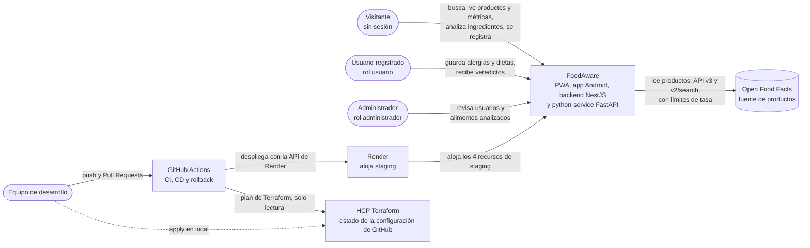
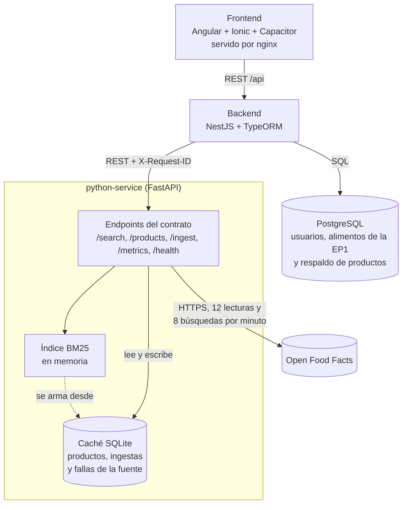
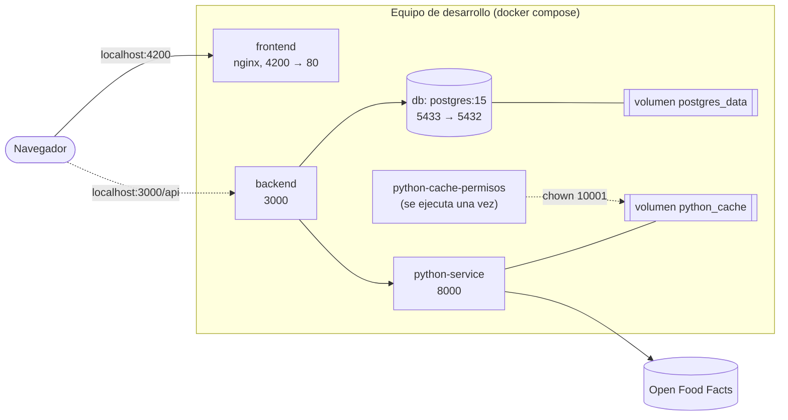
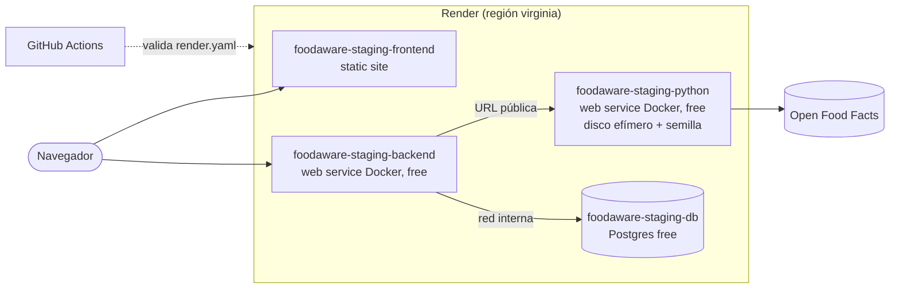
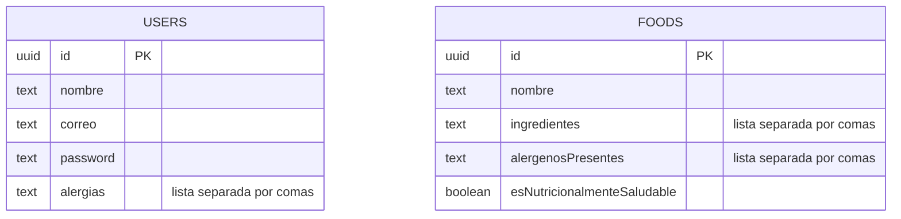

# Arquitectura

Este documento partió en la EP1 y lo actualizamos para la EP2. Los cambios
principales son que la fuente web ya no está planificada (es Open Food Facts,
integrada de verdad), que el python-service tiene su propia caché y su
buscador, y que staging ya no es Docker Compose sino Render.

## Diagrama de contexto

FoodAware visto desde afuera: quién lo usa y con qué sistemas externos se
relaciona. Los tres actores de la izquierda corresponden a los roles reales
del backend (sin sesión, `usuario` y `administrador`).

### Actores

| Actor | Cómo se identifica | Qué puede hacer | Dónde se controla |
|---|---|---|---|
| **Visitante** | Sin token | Buscar productos, ver el detalle de un producto, ver el panel de métricas, analizar ingredientes a mano, registrarse e iniciar sesión. Ve los alérgenos y trazas de cada producto y el aviso de que la información es orientativa (en el inicio), pero no recibe veredictos personalizados: el detalle lo invita a iniciar sesión | Rutas marcadas con `@Public()` en el backend; en el frontend, las páginas de inicio, búsqueda, producto, métricas, login y registro |
| **Usuario registrado** | JWT con rol `usuario`. Todo registro nace con este rol | Todo lo del visitante, más: guardar sus alergias, dietas y modo estricto; recibir el veredicto de cada producto ("Apto para ti", "Apto con advertencia" o "No apto"); buscar solo productos compatibles con su perfil; analizar ingredientes contra su perfil; borrar su cuenta | Guard JWT global del backend (todo lo que no es `@Public()`); página `/perfil` con `authGuard` |
| **Administrador** | JWT con rol `administrador`. Se asigna solo con el script `npm run admin:asignar` del backend, nunca desde la API | Todo lo del usuario registrado, más: ver la lista de usuarios (sin contraseñas ni datos de salud) y la de alimentos analizados | `@Roles(Rol.ADMINISTRADOR)` y `RolesGuard` en `GET /api/usuarios` y `GET /api/food`; página `/admin` con `adminGuard`. El rol del token se compara con el de la base en cada petición |

Las rutas de cada rol están en [backend.md](backend.md), y los riesgos de
cada uno en el [modelo de amenazas](modelo-amenazas.md).

### Sistemas externos

| Sistema | Para qué lo usamos | Qué se intercambia | Detalle |
|---|---|---|---|
| **Open Food Facts** | Fuente de los productos (base abierta, licencia ODbL) | El python-service lee productos con su User-Agent, dentro de los límites de la API (12 lecturas y 8 búsquedas por minuto). Nunca escribimos en ella | [fuente-web.md](fuente-web.md) |
| **Render** | Aloja staging en el plan gratuito: frontend, backend, python-service y PostgreSQL | Recibe los despliegues y genera los secretos (`JWT_SECRET`, `CLAVE_SERVICIO`, `INGESTA_CLAVE`) | [despliegue-staging.md](despliegue-staging.md) |
| **GitHub Actions** | Los 7 workflows de CI, CD Staging y Rollback staging | Corre las pruebas y los análisis de seguridad, y despliega en Render solo los commits de `main` con todo el CI en verde | [pipeline-devsecops.md](pipeline-devsecops.md) |
| **HCP Terraform** | Guarda y bloquea el estado de `terraform/`, que administra la configuración de GitHub (el ruleset de `main` y el Environment `staging`) | En CI solo se lee el estado para el `plan`; el `apply` se hace en local | [pipeline-devsecops.md](pipeline-devsecops.md#terraform-la-configuración-de-github-como-código) |

## Clasificación de compatibilidad, no garantía de seguridad

FoodAware **clasifica** cada producto según el perfil de la persona. **No
garantiza** que sea seguro comerlo. La diferencia importa porque una persona
alérgica podría tomar el veredicto como una promesa.

**Qué decide el sistema.** Compara los datos del producto con las alergias,
las dietas y el modo estricto del perfil, y devuelve uno de tres veredictos:

| Veredicto | En la interfaz | Cuándo |
|---|---|---|
| `apto` | "Apto para ti" | Solo si no aplica ninguna otra regla: ningún alérgeno ni traza del perfil, datos suficientes y las dietas confirmadas por la fuente |
| `apto_con_advertencia` | "Apto con advertencia" | Hay trazas, un alérgeno posible, datos incompletos o una dieta que el producto no declara cumplir |
| `no_apto` | "No apto" | Contiene un alérgeno del perfil, o contradice una de sus dietas. En modo estricto, también las trazas, los alérgenos posibles y los datos incompletos |

Cada veredicto trae su explicación, los conflictos encontrados y una
confianza (alta, media o baja) según la calidad de los datos. Las reglas
completas están en el [contrato](contratos/README.md#capacidad-adaptativa).

**Qué no garantiza.** El veredicto depende de los datos de Open Food Facts,
que es una base colaborativa: puede tener alérgenos sin declarar,
ingredientes mal escritos o una receta que el fabricante ya cambió.
FoodAware tampoco puede saber de contaminación cruzada que la etiqueta no
menciona. No es un dispositivo médico ni reemplaza leer la etiqueta del
envase.

**Aviso permanente.** Cada veredicto incluye el texto "Clasificación
orientativa según tu perfil y los datos de Open Food Facts. No es una
garantía de que el producto sea seguro para ti: revisa siempre la etiqueta
del envase." El frontend lo muestra siempre en el inicio, también sin sesión
([`aviso-orientativo.ts`](../frontend/src/app/compartido/aviso-orientativo.ts)),
y junto a cada veredicto en la búsqueda personalizada y en el detalle del
producto: en el frontend, un veredicto siempre aparece junto al aviso.

**Por qué el error más grave es un falso "apto".** Los dos errores posibles
no cuestan lo mismo. Un falso "no apto" le quita a la persona una opción que
sí podía comer: es molesto, pero no hace daño. Un falso "apto" la puede
llevar a comer su alérgeno. Por eso el sistema se equivoca a propósito hacia
el lado seguro:

- "Apto" es lo último que se decide, no lo que se asume: cualquier duda lo
  baja a "apto con advertencia" o a "no apto".
- Si el python-service no responde, el respaldo del backend nunca dice
  "apto".
- La evaluación sobre productos etiquetados a mano dio 0 falsos "apto" en 6
  perfiles y 2 modos
  ([recuperacion-y-evaluacion.md](recuperacion-y-evaluacion.md#8-evaluación-de-la-capacidad-adaptativa)).
  Después de cada despliegue, el CD repite esa evaluación en staging y falla
  si aparece un falso "apto".

El costo es que el sistema marca como "no apto" algunos productos que sí
eran aptos. Lo aceptamos a cambio de no decir "apto" cuando no corresponde.
Los riesgos que quedan están en el
[modelo de amenazas](modelo-amenazas.md#4-riesgos-del-dominio).

## Diagrama de contenedores

El frontend solo habla con el backend. El backend es el único que habla con
el python-service y con PostgreSQL. El python-service es el único que habla
con Open Food Facts y el único dueño de la caché SQLite. El contrato entre
backend y python-service está en [contratos/README.md](contratos/README.md).
Los límites de confianza entre estos componentes, y cómo se protege cada uno,
están en el [modelo de amenazas](modelo-amenazas.md).

## Diagramas de despliegue

### Local (Docker Compose)

Los contenedores arrancan en orden con healthchecks: el backend espera a que
`db` y `python-service` estén sanos, y el frontend espera al backend. El
navegador llama directo al backend en el puerto 3000, porque el frontend se
compila con esa URL.

### Staging (Render, plan gratuito)

Los detalles (por qué el backend llama al python-service por su URL pública,
qué se pierde cuando Render duerme el servicio, cómo se despliega) están en
[despliegue-staging.md](despliegue-staging.md).

## Modelo de base de datos

> Pendiente de actualizar por backend: este modelo es el de la EP1. Falta la
> tabla `products`, que el backend agregó en la EP2 con la migración
> `CreateProducts` (producto del contrato con procedencia y calidad en
> columnas, listas como `text[]`). Ver [backend.md](backend.md).

La caché del python-service no está en este modelo porque vive en otra base
(SQLite). Su diagrama está en
[recuperacion-y-evaluacion.md](recuperacion-y-evaluacion.md#la-caché-sqlite).

## Decisiones de arquitectura

Las tres decisiones de fondo tienen su propio registro (ADR), con contexto,
alternativas y consecuencias, en [adr/](adr/README.md):

| ADR | Decisión |
|---|---|
| [0001](adr/0001-estilo-servicios-separados.md) | Servicios separados por responsabilidad (un backend principal y un servicio especializado), no microservicios completos |
| [0002](adr/0002-python-fastapi.md) | Python y FastAPI como servicio independiente |
| [0003](adr/0003-rest-entre-servicios.md) | REST con contrato OpenAPI entre NestJS y FastAPI, en vez de gRPC o colas |
| 0004 | PostgreSQL y TypeORM (pendiente) |

Las de abajo son las decisiones más acotadas de cada entrega.

### De la EP1

**Servicio Python separado:** el análisis de alérgenos va en un servicio
aparte con FastAPI (ver [ADR 0001](adr/0001-estilo-servicios-separados.md)
y [ADR 0002](adr/0002-python-fastapi.md)), pensando en que a futuro podamos usar algo más
sofisticado que reglas simples. El costo es una llamada HTTP extra entre
NestJS y Python. En la EP2 la decisión se mantuvo: el python-service ahora
también hace la ingesta, la preparación de datos y la búsqueda.

**Reglas en vez de un modelo de IA:** la detección de alérgenos no usa un
modelo entrenado. En la EP1 comparaba ingredientes contra una lista conocida;
en la EP2 la ampliamos a un diccionario de sinónimos en español e inglés para
los 14 alérgenos, con excepciones ("leche de coco"), nombres de sabor ("sabor
leche"), negaciones ("sin gluten") y frases de trazas ("puede contener"). Lo
mantenemos con reglas porque cada marca se puede explicar y probar, y porque
no tenemos datos etiquetados para entrenar. El límite es que solo detecta lo
que el diccionario conoce. Ver
[extraccion-y-preparacion.md](extraccion-y-preparacion.md#7-detección-de-alérgenos-y-trazas).

**Listas guardadas como texto separado por comas:** ingredientes y alérgenos
se guardan con `simple-array` de TypeORM en vez de tablas relacionadas aparte.
Es más simple de implementar, pero hace las búsquedas por ingrediente menos
eficientes a futuro.

> Pendiente de actualizar por backend: la tabla `products` de la EP2 ya usa
> `text[]` en vez de `simple-array`, porque admite comas dentro de cada
> valor. Las tablas `users` y `foods` siguen con texto separado por comas.

**IDs tipo UUID:** se usan en vez de números correlativos (como 1, 2, 3) para
que no se puedan adivinar ni usar para acceder a otro registro cambiando un
número en la URL. Los productos son la excepción: su clave es el código de
barras, que es público y no da acceso a nada.

**Comunicación entre contenedores por nombre de servicio:** NestJS habla con
la base de datos y con Python usando los nombres de servicio de Docker Compose
(`db`, `python-service`), no `localhost`. Aprendimos esto arreglando un bug
real donde `localhost` apuntaba al contenedor equivocado. En Render no hay
nombres de servicio en el plan gratuito: el backend usa la URL pública del
python-service.

**Pipeline que bloquea errores:** el lint, los tests y la auditoría de
dependencias detienen el pipeline si fallan. En la EP2 agregamos más quality
gates (ver más abajo y [pipeline-devsecops.md](pipeline-devsecops.md)).

### De la EP2

**Caché SQLite propia del python-service:** los productos de Open Food Facts
se guardan en un archivo SQLite que solo usa el python-service, no en el
PostgreSQL del backend. Así cada servicio es dueño de sus datos y el contrato
entre ellos es solo HTTP. El costo es que hay dos copias parciales de los
productos (la caché y la tabla `products` del backend) que no se sincronizan
directamente.

**La búsqueda nunca consulta la fuente en vivo:** `/search` busca en un índice
armado con la caché, que se llena con ingestas por lotes. Open Food Facts
permite solo 10 búsquedas por minuto y en nuestras ingestas falló entre un
35 % y un 53 % de las páginas; con consultas en vivo, la app dependería de que
la fuente estuviera arriba justo en ese momento. El costo es que los datos
pueden tener hasta un día de atraso.

**BM25 en memoria en vez de un motor de búsqueda externo:** con 383 productos,
el índice se arma y se evalúa en unos 120 ms, y se reconstruye completo al
terminar cada ingesta. Un motor como Elasticsearch habría sido otro servicio
más que levantar y pagar. Elegimos BM25 y no búsqueda por embeddings porque es
explicable (se puede mostrar cuánto aportó cada campo) y no necesita un
modelo. Si el corpus creciera a decenas de miles de productos habría que
revisarlo.

**Evaluación con reglas de relevancia:** para medir la búsqueda definimos la
relevancia con reglas sobre atributos del producto, no con listas de códigos
de barras, para que el conjunto sirva con cualquier corpus y el recall sea
exacto. Ver [recuperacion-y-evaluacion.md](recuperacion-y-evaluacion.md#7-métricas).

**Semilla del corpus en el repositorio:** en Render el disco se borra en cada
reinicio. En vez de pagar un disco persistente, guardamos un extracto de la
caché (`python-service/semilla/corpus-off.json.gz`) que el servicio carga si
arranca vacío. El costo es que en staging los datos no se actualizan solos.

**Blueprint de Render en vez de Terraform:** el proveedor de Terraform para
Render no permite crear ni modificar web services del plan gratuito, así que
la infraestructura de staging quedó en `render.yaml`. `terraform/` administra
la configuración de GitHub de la que depende el despliegue (el ruleset de
`main` y el Environment `staging`), con el estado en HCP Terraform y el `apply` solo en
local. Ver
[despliegue-staging.md](despliegue-staging.md#por-qué-blueprint-y-no-terraform).

**Análisis de seguridad en el pipeline:** agregamos SAST con Bandit y CodeQL y
escaneo de imágenes con Trivy. Los umbrales los elegimos para que el pipeline
falle con lo que tiene arreglo y sea grave, y solo informe el resto. Ver
[pipeline-devsecops.md](pipeline-devsecops.md#quality-gates).
