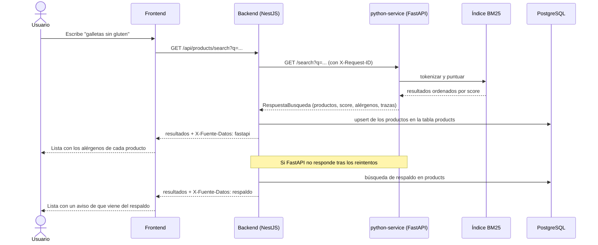
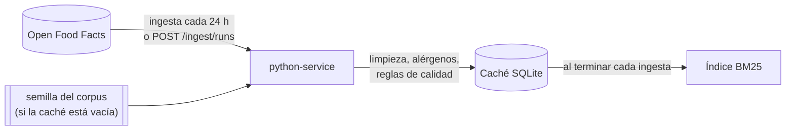

# Flujo de datos entre frontend, NestJS, Python y PostgreSQL

En la EP1 la app tenía un solo flujo: la persona escribía los ingredientes a
mano y el sistema los analizaba. En la EP2 el flujo principal es la búsqueda
de productos reales, que vienen de Open Food Facts. Los dos siguen existiendo,
y aquí describimos ambos.

## Flujo principal (EP2): buscar un producto

Paso a paso:

1. La persona escribe lo que busca en la página de búsqueda del frontend, que
   llama a `GET /api/products/search` del backend.
2. El backend llama a `GET /search` del python-service y le pasa el mismo
   `X-Request-ID`, para poder seguir la petición en los logs de los dos
   servicios. Si la llamada falla por timeout o por un 502, 503 o 504, la
   reintenta (`PYTHON_API_TIMEOUT_MS` y `PYTHON_API_REINTENTOS`).
3. El python-service no consulta Open Food Facts en este momento. Busca en su
   índice BM25 en memoria, que se armó con los productos de su caché SQLite, y
   devuelve los resultados ordenados con su puntaje, alérgenos, trazas,
   procedencia y calidad. Cómo se calcula el orden está en
   [recuperacion-y-evaluacion.md](recuperacion-y-evaluacion.md).
4. El backend guarda esos productos en su tabla `products` de PostgreSQL (un
   upsert por código de barras) y le devuelve la respuesta al frontend con el
   header `X-Fuente-Datos: fastapi`.
5. Si el python-service sigue sin responder después de los reintentos, el
   backend busca en su tabla `products` con una regla más simple y responde
   con `X-Fuente-Datos: respaldo`. El frontend lo muestra con un aviso. Si el
   respaldo tampoco tiene resultados, responde un error con el formato del
   contrato.

Los detalles internos del backend (cómo arma la búsqueda de respaldo, cómo
mapea el contrato a la entidad, qué errores usan el respaldo) le
corresponden a [backend.md](backend.md). El formato de cada respuesta está en
el [contrato](contratos/README.md).

## Cómo llegan los productos a la caché

Este flujo corre en segundo plano y no depende de que alguien esté buscando:

El detalle (limitadores, reintentos, limpieza, detección de alérgenos,
deduplicación) está en
[extraccion-y-preparacion.md](extraccion-y-preparacion.md).

## Flujo de la EP1: analizar ingredientes escritos a mano

Este flujo sigue disponible en `POST /api/food/analizar`:

El formulario en Angular junta el nombre del producto y los ingredientes que
escribió el usuario, y los manda por POST a `/api/food/analizar`.

Del lado del backend, NestJS primero valida esos datos con el DTO que armamos
(`AnalizarProductoDto`). Si vienen vacíos o mal formados, corta ahí mismo con
un 400 y ni siquiera llega a tocar la base de datos ni el servicio de Python.

Si todo viene bien, NestJS le pasa el nombre y los ingredientes al servicio de
FastAPI (`POST /analizar`). Python revisa los ingredientes contra una lista de
alérgenos conocidos y evalúa si el producto es saludable, y devuelve ese
resultado como JSON.

NestJS toma esa respuesta, calcula si el producto es apto para consumo
(viendo si hay alérgenos, y si se manda un `userId`, comparando además contra
las alergias guardadas de ese usuario), y guarda todo en la tabla `foods` de
PostgreSQL. Finalmente le devuelve el resultado completo al frontend, que lo
muestra en una tarjeta verde o roja según si es apto o no para el usuario.

Si el servicio de Python está caído, NestJS no se queda esperando para
siempre: responde con un error controlado y el frontend le muestra un mensaje
claro al usuario en vez de trabarse.

Una diferencia con el flujo nuevo: `/analizar` todavía usa la lista de la EP1,
no el diccionario de sinónimos, y devuelve `"lácteos"` y `"maní"` con tilde,
mientras que la búsqueda usa los códigos sin tilde del contrato (`lacteos`,
`mani`).

## Salud de los servicios

Los dos servicios tienen un endpoint de salud para revisar rápido si algo se
cayó: `/api/health` en NestJS y `/health` en Python. El de NestJS revisa de
verdad la conexión a PostgreSQL y al python-service. El de Python revisa la
caché, el índice y el estado de Open Food Facts según la última ingesta, sin
llamar a la fuente. Docker Compose y Render usan estos endpoints como
healthcheck. El detalle del de Python está en el
[contrato](contratos/README.md#salud-get-health).
