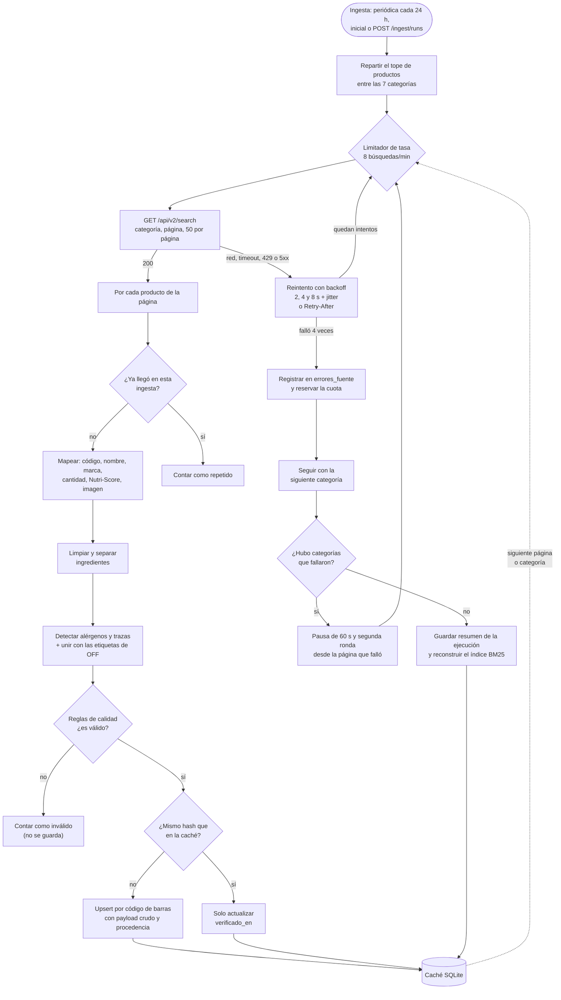

# Extracción y preparación de los datos

Aquí explicamos cómo un producto de Open Food Facts termina guardado en la
caché local del python-service, listo para buscarse y para revisar sus
alérgenos. Qué es la fuente y por qué la usamos está en
[fuente-web.md](fuente-web.md); qué se hace después con la caché (índice,
BM25 y métricas), en [recuperacion-y-evaluacion.md](recuperacion-y-evaluacion.md).

Todos los ejemplos de este documento son salidas reales del código o
productos reales de nuestra caché.

## El flujo completo



El código vive en tres capas, separadas a propósito para poder probar cada
una sin red ni base de datos:

| Capa | Archivo | Qué hace |
|---|---|---|
| Extracción | [`clients/open_food_facts.py`](../python-service/app/clients/open_food_facts.py), [`clients/limitador.py`](../python-service/app/clients/limitador.py) | Llama a la API respetando los límites y reintenta |
| Orquestación | [`services/ingesta.py`](../python-service/app/services/ingesta.py), [`services/mapeo_off.py`](../python-service/app/services/mapeo_off.py) | Recorre categorías y páginas, mapea, cuenta y guarda |
| Preparación | [`procesamiento/`](../python-service/app/procesamiento/) | Funciones puras: limpieza, detección de alérgenos y reglas de calidad |
| Persistencia | [`repositories/cache.py`](../python-service/app/repositories/cache.py) | Caché SQLite: productos, ejecuciones y fallas de la fuente |

## 1. Extracción por categorías

Una ingesta busca productos de Chile en 7 categorías que elegimos porque son
las más relevantes para alergias: galletas, lácteos, panes, chocolates,
cereales de desayuno, snacks salados y bebidas vegetales.

Al principio la ingesta pedía todas las categorías en una sola búsqueda, y
no controlábamos cuántos productos llegaban de cada una, así que el corpus
podía quedar cargado hacia una sola categoría. Por eso ahora hacemos
una búsqueda por categoría y repartimos el tope de productos entre ellas. A cada categoría le toca lo que queda dividido por las que faltan:
con 500 y 7 categorías son 72, 72, 72, 71, 71, 71 y 71. Si una categoría trae
menos, lo que sobra pasa a las siguientes.

Cada búsqueda pide páginas de 50 productos ordenados por última
modificación, hasta llenar la cuota o llegar a la última página. Si un
producto ya llegó en otra categoría de la misma ingesta (pasa, por ejemplo,
con galletas de chocolate), se cuenta pero no se procesa de nuevo ni gasta la
cuota de la segunda categoría.

## 2. Limitadores de tasa

Hay dos limitadores, uno para lecturas de producto (12 por minuto) y otro
para búsquedas (8 por minuto), ambos bajo los límites oficiales de 15 y 10.

Son de ventana deslizante: recuerdan cuándo fue cada llamada del último
minuto y, si ya hay 8, la siguiente espera hasta que la más antigua salga de
la ventana. Cada llamada reserva su turno antes de dormir, así varias
llamadas que esperan a la vez no se pisan.

La ingesta corre en segundo plano y espera lo que haga falta. Una petición de
un usuario no: si `GET /products/{codigo}` tendría que esperar más de 3
segundos (`LIMITADOR_ESPERA_MAX_SEGUNDOS`), responde 503 de inmediato con el
mensaje "Se alcanzó el límite de consultas a Open Food Facts; intenta de nuevo
en N s".

## 3. Reintentos

Cada petición tiene hasta 4 intentos (1 más 3 reintentos), pero solo cuando
el error puede ser pasajero:

| Respuesta de Open Food Facts | Qué hacemos |
|---|---|
| Error de red, timeout, 429 o 5xx | Reintentar con backoff exponencial y jitter |
| 404, o una redirección (3xx) | No reintentar: el producto no existe o no es un alimento |
| Otro 4xx | No reintentar: la petición está mal y repetirla no sirve |
| 200 con JSON inválido o sin `product`/`products` | Fallar como fuente no disponible |

El backoff duplica la espera en cada intento y le suma un poco de azar
(jitter) para no reintentar todos al mismo tiempo. Si la respuesta trae
`Retry-After`, esperamos al menos eso. Ninguna espera pasa de 30 segundos.

Las esperas no son iguales para todo. Empezamos con 1, 2 y 4 segundos para
todo, y en las primeras ingestas reales nos dimos cuenta de que
`/api/v2/search` respondía 503 en ráfagas que duraban más que eso: se agotaban
los reintentos y se perdían páginas enteras. Por eso las búsquedas de la
ingesta parten con 2 segundos (2, 4 y 8 s), mientras que la lectura de un
producto sigue con 1 segundo, porque ahí hay un usuario esperando.

## 4. Segunda ronda por categoría

Aun con los reintentos más largos, los 503 seguían apareciendo. Las 4
ingestas reales que tenemos en la caché terminaron `completado_con_errores`,
y todas las fallas registradas son `SOURCE_UNAVAILABLE`. En la última, 9 de
las 17 páginas pedidas fallaron después de agotar sus reintentos.

Entonces agregamos una segunda ronda. Cuando una categoría falla, la
ingesta no se detiene: le reserva la cuota que no alcanzó a usar (para que
las siguientes categorías no se la coman) y sigue con las demás. Al final
espera 60 segundos y reintenta solo esas categorías, desde la página exacta
en que fallaron.

`errores` del resumen cuenta solo las categorías que siguen fallando en esa
segunda ronda, es decir, las páginas perdidas de verdad. Todas las fallas,
recuperadas o no, quedan en la tabla `errores_fuente`. En las dos ingestas
que ya registran este detalle, la segunda ronda recuperó 2 categorías en una
y 1 en la otra. Ayuda, pero cuando Open Food Facts está muy caído tampoco
alcanza.

## 5. Mapeo y validación del payload

Cada producto que llega se traduce al esquema `Producto` del contrato:

- El código tiene que tener de 8 a 14 dígitos. Si no, el payload ni siquiera
  se puede representar y se cuenta como inválido con motivo
  `codigo_barras_invalido`.
- El nombre se toma de `product_name_es` y, si no hay, de `product_name`. Los
  textos se recortan a un largo máximo (300 caracteres el nombre, 5.000 los
  ingredientes) y se les quitan los espacios repetidos.
- El Nutri-Score se acepta solo si es a, b, c, d o e, y la URL de la imagen
  solo si es una URL válida.
- Las etiquetas de Open Food Facts se traducen a nuestros códigos:
  `en:milk` pasa a `lacteos`, `en:vegan` a `vegano` (y vegano implica
  vegetariano). Si una etiqueta está fuera de la taxonomía, como
  `es:avellanas`, la resolvemos con el diccionario de sinónimos; si tampoco
  se reconoce, se anota `alergenos_no_reconocidos`.

## 6. Limpieza y normalización de ingredientes

El texto de ingredientes de Open Food Facts viene escrito por personas
distintas y sin un formato fijo: con o sin "Ingredientes:", con porcentajes,
con los alérgenos marcados con `_guiones bajos_`, con notas al pie con
asterisco, con paréntesis anidados. La limpieza
([`ingredientes.py`](../python-service/app/procesamiento/ingredientes.py))
hace esto, en orden:

1. Quita el prefijo ("Ingredientes:", "Ingredients:", "Lista de ingredientes:").
2. Quita los porcentajes ("(10%)", "mín. 2%", "contiene 2% o menos de:").
3. Quita las marcas de Open Food Facts (`*`, `_`) y ordena la puntuación.
4. Separa en oraciones. Un punto después de una abreviatura ("vit.", "aprox.")
   no corta.
5. Separa cada oración por comas y punto y coma, pero no dentro de
   paréntesis ni entre números ("omega 3,6,9", "1,5").
6. Arma los subingredientes con los paréntesis ("chocolate (azúcar, cacao)").
7. Aparta las frases que no son ingredientes ("puede contener...", "sin
   gluten", "elaborado en...", "libre de..."). Se guardan como
   declaraciones, porque la detección de trazas las necesita.
8. Deja cada ingrediente en minúsculas, sin repetidos.

Un ejemplo real de la salida del código:

```text
Entrada:
  Chocolate (azúcar, manteca de cacao, leche en polvo 12%), emulsionante (E322).
  Elaborado en una línea que procesa trigo y soya.

Ingredientes:   ["chocolate (azúcar, manteca de cacao, leche en polvo)",
                 "emulsionante (e322)"]
Declaraciones:  ["elaborado en una línea que procesa trigo y soya"]
```

Para comparar textos usamos una forma normalizada: minúsculas, sin tildes,
sin puntuación, en singular básico ("nueces" pasa a "nuez", "almendras" a
"almendra") y con los aditivos unificados ("E-220", "e 220" e "INS 220"
quedan como "e220"). Así el diccionario y el texto se comparan en la misma
forma, sin tener que escribir cada variante.

## 7. Detección de alérgenos y trazas

La detección
([`alergenos.py`](../python-service/app/procesamiento/alergenos.py)) busca los
14 alérgenos de declaración obligatoria (lácteos, gluten, huevo, maní, frutos
secos, soya, pescado, crustáceos, moluscos, sésamo, mostaza, apio, sulfitos y
altramuces) con un diccionario de sinónimos en español de Chile y en inglés
([`sinonimos_alergenos.py`](../python-service/app/procesamiento/sinonimos_alergenos.py)).
Por ejemplo, lácteos incluye "leche", "suero de leche", "caseinato",
"manjar", "quesillo", "whey" y "butter".

Buscar la palabra no basta, porque hay muchos casos en que aparece y no
significa el alérgeno. Por eso revisamos cada ingrediente y subingrediente por
separado y descartamos cuatro tipos de coincidencias:

| Tipo | Ejemplos | Qué se descarta |
|---|---|---|
| Excepciones | "leche de coco", "manteca de cacao", "harina de arroz", "lecitina de girasol", "nuez moscada" | Solo ese alérgeno: en "leche de almendras" se descarta lácteos, pero frutos secos sigue |
| Nombres de sabor | "sabor leche (saborizante natural)", "sabor a mantequilla", "milk flavour" | Lácteos, solo si el término va justo después de "sabor" o antes de "flavour" |
| Negaciones | "sin gluten", "libre de lactosa", "free from milk", "Not Milk" | El término negado y lo que contiene ("sin harina de trigo" descarta también "trigo") |
| Trazas | "puede contener maní", "trazas de", "elaborado en una línea que procesa" | No se descarta: lo que sigue va a `trazas` en vez de `alergenos` |

Además, la lecitina sin origen (E322) se anota como `alergeno_posible:soya`,
porque suele ser de soya pero también puede ser de girasol, y no la contamos
como alérgeno confirmado.

El resultado final es la unión de lo que declaró Open Food Facts en sus
etiquetas y lo que detectamos en el texto. Lo que encontramos nosotros y Open
Food Facts no tenía queda anotado en `calidad.problemas` como
`alergeno_detectado_en_texto:<código>` o `traza_detectada_en_texto:<código>`,
así se puede revisar de dónde salió cada marca. En la caché actual hay 97
productos (de 383) con algún alérgeno que solo encontramos en el texto y 44
con alguna traza que solo encontramos en el texto: son casos que, con las
etiquetas de Open Food Facts nada más, se habrían pasado por alto.

El nombre y la marca del producto nunca se revisan, solo el texto de
ingredientes.

### Ejemplos reales

Estas son salidas del código actual:

| Texto de ingredientes | Alérgenos | Trazas |
|---|---|---|
| "Harina de trigo, azúcar, aceite vegetal, saborizante sabor leche (saborizante natural), sal. Puede contener maní y almendras." | gluten | maní, frutos secos |
| "Bebida de coco: agua, leche de coco (10%), lecitina de girasol, manteca de cacao." | ninguno | ninguna |
| "Azúcar, cacao\*. \*Contiene leche." (nota al pie) | lácteos | ninguna |
| "Cacao sin azúcar, leche" | lácteos | ninguna |
| "Harina sin gluten, trigo" | gluten | ninguna |

Los dos últimos muestran por qué la negación no pasa al ingrediente de al
lado: "sin" niega a "azúcar" y a "gluten", no a "leche" ni a "trigo".

### El caso de Not Milk

Este fue el falso positivo que más nos enseñó. Not Milk es una bebida vegetal
chilena de NotCo, sin leche. Revisando la caché vimos que la detección marcaba
lácteos en varios productos de la marca. Había dos razones:

- El texto de ingredientes de algunos dice "sabor leche (saborizante natural)"
  o "sabor leche y crema (saborizantes naturales)". La palabra "leche"
  coincidía con el sinónimo, aunque describe el sabor y no un ingrediente.
- En otros, el nombre de la marca aparece dentro del texto de ingredientes, y
  "milk" también es un sinónimo de lácteos.

Lo corregimos con la regla de nombres de sabor y agregando "not" a las
negaciones. Cuidamos no pasarnos al otro lado: "leche sabor frutilla", "sabor
vainilla y leche" y "sabor queso" se siguen marcando, porque ahí sí hay leche
o queso. Todos esos casos quedaron como pruebas en
[`test_procesamiento_alergenos.py`](../python-service/tests/test_procesamiento_alergenos.py).
Como cambiaron las reglas, subimos la versión de procesamiento de 1 a 2 y la
caché se reprocesó sola al reiniciar (ver la sección 12).

Hoy el Not Milk 7804659650363 ("sabor leche (saborizante natural)") sale sin
alérgenos. El 7804659650998 (Not Milk Zero Sugar) sigue con lácteos, pero no
por nuestro texto: Open Food Facts lo etiqueta `en:milk`, y nosotros no
borramos lo que declara la fuente. Si Open Food Facts marca un alérgeno,
preferimos creerle antes que arriesgar un falso negativo.

### "Libre de leche, lactosa, caseína..."

Este caso no lo resolvimos, y fue a propósito. El producto 10248188
(Notmilk original) dice: "El producto es libre de leche, lactosa, caseína,
gluten y transgénicos". Como cada ingrediente se revisa por separado, la
negación "libre de" solo alcanza a "leche": "lactosa", "caseína" y "gluten"
quedan como ingredientes y se marcan.

Podríamos extender la negación a toda la enumeración, pero eso rompería
textos como "cacao sin azúcar, leche", donde la leche sí es un ingrediente.
Elegimos el falso positivo antes que el falso negativo. En este producto da
lo mismo, porque Open Food Facts también lo etiqueta con `en:gluten` y
`en:milk`. Está anotado como limitación en
[limitaciones.md](limitaciones.md) y en el
[contrato](contratos/README.md#códigos-de-alérgenos-allergencode).

## 8. Reglas de calidad

Cada producto termina con un bloque `calidad` que dice si es válido, qué
problemas tiene y qué tan completo está. Un producto es inválido si le falta
algo sin lo cual no sirve para FoodAware:

- no tiene nombre, o no tiene texto de ingredientes;
- tiene texto, pero después de limpiarlo no queda ningún ingrediente;
- el código no es EAN-8, UPC-A ni EAN-13 (8, 12 o 13 dígitos), o su dígito
  verificador GS1 no cuadra.

Los inválidos no se guardan ni se buscan. En la última ingesta llegaron 339
productos y 86 fueron inválidos: 83 sin ingredientes, 16 sin nombre y 1 con el
dígito verificador malo (un producto puede tener más de un motivo).

Los demás problemas solo informan y no invalidan: sin marca, sin cantidad,
sin Nutri-Score, sin imagen y los de alérgenos detectados en el texto. En la
caché actual, los más comunes son `sin_nutriscore` (62 productos) y
`sin_cantidad` (40). La `completitud` es la fracción de seis campos
presentes (nombre, marca, cantidad, ingredientes, Nutri-Score e imagen), y se
usa para desempatar resultados de búsqueda.

La tabla completa de reglas está en el
[contrato](contratos/README.md#calidad-calidad).

## 9. Deduplicación

Hay dos niveles de duplicado, y los tratamos distinto.

**Por código de barras.** El código es la clave primaria de la tabla
`productos` y cada guardado es un upsert, así que es imposible guardar dos
veces el mismo código. Antes de escribir comparamos el hash del contenido: si
no cambió, solo actualizamos `verificado_en`. En la caché actual hay 0 códigos
repetidos.

Cuando un producto válido no aporta nada nuevo, lo contamos como duplicado.
Puede ser porque llegó dos veces en la misma ingesta o porque ya estaba en la
caché con el mismo contenido. Guardamos los dos conteos por separado; los
números y su interpretación están en
[recuperacion-y-evaluacion.md](recuperacion-y-evaluacion.md).

**Posibles duplicados.** A veces Open Food Facts tiene el mismo producto con
dos códigos distintos (por ejemplo, un cambio de envase). Si dos productos
tienen el mismo nombre, marca y cantidad normalizados, los marcamos con
`posible_duplicado:<otro código>`, pero no descartamos ninguno, porque
también pueden ser dos productos distintos que Open Food Facts describe
igual. La marca se calcula al leer, así siempre refleja la caché actual. Hoy
hay 5 productos marcados.

## 10. Trazabilidad

De cada producto guardado se puede saber de dónde vino, cuándo y en qué
ejecución:

| Dato | Dónde | Qué responde |
|---|---|---|
| `run_id` | `procedencia` y columna `run_id` | Qué ingesta lo trajo |
| `recuperado_en` | `procedencia` | Cuándo se descargó esta versión del contenido |
| `verificado_en` | columna de la caché | La última vez que se confirmó contra la fuente, aunque no haya cambiado |
| `modificado_en_fuente` | `procedencia` | Cuándo lo modificó alguien en Open Food Facts |
| `url_fuente` | `procedencia` | Su página en Open Food Facts |
| `hash_contenido` | `procedencia` | SHA-256 del contenido normalizado, sin procedencia ni calidad; si cambia, el producto cambió |
| `payload_off` | columna de la caché | La respuesta cruda de Open Food Facts, para reprocesar sin volver a pedirla |
| `version_procesamiento` | columna de la caché | Con qué versión de las reglas se procesó |

Cada ejecución queda en `ejecuciones_ingesta`, con sus conteos y su estado, y
cada falla de la fuente en `errores_fuente`, con su `run_id`. En los logs, una
ingesta usa su `run_id` como `request_id`, así se pueden seguir todos sus
eventos con un solo filtro.

En la caché actual, los 383 productos vienen de 4 ejecuciones: 188 de la
primera, 158 de la segunda, 31 de la tercera y 6 de la cuarta. Las dos últimas
aportaron pocos productos nuevos porque casi todo lo que trajeron ya estaba
en la caché.

## 11. Errores e indisponibilidad de la fuente

La idea general es que una falla de Open Food Facts nunca deje al servicio
sin responder. Estos son los casos:

| Situación | Qué pasa |
|---|---|
| 503 durante una ingesta | Reintentos; si siguen fallando, la categoría queda para la segunda ronda; lo que no se recupera cuenta en `errores` y la ingesta termina `completado_con_errores` |
| Todas las páginas fallan | La ingesta termina `fallido`; la caché y el índice anteriores siguen sirviendo |
| `GET /products` y la fuente no responde | Si el producto está en la caché, se devuelve ese aunque esté vencido; si no, 503 `SOURCE_UNAVAILABLE` o 504 `SOURCE_TIMEOUT` |
| El limitador obligaría a esperar más de 3 s | 503 inmediato, con los segundos que faltan |
| Falta `OFF_USER_AGENT` | No se crea el cliente; los endpoints que necesitan la fuente responden 503 y la búsqueda sigue funcionando con la caché |
| El servicio se reinicia en medio de una ingesta | Al arrancar, la ejecución que quedó en curso se marca `fallido` |
| Llega un `POST /ingest/runs` con una ingesta en curso | Se devuelve la que está corriendo, en vez de lanzar otra |
| Falla la reconstrucción del índice al terminar | El resumen ya quedó guardado y el índice anterior sigue respondiendo |

`/health` informa todo esto sin consultar la fuente: Open Food Facts aparece
`degradado` si la última ingesta tuvo errores o si hubo una falla en los
últimos 15 minutos. El detalle está en el
[contrato](contratos/README.md#salud-get-health).

## 12. Semilla del corpus

En Render (plan gratuito) el disco se borra cada vez que el servicio se
duerme, se reinicia o se despliega. Sin hacer nada, cada arranque partiría con
la caché vacía y tendría que lanzar una ingesta, que con los 503 de Open Food
Facts tarda varios minutos y puede fallar.

Por eso guardamos en el repositorio una semilla:
[`semilla/corpus-off.json.gz`](../python-service/semilla/corpus-off.json.gz).
Tiene los 383 productos válidos de la caché con su payload crudo, su
procedencia (`run_id`, `recuperado_en`, `verificado_en`) y la versión de
procesamiento. Si la caché está vacía al arrancar (`CARGAR_SEMILLA_SI_VACIA=true`),
el servicio carga la semilla antes de construir el índice, sin llamar a Open
Food Facts. Cada payload se procesa con las reglas actuales, así una semilla
vieja no trae alérgenos detectados con reglas antiguas.

Para regenerarla con la caché actual:

```powershell
docker compose exec python-service python scripts/exportar_semilla.py
```

La semilla es una base derivada de Open Food Facts y va con su licencia (ver
[fuente-web.md](fuente-web.md#licencia-y-atribución)).

## 13. Reprocesamiento por versión

Como guardamos el payload crudo, podemos cambiar las reglas de limpieza o de
detección sin volver a descargar nada. Cada producto guarda la
`VERSION_PROCESAMIENTO` con que se procesó (hoy es 2). Al arrancar, el
servicio busca los productos con una versión anterior y los rehace desde su
payload, conservando su `run_id` y su `recuperado_en`, porque los datos siguen
siendo los de esa descarga y solo cambió cómo se leen. Esto pasa antes de
construir el índice, así la búsqueda nunca mezcla reglas viejas y nuevas.

Lo usamos con el arreglo de Not Milk: subimos la versión de 1 a 2 y, al
reiniciar, el servicio rehízo la caché desde los payloads guardados. Hoy los
383 productos están en la versión 2. También se puede forzar a mano:

```powershell
docker compose exec python-service python scripts/reprocesar_cache.py          # solo los desactualizados
docker compose exec python-service python scripts/reprocesar_cache.py --todos  # todos
```

## Cómo se verifica

- Las pruebas del proceso de recuperación (ingesta, limpieza, alérgenos,
  calidad, semilla, reprocesamiento, búsqueda y evaluación) llevan el marcador
  `recuperacion` y son 535. No llaman a la red: usan un cliente falso de Open
  Food Facts que puede simular 503, timeouts y páginas que se recuperan en el
  reintento. Cómo correrlas y el resto de las pruebas está en
  [pipeline-devsecops.md](pipeline-devsecops.md).
- El estado real de la caché se revisa con
  `docker compose exec python-service python scripts/estadisticas_corpus.py`.
  Muestra los conteos de la última ingesta, sus motivos de invalidez y su tasa
  de fallas de la fuente.
- Para probar contra la API real, fuera del pipeline,
  `python scripts/probar_off.py` hace una ingesta chica (1 búsqueda y 1
  lectura) sobre una base temporal, sin tocar la caché del servicio.
