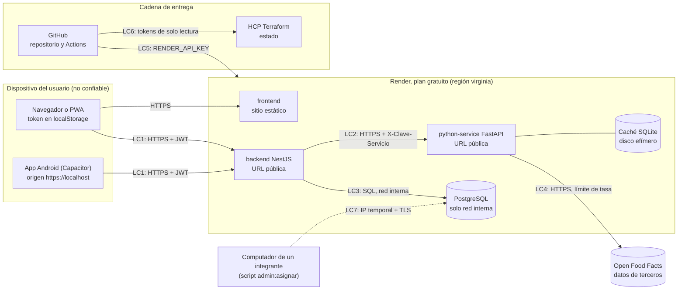

# Modelo de amenazas

Este documento revisa qué podría salir mal en FoodAware desde el punto de
vista de la seguridad y del dominio: qué protegemos, quién participa, qué
amenazas vemos con el método STRIDE, qué control ya existe y qué riesgo
queda. Cubre la app (navegador, PWA y Android), el backend, el python-service,
staging en Render y el pipeline de GitHub Actions.

Es un modelo básico, hecho por el equipo el 19 de noviembre de 2026 sobre el
estado de `main` de esa fecha, y actualizado el 21 de noviembre con el límite
de peticiones y la contraseña mínima. No es una auditoría ni una prueba de
penetración. Para cada control indicamos el archivo o la prueba que lo
demuestra, y los riesgos que no resolvimos quedan en
[Riesgos pendientes](#5-riesgos-pendientes), con la misma honestidad que
[limitaciones.md](limitaciones.md).

Lo más importante, igual que en el resto de la documentación: el peor error
de FoodAware no es informático sino del dominio. Es decirle "apto" a una
persona alérgica sobre un producto que contiene su alérgeno
([Riesgos del dominio](#4-riesgos-del-dominio)).

## 1. Activos

| Activo | Dónde vive | Por qué importa |
|---|---|---|
| Datos de los usuarios: nombre, correo, alergias, dietas y modo estricto | PostgreSQL (tabla de usuarios) | Las alergias y las dietas son **datos de salud**. Una filtración expone información sensible de personas reales |
| Contraseñas | PostgreSQL, solo el hash bcrypt ([`users.service.ts`](../backend/src/users/users.service.ts)) | Muchas personas repiten contraseñas: una filtración podría servir en otros sitios |
| `JWT_SECRET` | Render (backend), generada por Render | Con ella se pueden firmar tokens de cualquier usuario, también de administradores |
| `CLAVE_SERVICIO` | Render (python-service y backend) y una copia en el Secret `CLAVE_SERVICIO_STAGING` de GitHub | Da acceso a todos los endpoints internos de FastAPI, que tiene URL pública |
| `INGESTA_CLAVE` | Render (python-service) | Permite lanzar ingestas, que gastan el límite de consultas a Open Food Facts |
| Base de datos PostgreSQL | Render (`foodaware-staging-db`), solo con conexiones internas | Contiene los usuarios, el respaldo de productos y los alimentos analizados en la EP1 |
| Caché SQLite del python-service | Disco efímero de Render, cargado desde la semilla del corpus | De ella salen el índice de búsqueda y los veredictos. Si se corrompe, los veredictos se calculan sobre datos equivocados |
| Credenciales del pipeline | Secrets de GitHub (`RENDER_API_KEY`, `TF_API_TOKEN`, `TF_GITHUB_TOKEN_LECTURA`, `CLAVE_SERVICIO_STAGING`) | Con `RENDER_API_KEY` se puede desplegar cualquier commit o cambiar los servicios de Render |
| La confianza en el veredicto | Motor adaptativo de FastAPI y respaldo del backend | Un veredicto equivocado puede causar una reacción alérgica. Es el activo que más cuidamos |

## 2. Actores y límites de confianza

**Actores:**

| Actor | Qué puede hacer hoy |
|---|---|
| Visitante anónimo | Buscar productos, ver su detalle, analizar ingredientes (`POST /api/food/analizar`), registrarse e iniciar sesión |
| Usuario registrado | Además, guardar alergias y dietas, ver veredictos personalizados y borrar su cuenta |
| Administrador | Además, ver la lista de usuarios (sin contraseñas ni datos de salud) y la de alimentos analizados |
| Atacante externo | Lo mismo que un visitante anónimo, más llamar directo a las URL públicas de Render (backend y python-service) |
| Integrantes del equipo | Escriben en el repositorio, unen Pull Requests a `main` y administran Render, GitHub y HCP Terraform |
| Open Food Facts | Fuente de datos colaborativa: cualquiera puede editar sus productos. Sus datos **no son confiables** por defecto |
| GitHub Actions | Corre el CI, despliega en Render con `RENDER_API_KEY` y hace el `plan` de Terraform con un token de solo lectura |
| Render | Aloja los cuatro recursos de staging, genera los secretos y termina el TLS |
| HCP Terraform | Guarda y bloquea el estado de Terraform (la configuración de GitHub) |

**Diagrama.** Cada recuadro es una zona de confianza, y cada flecha con
etiqueta `LCn` cruza un límite de confianza:

| Límite | Qué lo cruza | Control |
|---|---|---|
| LC1: dispositivo → backend | Todo lo que escribe el usuario y su token | HTTPS de Render, guard JWT global, `ValidationPipe` estricto y CORS limitado a `CORS_ORIGINS` |
| LC2: backend → python-service | Consultas y el perfil de restricciones, sin datos personales | `X-Clave-Servicio` obligatoria. El python-service tiene URL pública, porque el plan gratuito no tiene red privada |
| LC3: backend → PostgreSQL | Usuarios, productos y alimentos | Host interno de Render y `ipAllowList: []` en [`render.yaml`](../render.yaml): sin conexiones externas |
| LC4: python-service → Open Food Facts | Datos de productos hechos por terceros | Limitador de tasa, timeouts y validación al procesar. Los datos se tratan como no confiables ([sección 4](#4-riesgos-del-dominio)) |
| LC5: GitHub Actions → Render | Despliegues y validación del Blueprint | El CD solo despliega commits de `main` con todo el CI en verde, desde el Environment `staging` |
| LC6: GitHub Actions → HCP Terraform y GitHub | `plan` de la configuración del repositorio | En CI solo hay tokens de lectura; el `apply` se hace en local ([pipeline-devsecops.md](pipeline-devsecops.md#estado-y-credenciales)) |
| LC7: computador de un integrante → PostgreSQL | El cambio de rol con `admin:asignar` | Solo con la IP del integrante habilitada por unos minutos en el control de acceso de la base, y con TLS (`DB_SSL=true`) |

## 3. Amenazas por categoría (STRIDE)

En cada tabla, la columna "Evidencia" apunta al código o a la prueba que
demuestra el control, y "Riesgo que queda" a lo que el control no cubre.

### S: Suplantación de identidad

| # | Amenaza | Control existente | Evidencia | Riesgo que queda |
|---|---|---|---|---|
| S1 | Adivinar contraseñas probando muchas en `POST /api/auth/login` (fuerza bruta o listas filtradas) | **Límite de 5 intentos por minuto por IP** (`@LimitarPeticiones("login")`); el sexto responde 429. Al registrarse se exige una **contraseña de al menos 8 caracteres**. bcrypt hace lenta cada comparación, y la respuesta es siempre "Credenciales inválidas" | [`limite-peticiones.ts`](../backend/src/seguridad/limite-peticiones.ts), [`limite-peticiones.int-spec.ts`](../backend/test/integracion/limite-peticiones.int-spec.ts) (el sexto login en un minuto responde 429), [`create-user.dto.ts`](../backend/src/users/dto/create-user.dto.ts), [`auth.service.ts`](../backend/src/auth/auth.service.ts) | No hay segundo factor ni se revisa si la contraseña aparece en filtraciones conocidas. Las cuentas creadas antes de la regla de 8 caracteres pueden tener contraseñas más cortas, porque el login no exige largo. El límite tiene sus propios riesgos ([P1](#5-riesgos-pendientes)) |
| S2 | Usar un token robado, falsificado o de un usuario al que le cambiaron el rol | JWT firmado con `JWT_SECRET` (256 bits aleatorios, generada por Render), que vence en 1 hora. En cada petición se comprueba que el usuario exista y tenga el mismo rol que dice el token | [`auth.module.ts`](../backend/src/auth/auth.module.ts), [`jwt.strategy.ts`](../backend/src/auth/jwt.strategy.ts), [`jwt-auth.guard.spec.ts`](../backend/src/auth/jwt-auth.guard.spec.ts) ("responde 401 si al administrador le quitaron el rol después del login"), [`usuarios.int-spec.ts`](../backend/test/integracion/usuarios.int-spec.ts) | Cerrar sesión no invalida el token: sigue sirviendo hasta que vence (1 hora como máximo) |
| S3 | Llamar directo a FastAPI haciéndose pasar por el backend | `X-Clave-Servicio` obligatoria, comparada en tiempo constante. Sin la clave, o con una incorrecta, responde 403 | [`clave_servicio.py`](../python-service/app/core/clave_servicio.py), [`test_clave_servicio.py`](../python-service/tests/test_clave_servicio.py), Prueba 5 de [CI Integración](../.github/workflows/ci-integracion.yml) | Es una sola clave para todos los endpoints internos ([P2](#5-riesgos-pendientes)) |
| S4 | Lanzar ingestas sin autorización | `X-Clave-Ingesta`, cerrada por defecto: sin `INGESTA_CLAVE` configurada responde 403 siempre | [`clave_ingesta.py`](../python-service/app/core/clave_ingesta.py), [`test_clave_ingesta.py`](../python-service/tests/test_clave_ingesta.py) | Ninguno relevante |
| S5 | Analizar ingredientes a nombre de otro usuario enviando su `userId` | El `userId` del cuerpo se ignora: el usuario sale del token | [`jwt-auth.guard.spec.ts`](../backend/src/auth/jwt-auth.guard.spec.ts) ("con un token válido usa el usuario del token") | Ninguno relevante |

### T: Manipulación

| # | Amenaza | Control existente | Evidencia | Riesgo que queda |
|---|---|---|---|---|
| T1 | Enviar campos de más (`rol`, `id`, `password`) al registrarse o al editar el perfil (asignación masiva) | `ValidationPipe` con `whitelist` y `forbidNonWhitelisted`: un campo que no está en el DTO se rechaza con 400 | [`configurar-app.ts`](../backend/src/config/configurar-app.ts), [`usuarios.int-spec.ts`](../backend/test/integracion/usuarios.int-spec.ts) ("el registro crea siempre un usuario y rechaza elegir el rol") | Ninguno relevante |
| T2 | Inyección SQL | TypeORM con consultas parametrizadas. En la caché SQLite, los nombres de columna salen de constantes (las excepciones de Bandit están justificadas con `# nosec`). Bandit y CodeQL revisan cada push | [`ci-security.yml`](../.github/workflows/ci-security.yml) | Los hallazgos medios y bajos de CodeQL y Bandit no bloquean: se revisan en la pestaña Security |
| T3 | Datos manipulados o equivocados en Open Food Facts | Se tratan como no confiables: el sistema une lo declarado con lo detectado en el texto y, si faltan datos, advierte en vez de decir "apto" | Ver [sección 4](#4-riesgos-del-dominio) | Un alérgeno que no aparece ni declarado ni en el texto no se puede detectar |
| T4 | Meter código malicioso por el repositorio o por una dependencia (cadena de suministro) | Ruleset de `main`: Pull Request obligatorio, 15 checks en verde y sin force push. Gitleaks, `npm audit`, `pip-audit` y Trivy. La acción de Trivy está fijada por commit. El CD solo despliega commits de `main` con todo el CI en verde | [pipeline-devsecops.md](pipeline-devsecops.md#protección-de-main), [`ci-security.yml`](../.github/workflows/ci-security.yml) | Se exigen 0 aprobaciones (somos dos). Las demás acciones de GitHub están fijadas por tag (`@v7`, `@v4`), no por commit ([P10](#5-riesgos-pendientes)) |
| T5 | Mover un tag `staging-verificado-*` para que "Rollback staging" vuelva a un commit que no pasó las pruebas | Solo los dos integrantes tienen escritura, y el CD crea el tag solo cuando pasan todas las pruebas | [despliegue-staging.md](despliegue-staging.md#rollback-staging) | Los tags no están protegidos ([P4](#5-riesgos-pendientes)) |
| T6 | Cambiar la protección de `main` con un token filtrado del pipeline | En CI, Terraform solo tiene tokens de lectura. El token con escritura existe solo en la sesión de PowerShell de quien hace el `apply` | [pipeline-devsecops.md](pipeline-devsecops.md#estado-y-credenciales) | Ninguno relevante |

### R: Repudio

| # | Amenaza | Control existente | Evidencia | Riesgo que queda |
|---|---|---|---|---|
| R1 | No poder reconstruir qué pasó en una petición que cruzó los dos servicios | Logs JSON con el mismo `X-Request-ID` en NestJS y en FastAPI | [`request-id.spec.ts`](../backend/src/observabilidad/request-id.spec.ts), [`test_logs.py`](../python-service/tests/test_logs.py), Prueba 4 de [CI Integración](../.github/workflows/ci-integracion.yml) | El backend registra cada petición (`acceso_http`, con ruta, código de estado y duración, en [`tiempo-respuesta.interceptor.ts`](../backend/src/observabilidad/tiempo-respuesta.interceptor.ts)) y los 429 del límite (`limite_peticiones_superado`), así que un login fallido queda como `POST /api/auth/login 401`. Pero no dice qué cuenta se intentó, a propósito, para no escribir correos en los logs |
| R2 | Dar el rol de administrador sin que quede registro | La API no permite cambiar roles: solo el script `admin:asignar`, con acceso directo a la base | [`asignar-admin.ts`](../backend/src/scripts/asignar-admin.ts) | No queda registro de quién cambió un rol ni cuándo, salvo en la consola de quien corrió el script ([P11](#5-riesgos-pendientes)) |
| R3 | Rechazos de la clave entre servicios sin rastro | FastAPI registra `clave_servicio_rechazada` con la ruta, nunca con la clave | [`test_clave_servicio.py`](../python-service/tests/test_clave_servicio.py) ("el rechazo queda en el log sin la clave"), Prueba 5 de CI Integración | En el plan gratuito, Render guarda los logs por poco tiempo |

### I: Divulgación de información

| # | Amenaza | Control existente | Evidencia | Riesgo que queda |
|---|---|---|---|---|
| I1 | Robar el token con XSS (está en `localStorage`) | Angular escapa todo lo que se muestra, y el código no usa `innerHTML` ni `bypassSecurityTrust`. El interceptor envía el token solo al backend. Render agrega `X-Content-Type-Options`, `X-Frame-Options: DENY` y `Referrer-Policy` | [`auth.interceptor.ts`](../frontend/src/app/auth/auth.interceptor.ts), [`render.yaml`](../render.yaml) | No hay `Content-Security-Policy` ([P6](#5-riesgos-pendientes)) |
| I2 | Exponer datos de salud | La lista de usuarios para administradores no incluye contraseñas ni datos de salud. Al motor solo va el perfil de restricciones, sin datos personales. Los logs de FastAPI ocultan correos, y los del backend ocultan `Authorization`, cookies, `X-Clave-Servicio` y contraseñas. El usuario puede borrar su cuenta | [`usuarios.int-spec.ts`](../backend/test/integracion/usuarios.int-spec.ts) ("la lista de usuarios no incluye contraseñas ni datos de salud", "el motor recibe las dietas y el modo estricto guardados, sin datos personales"), [`test_logs.py`](../python-service/tests/test_logs.py) ("nunca registra correos"), [`logger.config.spec.ts`](../backend/src/observabilidad/logger.config.spec.ts) | Las alergias se guardan sin cifrado por columna, y la base gratuita de staging no tiene respaldos ([P11](#5-riesgos-pendientes)) |
| I3 | Saber si un correo está registrado (enumeración) | El login responde lo mismo si el correo no existe o si la contraseña está mal | [`auth.service.ts`](../backend/src/auth/auth.service.ts) | El registro responde 409 "Ya existe un usuario con ese correo", y el login tarda menos cuando el correo no existe (no llega a bcrypt) ([P9](#5-riesgos-pendientes)) |
| I4 | Secretos en el repositorio | Gitleaks revisa todo el historial. Render genera los secretos (`generateValue`), y el estado de Terraform nunca se sube | [pipeline-devsecops.md](pipeline-devsecops.md#ep1-gitleaks-bloqueando-un-secreto), [`render.yaml`](../render.yaml) | Ninguno relevante |
| I5 | Errores con detalles internos | Los errores del contrato no incluyen detalles internos (`INTERNAL_ERROR`), y el 403 de las claves usa siempre el mismo mensaje | [contratos/README.md](contratos/README.md#errores) | Swagger está expuesto en staging a propósito, para la evaluación: muestra toda la API (es pública de todas formas) |
| I6 | Interceptar el tráfico | HTTPS en todos los servicios de Render. La app de Android no permite contenido mixto (`allowMixedContent: false`). La base solo acepta conexiones internas, y el script de administración usa TLS | [`capacitor.config.ts`](../frontend/capacitor.config.ts), [`data-source.ts`](../backend/src/data-source.ts) | Ninguno relevante |

### D: Denegación de servicio

| # | Amenaza | Control existente | Evidencia | Riesgo que queda |
|---|---|---|---|---|
| D1 | Gastar el límite de Open Food Facts (12 lecturas por minuto) pidiendo códigos que no están en la caché con `GET /api/products/:codigo_barras`, que es público | **Límite de 30 peticiones por minuto por IP** en el backend (`@LimitarPeticiones("publico")`). En el python-service, el limitador espera como máximo 3 segundos y, si no alcanza, responde 503; el backend responde entonces desde su respaldo | [`products.controller.ts`](../backend/src/products/products.controller.ts), [`limite-peticiones.int-spec.ts`](../backend/test/integracion/limite-peticiones.int-spec.ts) (el detalle responde `TOO_MANY_REQUESTS`), [`test_limitador.py`](../python-service/tests/test_limitador.py) | El límite por IP (30) es mayor que las 12 lecturas por minuto de Open Food Facts: una sola IP todavía puede gastar esa cuota si pide códigos que no están en la caché, y varias IPs, más. La búsqueda no tiene límite, pero no consulta la fuente ([P1](#5-riesgos-pendientes)) |
| D2 | Llenar la base con `POST /api/food/analizar`, que es público y guarda una fila en cada llamada | **Límite de 30 peticiones por minuto por IP**, más el límite de tamaño del cuerpo de Express (100 kB por defecto) | [`ia.controller.ts`](../backend/src/ia/ia.controller.ts), [`ia.service.ts`](../backend/src/ia/ia.service.ts) | Más lento, pero posible: cada IP puede seguir guardando hasta 30 filas por minuto ([P8](#5-riesgos-pendientes)) |
| D3 | Crear cuentas en masa con `POST /api/users` | **Límite de 30 peticiones por minuto por IP**, además de la validación de los campos | [`users.controller.ts`](../backend/src/users/users.controller.ts) | Sin captcha ni verificación del correo: con varias IPs se pueden seguir creando cuentas ([P1](#5-riesgos-pendientes), [P7](#5-riesgos-pendientes)) |
| D4 | FastAPI caído o lento | Timeout y reintentos con espera creciente; después, respaldo desde PostgreSQL con `X-Fuente-Datos: respaldo` | Prueba 6 de [CI Integración](../.github/workflows/ci-integracion.yml), [backend.md](backend.md#robustez-frente-a-fastapi) | El plan gratuito duerme los servicios: la primera petición tarda cerca de un minuto ([limitaciones.md](limitaciones.md#4-staging-en-el-plan-gratuito)) |

### E: Elevación de privilegios

| # | Amenaza | Control existente | Evidencia | Riesgo que queda |
|---|---|---|---|---|
| E1 | Que un usuario se vuelva administrador | El registro crea siempre un usuario normal y rechaza el campo `rol`. La API no permite cambiar roles. `RolesGuard` protege las rutas de administración, y el rol del token se compara con el de la base | [`roles.guard.spec.ts`](../backend/src/auth/roles.guard.spec.ts), [`usuarios.int-spec.ts`](../backend/test/integracion/usuarios.int-spec.ts), [`jwt-auth.guard.spec.ts`](../backend/src/auth/jwt-auth.guard.spec.ts) ("responde 403 con el token válido de un usuario sin ese rol") | Ninguno relevante |
| E2 | Una ruta nueva que quede pública por olvido | El guard JWT es global: una ruta es pública solo si se marca con `@Public()`. Si se olvida, la ruta queda cerrada, no abierta | [`auth.module.ts`](../backend/src/auth/auth.module.ts) | Ninguno relevante |
| E3 | Acceso directo a la base desde internet | `ipAllowList: []`. Para el script de administración se habilita una sola IP (`/32`) por unos minutos | [`render.yaml`](../render.yaml) | Depende de acordarse de quitar la IP (un *Manual Sync* también la quita, porque vuelve a dejar la lista vacía) |
| E4 | Que una falla en un contenedor dé acceso de administrador del sistema | El backend corre como `node`, y el python-service como un usuario sin privilegios (UID 10001). La imagen final del backend no trae npm | [`backend/Dockerfile`](../backend/Dockerfile), [`python-service/Dockerfile`](../python-service/Dockerfile) | Las HIGH sin arreglo de Debian en la imagen del python-service ([limitaciones.md](limitaciones.md#5-seguridad-y-vulnerabilidades)) |
| E5 | Que un workflow use credenciales con más permisos de los que necesita | Los workflows declaran `permissions: contents: read`, y Terraform solo tiene tokens de lectura en CI | [`.github/workflows/`](../.github/workflows/) | `RENDER_API_KEY` es un Secret del repositorio (no solo del Environment `staging`), y una API key de Render da acceso a toda la cuenta ([P10](#5-riesgos-pendientes)) |

## 4. Riesgos del dominio

No todos los riesgos son informáticos. FoodAware le dice a una persona
alérgica si un producto es apto para ella, así que un error de datos o de
criterio puede dañar a alguien aunque el sistema esté perfectamente seguro.

| Riesgo | Por qué es grave | Cómo lo mitigamos | Evidencia | Riesgo que queda |
|---|---|---|---|---|
| **Un falso "apto" para una persona alérgica**: el criterio | Es el peor error posible: la persona confía y consume su alérgeno | **Veredicto conservador:** "apto" solo sale si no aplica ninguna otra regla. Las trazas, los alérgenos posibles y los datos insuficientes dan `apto_con_advertencia` (y `no_apto` en modo estricto). El esquema rechaza un "apto" con conflictos, y el respaldo del backend nunca responde "apto" | [`veredicto.py`](../python-service/app/adaptativo/veredicto.py), [`test_veredicto.py`](../python-service/tests/test_veredicto.py), [`schemas/adaptativo.py`](../python-service/app/schemas/adaptativo.py), [`usuarios.int-spec.ts`](../backend/test/integracion/usuarios.int-spec.ts) ("en respaldo, sin conflictos tampoco responde apto") | Un alérgeno que la fuente no declara y que no aparece en el texto de ingredientes no se puede detectar |
| Falso "apto": cómo lo medimos | Sin medirlo, no sabemos si el criterio funciona | **Evaluación con 0 falsos "apto":** sobre un conjunto etiquetado a mano, con 6 perfiles y 2 modos, ningún perfil tuvo falsos "apto" en las versiones 2, 3 y 4 del procesamiento | [recuperacion-y-evaluacion.md](recuperacion-y-evaluacion.md#8-evaluación-de-la-capacidad-adaptativa), [`test_evaluacion_adaptativa.py`](../python-service/tests/test_evaluacion_adaptativa.py) | Cero errores en pocos casos no prueba que no existan: con 5 productos con lácteos, la tasa real podría llegar a cerca de 60 % ("regla de tres") |
| Falso "apto": en cada despliegue | Un cambio de código o de datos podría romper el criterio sin que nadie lo note | **Prueba en el CD:** después de cada despliegue, la evaluación adaptativa corre en staging, y el CD falla si aparece un falso "apto" | [pipeline-devsecops.md](pipeline-devsecops.md#cd-staging-render) | Solo cubre el conjunto etiquetado, no todo el corpus |
| Falso "apto": al mostrarlo | Ningún criterio automático es perfecto | **Aviso permanente:** cada veredicto trae el aviso "Clasificación orientativa [...] revisa siempre la etiqueta del envase", y el frontend lo muestra en el inicio, en la búsqueda y en el detalle del producto | [`schemas/adaptativo.py`](../python-service/app/schemas/adaptativo.py) (`AVISO_VEREDICTO`), [`aviso-orientativo.ts`](../frontend/src/app/compartido/aviso-orientativo.ts) y las pruebas de `home`, `busqueda` y `producto` | Una persona puede no leerlo |
| **Datos incorrectos o incompletos de Open Food Facts** | Es una fuente colaborativa: puede haber alérgenos no declarados, ingredientes con errores o productos desactualizados | Unimos lo declarado con lo detectado en el texto; ante la duda se marca ("harina" sin más cuenta como gluten). Los productos sin ingredientes quedan como inválidos y no aparecen. La confianza del veredicto baja si faltan datos, y no se borra nada de lo que declara la fuente | [extraccion-y-preparacion.md](extraccion-y-preparacion.md), [limitaciones.md](limitaciones.md#2-detección-de-alérgenos) | La detección de trazas encuentra el 65 % de las del etiquetado (9 faltantes en la versión 4). Los datos de staging vienen de la semilla y no se actualizan solos |
| **Dietas que no dependen de alérgenos** | La carne, la miel o la gelatina no son alérgenos: el sistema no las ve | Un producto vegano o vegetariano es "apto" solo si Open Food Facts lo etiqueta así; si no, queda en `apto_con_advertencia` | [contratos/README.md](contratos/README.md#capacidad-adaptativa) | Depende de que la etiqueta de la fuente sea correcta |
| **Confiar en la app como si fuera una garantía** | FoodAware no es un dispositivo médico | El aviso permanente, y la documentación lo repite en cada lugar donde hay veredictos | [limitaciones.md](limitaciones.md) | No podemos controlar cómo se usa |

## 5. Riesgos pendientes

Lo que sabemos que no está resuelto, ordenado de mayor a menor prioridad.
Los riesgos que ya mitigamos se quedan en la tabla, marcados, con lo que
todavía les falta.

| # | Riesgo | Por qué lo aceptamos hoy, o qué falta | Prioridad |
|---|---|---|---|
| P1 | **Límite de peticiones** en el login, el registro, `POST /api/food/analizar` y `GET /api/products/:codigo_barras` (amenazas S1, D1, D2 y D3) | **Mitigado** (21 de noviembre de 2026): límite por IP con `@nestjs/throttler`, de 5 logins y 30 peticiones a las rutas públicas por minuto. La IP sale de `CF-Connecting-IP`, porque en Render `X-Forwarded-For` se podía falsificar ([backend.md](backend.md#seguridad)). Lo que queda: el contador vive en memoria, así que se reinicia con cada despliegue y no serviría con varias instancias (haría falta Redis); las personas detrás de una misma red comparten el límite; y se supone que todo el tráfico pasa por Cloudflare (si no, el header se puede falsificar y hay que usar `IP_DESDE_CLOUDFLARE=false`) | Mitigado |
| P2 | **Una sola clave compartida entre servicios** | Si se filtra, sirve para llamar a todos los endpoints internos de FastAPI hasta que se cambie, y no hay rotación automática. Para cambiarla hay que regenerarla en Render, redesplegar los dos servicios y actualizar el Secret `CLAVE_SERVICIO_STAGING`. La mitigación es que Render la genera y la copia al backend con `fromService`, así que no pasa por personas ni por el repositorio. Una clave por consumidor, o firmar las peticiones, sería mejor, pero hoy hay un solo consumidor | Media |
| P3 | **Plan gratuito sin red privada** | El python-service tiene URL pública y solo lo protege la clave entre servicios. `/health`, `/` y `/docs` quedan públicos a propósito. Con un plan pagado, el python-service sería un servicio privado sin URL pública | Media |
| P4 | **Tags `staging-verificado-*` sin proteger** | Alguien con escritura podría mover uno, y el rollback volvería a un commit que no pasó las pruebas. Intentamos un ruleset de tags en Terraform, pero GitHub lo rechazó con un 422 ([limitaciones.md](limitaciones.md#6-terraform-y-el-blueprint-de-render)). Hoy solo los dos integrantes tienen escritura | Media |
| P5 | **El origen `https://localhost` está permitido en CORS** para la app de Android | La app de Capacitor carga desde `https://localhost` ([`capacitor.config.ts`](../frontend/capacitor.config.ts)), así que el backend tiene que aceptarlo en `CORS_ORIGINS`. Lo consideramos aceptable porque **el token va en el header `Authorization` y no en cookies**: el navegador nunca agrega credenciales por su cuenta. Una página servida en `https://localhost` (que solo puede existir en el propio equipo de quien la abre) no tiene el token de nadie, porque el token vive en el almacenamiento del origen de la app, separado del de cualquier otra página. Sin el token, CORS solo le deja leer lo que ya es público, y eso se puede pedir igual con `curl`. Si algún día la sesión pasara a cookies, habría que revisar esta decisión (CSRF) | Baja |
| P6 | **Token en `localStorage` sin `Content-Security-Policy`** | Si apareciera un XSS, el token se podría leer. Hoy no conocemos ninguno (ver I1). Falta agregar una CSP en los headers del frontend en [`render.yaml`](../render.yaml) y en [`nginx.conf`](../frontend/nginx.conf), probándola con la PWA y con Android | Media |
| P7 | **Contraseñas y verificación del correo** | **Mitigado en parte:** al registrarse se exigen al menos 8 caracteres, y el límite de P1 frena la creación de cuentas en masa. Falta verificar el correo (hoy cualquiera puede registrar uno que no es suyo) y revisar las contraseñas contra filtraciones conocidas | Media |
| P8 | **`POST /api/food/analizar` es público y escribe en la base** | **Mitigado en parte:** el límite de P1 deja 30 llamadas por minuto por IP. Sigue guardando un alimento en cada llamada (viene de la EP1), así que la base gratuita crece igual, solo que más lento | Media |
| P9 | **Enumeración de correos** por el 409 del registro y por el tiempo de respuesta del login | **Mitigado en parte:** el límite de P1 hace lenta la enumeración (5 logins y 30 registros por minuto por IP). Revela si una persona usa FoodAware, que ya dice algo de su salud. Falta comparar contra un hash falso en el login cuando el correo no existe, para que tarde lo mismo | Baja |
| P10 | **Credenciales y acciones del pipeline** | `RENDER_API_KEY` está a nivel de repositorio y da acceso a toda la cuenta de Render; podría quedar solo en el Environment `staging`, aunque CI Render también la usa. Las acciones de GitHub, salvo Trivy, están fijadas por tag y no por commit. El ruleset exige 0 aprobaciones | Media |
| P11 | **Datos de salud y auditoría en staging** | Las alergias no están cifradas por columna, la base gratuita no tiene respaldos, no queda registro de los cambios de rol y los inicios de sesión solo quedan como peticiones (sin la cuenta). Lo aceptamos porque staging solo tiene cuentas de prueba del equipo y de la evaluación. Antes de tener usuarios reales habría que resolverlo | Baja hoy, alta con usuarios reales |
| P12 | **Cerrar sesión no revoca el token** | Sigue sirviendo hasta que vence (1 hora). Lo aceptamos porque el vencimiento es corto, y borrar la cuenta o cambiar el rol sí lo invalida de inmediato | Baja |
