# Pipeline DevSecOps

El pipeline de FoodAware corre en GitHub Actions. Su trabajo es que nada
llegue a `main` sin pasar lint, pruebas, revisión de dependencias, análisis de
seguridad y validación de la infraestructura. Aquí explicamos cada workflow,
qué lo hace fallar, qué Variables y Secrets usa, cómo correr las pruebas y
dónde está la evidencia.

## Cuándo corre

Los 7 workflows de CI están en [`.github/workflows/`](../.github/workflows/) y
todos se disparan igual:

- en cada push a cualquier rama;
- en cada pull request hacia `main`.

Hay un octavo, CD Staging (Render), que no corre con los push: espera a que
los 7 de CI terminen en verde en un commit de `main` y recién ahí despliega
(ver [CD Staging](#cd-staging-render)).

Todos tienen `permissions: contents: read` (solo leen el repositorio); los
jobs que suben resultados a la pestaña Security piden además
`security-events: write`. Si llega un push nuevo a una rama mientras el
anterior sigue corriendo, el anterior se cancela para no gastar minutos. En
`main` no se cancela ninguno: cada commit termina su ejecución completa.

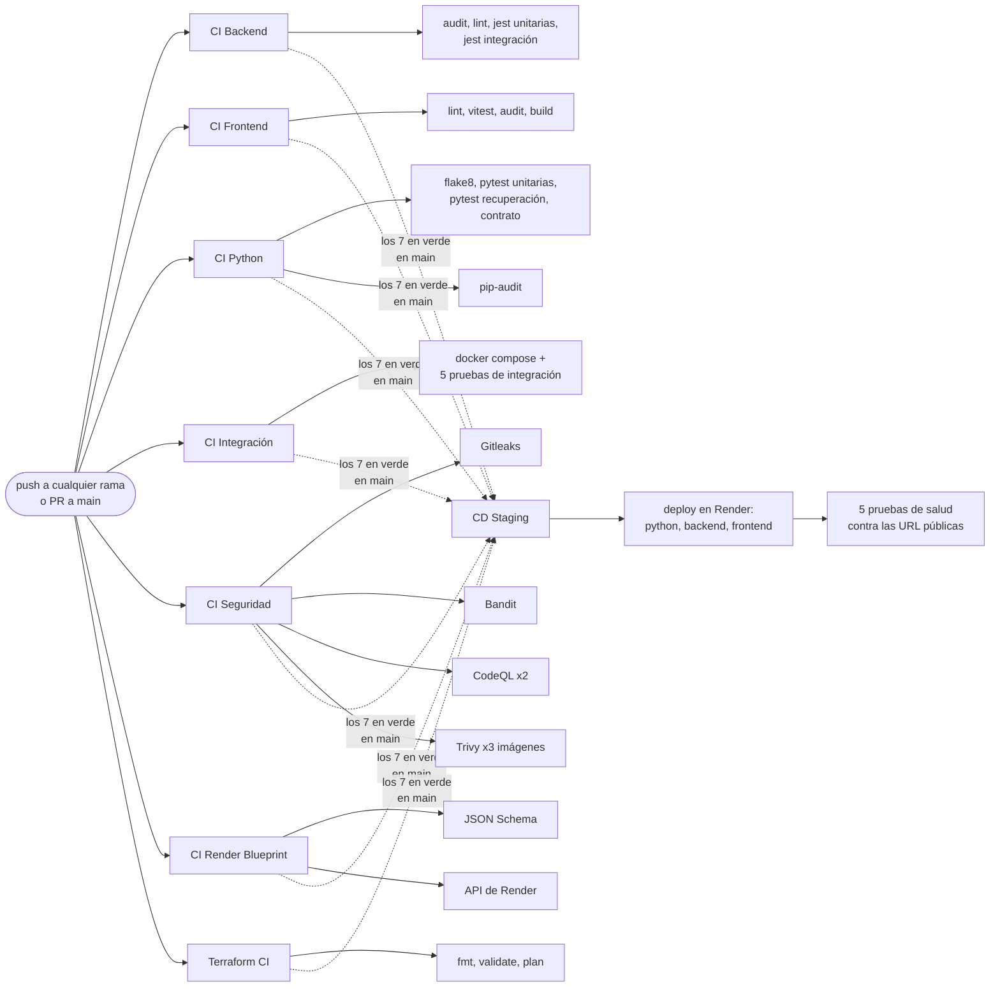

## Los workflows

### CI Backend (NestJS)

[`ci-backend.yml`](../.github/workflows/ci-backend.yml), un job: instala con
`npm ci`, corre `npm audit --audit-level=critical`, `npm run lint`,
`npm run test` (192 pruebas unitarias de Jest) y `npm run test:integration`
(36 pruebas de integración). Las de integración levantan la app NestJS
completa contra un FastAPI simulado y repositorios en memoria, sin Docker ni
PostgreSQL, y tardan unos 20 segundos. Falla si hay una dependencia con una
vulnerabilidad crítica, un error de lint o una prueba que no pasa.

### CI Frontend (Angular)

[`ci-frontend.yml`](../.github/workflows/ci-frontend.yml), un job: `npm ci`,
`npm run lint`, las 121 pruebas unitarias con Vitest
(`npm test -- --configuration ci`), `npm audit --audit-level=critical` y
`npm run build`. Que el build esté en el pipeline importa: un error de
plantilla de Angular a veces solo aparece al compilar para producción.

### CI Python (FastAPI)

[`ci-python.yml`](../.github/workflows/ci-python.yml), dos jobs:

- Lint, pruebas y contrato: `flake8 .`, luego las pruebas unitarias
  (`pytest -m "not recuperacion"`, 293), después las del proceso de
  recuperación (`pytest -m recuperacion`, 543) y al final
  `python scripts/export_openapi.py --check`, que falla si
  [`fastapi-openapi.json`](contratos/fastapi-openapi.json) no coincide con el
  código. Así el contrato que lee el backend nunca queda atrasado.
- Dependencias vulnerables: `pip-audit -r requirements-dev.txt`, que falla
  con cualquier vulnerabilidad conocida en las dependencias declaradas.

Separamos las pruebas en dos pasos para que en el log se vea de inmediato si
lo que falló es una prueba general del servicio o una del proceso de
recuperación de información, que es lo que pide la pauta.

### CI Integración (NestJS ↔ FastAPI)

[`ci-integracion.yml`](../.github/workflows/ci-integracion.yml) levanta la app
completa con Docker Compose, igual que en local, y prueba que los servicios
funcionen juntos:

1. Genera un `.env` de CI. Lo sensible sale de Secrets y lo demás de
   Variables; si los Secrets no existen, genera valores aleatorios para esa
   ejecución. `OFF_BASE_URL` apunta a `http://off.invalid`, un dominio que
   nunca resuelve, para que ninguna prueba llame a Open Food Facts.
2. Construye las imágenes y carga productos de prueba ficticios en la caché
   con `scripts/cargar_fixtures.py`.
3. Levanta todo con `docker compose up --wait` y espera a que el backend
   responda `/api/health`.
4. Corre 5 pruebas:

| Prueba | Qué comprueba |
|---|---|
| 1 | `/health` del python-service responde `ok` o `degradado` |
| 2 | `/api/health` del backend reporta PostgreSQL `ok` y FastAPI `ok` o `degradado` |
| 3 | Una búsqueda por NestJS devuelve los productos de prueba con `X-Fuente-Datos: fastapi`, el mismo `X-Request-ID` que se envió y los mismos resultados, en el mismo orden, que el `/search` de FastAPI |
| 4 | El `X-Request-ID` enviado a NestJS aparece en los logs JSON del python-service |
| 5 | Con el python-service detenido, NestJS sigue arriba y responde desde el respaldo (o con un error con el formato del contrato), y `/api/health` reporta FastAPI `error` |

Al principio las pruebas partían antes de que el backend terminara las
migraciones y fallaban sin razón. Por eso agregamos un healthcheck al backend
en `docker-compose.yml` y, como respaldo, un paso que espera a que
`/api/health` responda antes de la primera prueba.

### CI Seguridad

[`ci-security.yml`](../.github/workflows/ci-security.yml), con cuatro tipos de
análisis que corren en paralelo:

| Job | Herramienta | Qué busca | Falla si |
|---|---|---|---|
| Detección de secretos | Gitleaks | Contraseñas, tokens o claves en todo el historial de commits | Encuentra cualquier secreto |
| SAST Python | Bandit | Patrones inseguros en el código Python (`app/` y `scripts/`) | Hay un hallazgo de severidad alta |
| SAST CodeQL | CodeQL (Python y JavaScript/TypeScript) | Inyecciones, flujos de datos inseguros y similares | El análisis no termina (los hallazgos van a la pestaña Security) |
| Imagen Docker | Trivy (python-service, backend y frontend) | Vulnerabilidades conocidas en los paquetes de cada imagen | Hay una vulnerabilidad CRITICAL que ya tiene arreglo |

Bandit y Trivy suben su reporte completo (formato SARIF) a la pestaña
Security antes de aplicar el umbral, así quedan registrados también los
hallazgos que no hacen fallar el pipeline. Las excepciones de Bandit se
documentan en el código con `# nosec` y su justificación (por ejemplo, las
consultas SQL de la caché que arman nombres de columna desde constantes).

La acción de Trivy está fijada por commit y no por tag, porque en marzo de
2026 se reescribieron tags de las acciones de Trivy con código malicioso.

### CI Render Blueprint

[`ci-render.yml`](../.github/workflows/ci-render.yml) valida
[`render.yaml`](../render.yaml) sin crear nada en Render:

- contra el JSON Schema oficial de Render, siempre;
- con el endpoint *Validate Blueprint* de la API de Render, solo si existen
  `RENDER_OWNER_ID` y `RENDER_API_KEY`. Ese endpoint revisa el archivo como lo
  haría un sync real, pero no crea ni modifica recursos.

### Terraform CI

[`ci-terraform.yml`](../.github/workflows/ci-terraform.yml) corre
`terraform init`, `fmt -check`, `validate` y `plan` sobre
[`terraform/`](../terraform/). Hoy esa carpeta solo declara el proveedor de
AWS y dos variables, sin recursos, así que el plan sale vacío. Por qué no la
usamos para staging está en
[despliegue-staging.md](despliegue-staging.md#por-qué-blueprint-y-no-terraform).

### CD Staging (Render)

[`cd-staging.yml`](../.github/workflows/cd-staging.yml) se dispara cuando
termina cualquiera de los 7 workflows de CI en un push a `main`, y también a
mano (*Run workflow*). Tiene tres jobs:

- Verificar el CI del commit: con la API de GitHub revisa que los 7 hayan
  terminado bien para ese commit. Si falta alguno, falló alguno, `main` ya
  avanzó o el commit ya se desplegó, no sigue y deja el motivo en el resumen.
- Desplegar en Render: con el Environment `staging`, pide a la API de Render
  un deploy de ese commit para python-service, backend y frontend, en ese
  orden, y espera a que cada uno quede `live`. Falla si alguno termina en
  `build_failed`, `update_failed` o `canceled`.
- Pruebas de salud: 5 pruebas contra las URL públicas, con reintentos hasta
  5 minutos por el arranque en frío, y una tabla con el resultado en el
  resumen de la ejecución.

El detalle, con qué revisa cada prueba, está en
[despliegue-staging.md](despliegue-staging.md#despliegue-automático).

## Quality gates

Un quality gate es una condición que, si no se cumple, detiene el pipeline.
Estos son los nuestros y por qué elegimos cada umbral:

| Gate | Umbral | Por qué ese umbral |
|---|---|---|
| Lint (ESLint, flake8) | Cero errores | Es barato de corregir y mantiene el código parejo entre los dos |
| Pruebas | Todas pasan | Una prueba que falla es un comportamiento roto |
| Contrato OpenAPI | Igual al código | El backend depende de él; un contrato atrasado rompe la integración sin que nadie se dé cuenta |
| `npm audit` | Sin vulnerabilidades críticas | Las dependencias de Node tienen muchas altas sin arreglo práctico; con un umbral más bajo el pipeline estaría siempre rojo y lo terminaríamos ignorando |
| `pip-audit` | Sin ninguna vulnerabilidad conocida | El servicio tiene pocas dependencias y todas fijadas, así que se puede exigir |
| Gitleaks | Cero secretos | Un secreto en el historial queda expuesto aunque se borre después |
| Bandit | Sin severidad alta | Lo medio y bajo se revisa en la pestaña Security |
| Trivy | Sin CRITICAL con arreglo disponible | Lo que no tiene arreglo no lo podemos corregir nosotros; las HIGH se reportan pero no bloquean |
| Integración | Las 5 pruebas de CI Integración y las 36 de integración del backend pasan | Son las que prueban los servicios juntos: con Docker Compose, y el backend completo contra un FastAPI simulado |
| Render Blueprint | Válido contra el esquema y la API | Un `render.yaml` roto solo se notaría al desplegar |
| Despliegue a staging | Los 7 workflows de CI en verde para el commit de `main` | Lo que no pasó todos los gates anteriores no se publica |
| Pruebas de salud del staging | Las 5 pasan dentro de 5 minutos cada una | Confirman que lo desplegado responde de punta a punta, no solo que el build terminó |

Las HIGH que dejamos pasar no las ignoramos: están listadas, con su plan, en
[limitaciones.md](limitaciones.md#5-seguridad-y-vulnerabilidades).

## Variables y Secrets de GitHub Actions

Lo no sensible va en Variables y lo sensible en Secrets
(*Settings → Secrets and variables → Actions*). Los workflows tienen un valor
por defecto para cada Variable, así el pipeline también corre en un fork o si
alguien borra una Variable. Ningún valor está en el repositorio.

| Nombre | Tipo | Lo usa | Por defecto si no existe | Para qué |
|---|---|---|---|---|
| `NODE_VERSION_BACKEND` | Variable | CI Backend | `22` | Versión de Node, la misma de `backend/Dockerfile` |
| `NODE_VERSION_FRONTEND` | Variable | CI Frontend | `22` | Versión de Node, la misma de `frontend/Dockerfile` |
| `PYTHON_VERSION` | Variable | CI Python, CI Seguridad, CI Render | `3.11` | Versión de Python, la misma de `python-service/Dockerfile` |
| `TRIVY_VERSION` | Variable | CI Seguridad | `v0.75.0` | Versión de Trivy |
| `TERRAFORM_VERSION` | Variable | Terraform CI | `1.16.5` | Versión de Terraform |
| `DB_USER`, `DB_NAME` | Variable | CI Integración | `foodaware`, `foodaware_db` | Base de datos de CI |
| `LOG_LEVEL` | Variable | CI Integración | `INFO` | Nivel de logs del python-service |
| `OFF_USER_AGENT` | Variable | CI Integración | un User-Agent de ejemplo | Formato válido para que el cliente se cree (en CI nunca sale a la red) |
| `PYTHON_API_TIMEOUT_MS`, `PYTHON_API_REINTENTOS` | Variable | CI Integración | `2000`, `2` | Llamadas del backend al python-service |
| `RENDER_OWNER_ID` | Variable | CI Render | ninguno: sin ella se omite el job | ID del workspace de Render |
| `DB_PASSWORD` | Secret | CI Integración | aleatorio en cada ejecución | Contraseña de la base de CI |
| `JWT_SECRET` | Secret | CI Integración | aleatorio en cada ejecución | Firma de tokens en CI |
| `RENDER_API_KEY` | Secret | CI Render, CD Staging | en CI Render se omite la validación con la API; CD Staging falla | Validar el Blueprint y desplegar con la API de Render |
| `GITHUB_TOKEN` | Secret automático | Gitleaks, CD Staging | lo crea GitHub | Leer los commits de un PR; revisar el CI y los despliegues de un commit |
| `RENDER_SERVICE_ID_PYTHON`, `RENDER_SERVICE_ID_BACKEND`, `RENDER_SERVICE_ID_FRONTEND` | Variable del Environment `staging` | CD Staging | ninguno: el despliegue falla | ID de cada servicio en Render (`srv-…`) |
| `STAGING_URL_PYTHON`, `STAGING_URL_BACKEND`, `STAGING_URL_FRONTEND` | Variable del Environment `staging` | CD Staging | ninguno: las pruebas de salud fallan | URL pública de cada servicio |

El Environment `staging` solo acepta despliegues desde `main`, así que
ningún workflow de otra rama puede leer sus Variables ni desplegar.

Los Secrets que llegan a un `.env` se enmascaran con `::add-mask::`, así que
si se imprimen por error en el log aparecen como `***`. Los secretos de
staging (contraseña de la base, `JWT_SECRET`, `INGESTA_CLAVE`) no están en
GitHub: los genera Render (ver
[despliegue-staging.md](despliegue-staging.md#secretos-y-configuración)).

## Pruebas

| Grupo | Herramienta | Cantidad | Qué cubren |
|---|---|---:|---|
| Python, unitarias | pytest | 293 | Esquemas del contrato, errores, request id, logs, simulación de errores, cliente de Open Food Facts, limitador, clave de ingesta, caché, catálogo, salud, `/analizar` |
| Python, proceso de recuperación | pytest (`-m recuperacion`) | 543 | Ingesta por categorías y segunda ronda, mapeo, limpieza de ingredientes, alérgenos, calidad, planificador, semilla, reprocesamiento, BM25, endpoint de búsqueda, métricas y evaluación |
| Backend, unitarias | Jest | 192 (18 archivos) | Guard JWT, puerto y CORS, cliente de FastAPI y reintentos, respaldo, mapeo, repositorio, controlador y servicio de productos, métricas, salud, observabilidad, usuarios y alergias |
| Backend, integración | Jest (`npm run test:integration`) | 36 (4 archivos) | La app NestJS completa contra un FastAPI simulado: búsqueda y salud, detalle de producto, métricas, y perfil, alergias y compatibilidad con JWT |
| Frontend | Vitest | 121 (12 archivos) | Búsqueda (incluidos los avisos de respaldo y "Despertando el servidor…"), detalle de producto, métricas, login, registro y perfil, sesión, servicios y etiquetas de alérgenos |
| Integración | bash + curl en CI | 5 | Los servicios juntos, ver arriba |
| Salud del staging | bash + curl en CD Staging | 5 | Lo desplegado en Render, por sus URL públicas |

En total son 1185 pruebas automatizadas más las 5 de CI Integración y las 5
de salud del staging. Las de Python las contamos el 25 de octubre de 2026 y
las del backend y el frontend el 24 de octubre de 2026, corriendo cada grupo;
todas pasaron.

Las pruebas de Python nunca llaman a Open Food Facts. Usan un cliente falso
(`ClienteOFFFalso` en [`conftest.py`](../python-service/tests/conftest.py))
que puede devolver páginas, 503, timeouts o un 503 que se recupera en el
reintento, y `respx` para simular la API en las pruebas del cliente HTTP.

### Cómo correrlas en local (PowerShell)

Python, con Python 3.11 instalado:

```powershell
cd python-service
python -m venv .venv
.\.venv\Scripts\Activate.ps1
pip install -r requirements-dev.txt
flake8 .
pytest -m "not recuperacion"
pytest -m recuperacion
python scripts/export_openapi.py --check
```

Python, sin instalar nada (con Docker):

```powershell
docker run --rm -e PYTHONDONTWRITEBYTECODE=1 -v "${PWD}:/repo" -w /repo/python-service python:3.11-slim sh -c "pip install -q -r requirements-dev.txt && pytest -p no:cacheprovider"
```

Backend y frontend, con Node instalado:

```powershell
cd backend
npm ci
npm test
npm run test:integration

cd ..\frontend
npm ci
npm run lint
npm test -- --configuration ci
npm run build
```

Ojo: en el backend, `npm run lint` usa `--fix` y puede modificar archivos.

La integración se puede repetir en local siguiendo los mismos pasos del
workflow, pero `cargar_fixtures.py` agrega productos de prueba a la caché del
volumen `python_cache`. Para no mezclarlos con los datos reales, conviene
hacerlo con un proyecto aparte (`docker compose -p foodaware-ci ...`) y
borrarlo al terminar con `docker compose -p foodaware-ci down -v`.

## Estado actual

En el último commit de `main` revisado (`545168e`, merge del PR #24), los 7
workflows terminaron en verde, incluidos los 7 jobs de CI Seguridad. La
captura [`ep2-ci-verde.png`](evidencia/ep2-ci-verde.png) muestra todos los
checks del pipeline en verde, y
[`ep2-cd-staging.png`](evidencia/ep2-cd-staging.png), el despliegue
automático en verde con la tabla de las pruebas de salud.

No siempre fue así, y conviene contarlo. Desde el PR #15, cuando agregamos
Trivy, CI Seguridad falló en `main` en un solo job: Trivy sobre la imagen del
backend, en el paso "Fallar con vulnerabilidades CRITICAL con arreglo
disponible". La causa era `tar` 6.2.1 (CVE-2026-59873, arreglado en 7.5.19),
que no era una dependencia nuestra: venía dentro del npm que trae la imagen
base `node:20-alpine`.

El gate hizo su trabajo: detectó algo real y grave, y obligó a corregirlo. En
el PR #17 la imagen del backend pasó a `node:22-alpine` y se quitaron npm y
npx de la imagen final, igual que hicimos con pip en el python-service.

También nos dimos cuenta de que los PR #15 y #16 se pudieron integrar con CI
Seguridad en rojo. Para que los gates bloqueen de verdad hay que activar una
regla de protección de `main` que exija los checks antes del merge.

## Evidencia

### EP1: Gitleaks bloqueando un secreto

Para comprobar que el pipeline bloquea el flujo ante un problema de
seguridad, subimos a propósito un secreto falso en una rama de prueba. El job
de Gitleaks lo detectó de inmediato y falló, indicando el archivo, la línea y
la regla.

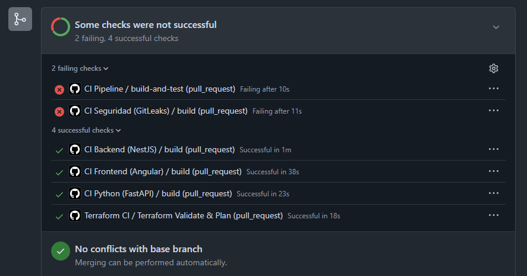
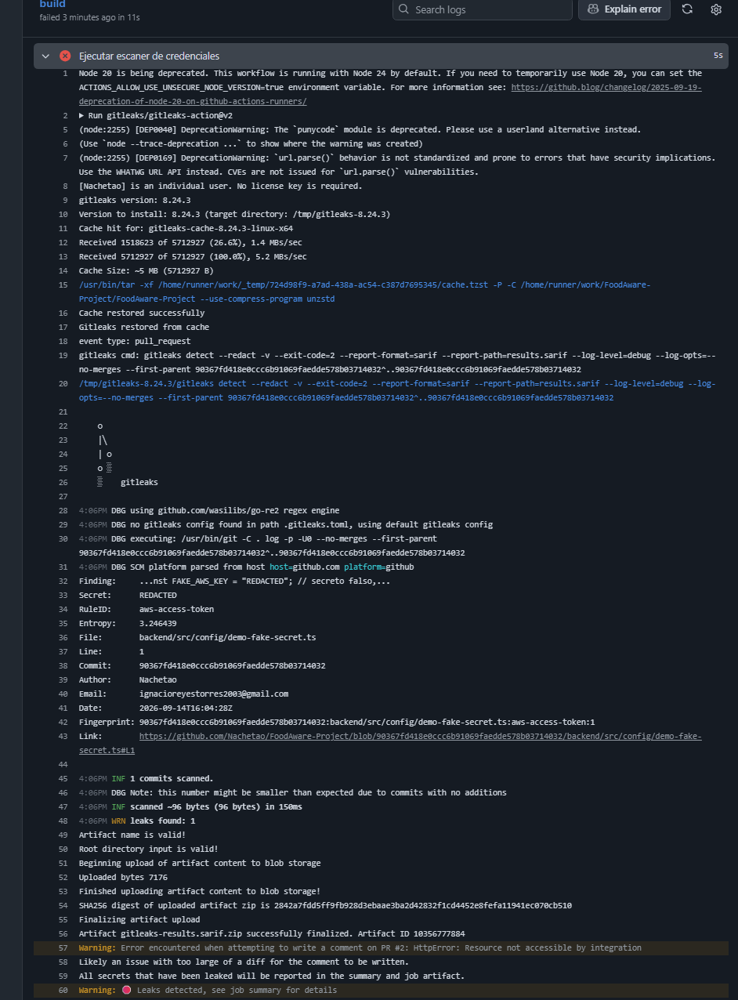
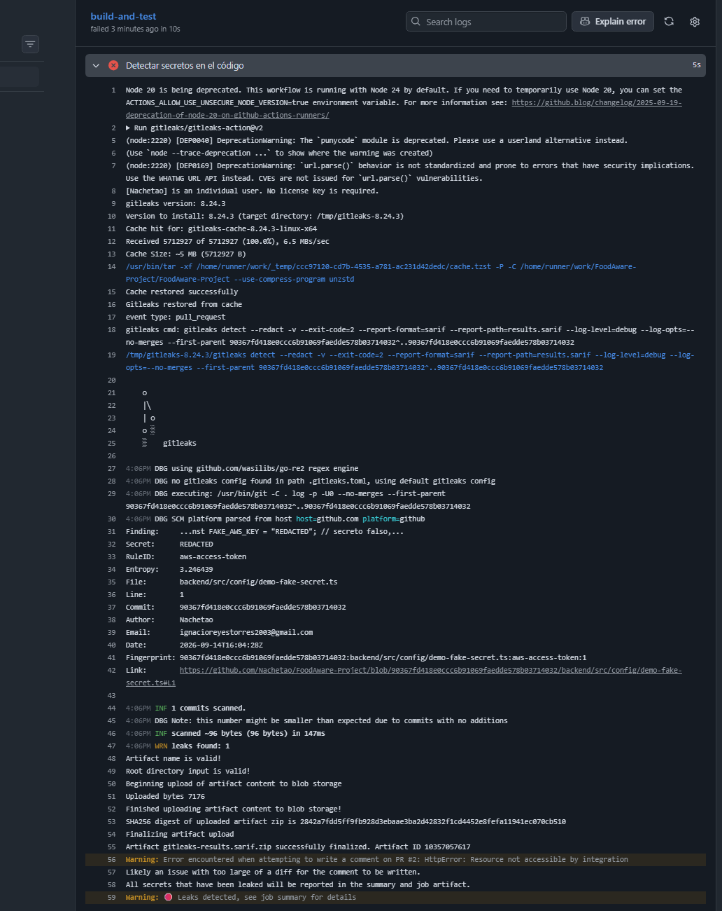

Después de eliminar el secreto (limpiando también el historial, porque
Gitleaks revisa los commits y no solo el código final), el pipeline volvió a
estar en verde.

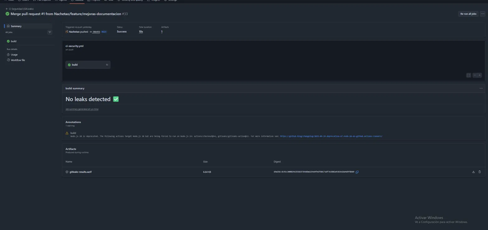

### EP2

Las capturas del pipeline de la EP2 están en [`docs/evidencia/`](evidencia/):

| Archivo | Qué muestra |
|---|---|
| `ep2-ci-verde.png` | Todos los checks del pipeline en verde |
| `ep2-trivy-backend-critical.png` | Trivy bloqueando el CRITICAL de `tar` en la imagen del backend, antes del PR #17 |
| `ep2-github-secrets.png` | Los Secrets de GitHub Actions (GitHub solo muestra los nombres) |
| `ep2-github-variables.png` | Las Variables de GitHub Actions (con el valor de `OFF_USER_AGENT` tapado, porque lleva un correo) |
| `ep2-render-servicios.png` | Los 4 recursos del Blueprint desplegados en Render |
| `ep2-cd-staging.png` | El workflow CD Staging en verde, con la tabla de las pruebas de salud |

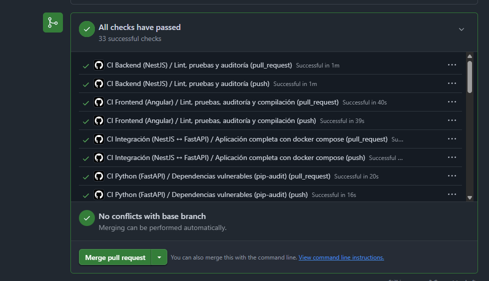
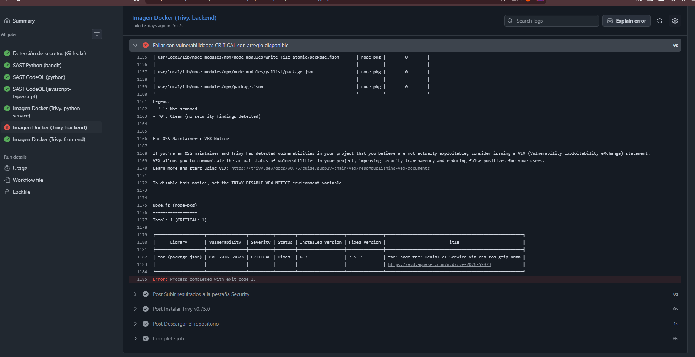
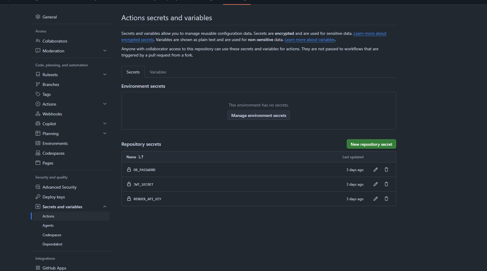
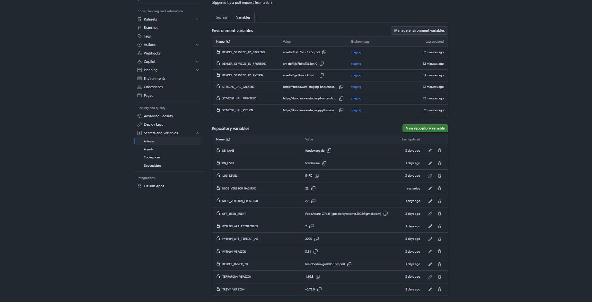
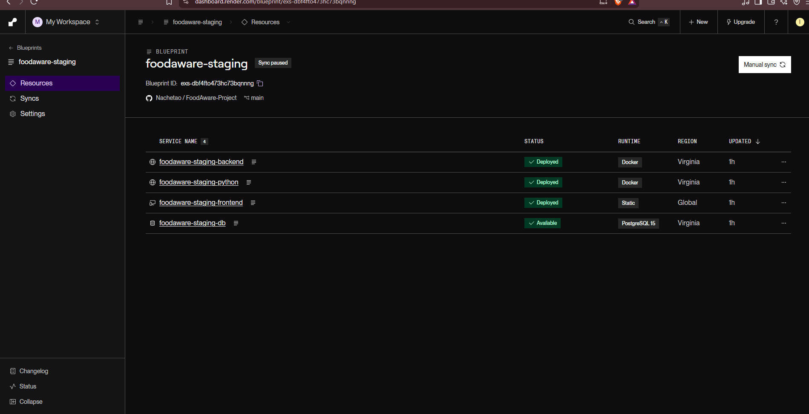
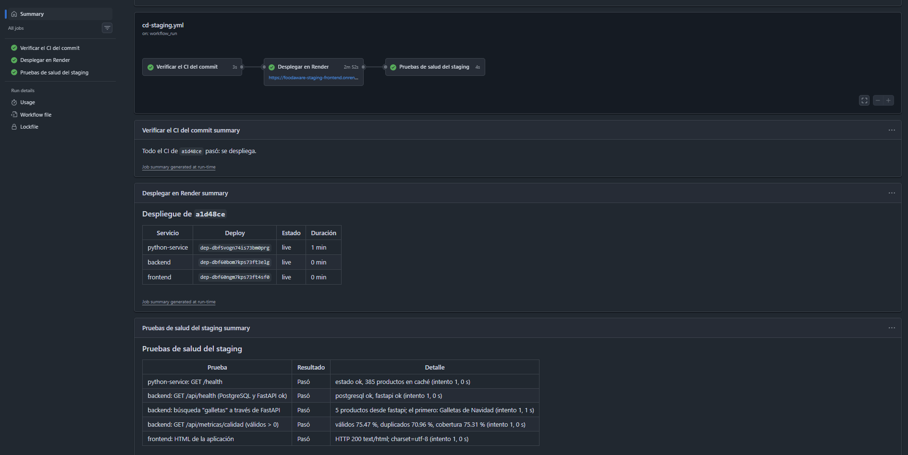

Las capturas de la aplicación (búsqueda con respaldo, panel de métricas,
detalle del producto y compatibilidad) están en
[frontend.md](frontend.md#evidencia) y [backend.md](backend.md#evidencia).

La evidencia de las métricas (salidas de `estadisticas_corpus.py` y
`evaluar_busqueda.py`) está como texto en
[recuperacion-y-evaluacion.md](recuperacion-y-evaluacion.md).
