# Pipeline DevSecOps

El pipeline de FoodAware corre en GitHub Actions. Su trabajo es que nada
llegue a `main` sin pasar lint, pruebas, revisión de dependencias, análisis de
seguridad y validación de la infraestructura. Aquí explicamos cada workflow,
qué lo hace fallar, qué Variables y Secrets usa, cómo correr las pruebas y
dónde está la evidencia.

## Cuándo corre

Los 7 workflows de CI están en [`.github/workflows/`](../.github/workflows/) y
todos se disparan igual:

- en cada push a cualquier rama;
- en cada pull request hacia `main`.

Hay un octavo, CD Staging (Render), que no corre con los push: espera a que
los 7 de CI terminen en verde en un commit de `main` y recién ahí despliega
(ver [CD Staging](#cd-staging-render)). El noveno, Rollback staging, solo
corre a mano (ver [Rollback staging](#rollback-staging)).

Todos tienen `permissions: contents: read` (solo leen el repositorio); los
jobs que suben resultados a la pestaña Security piden además
`security-events: write`. Si llega un push nuevo a una rama mientras el
anterior sigue corriendo, el anterior se cancela para no gastar minutos. En
`main` no se cancela ninguno: cada commit termina su ejecución completa.

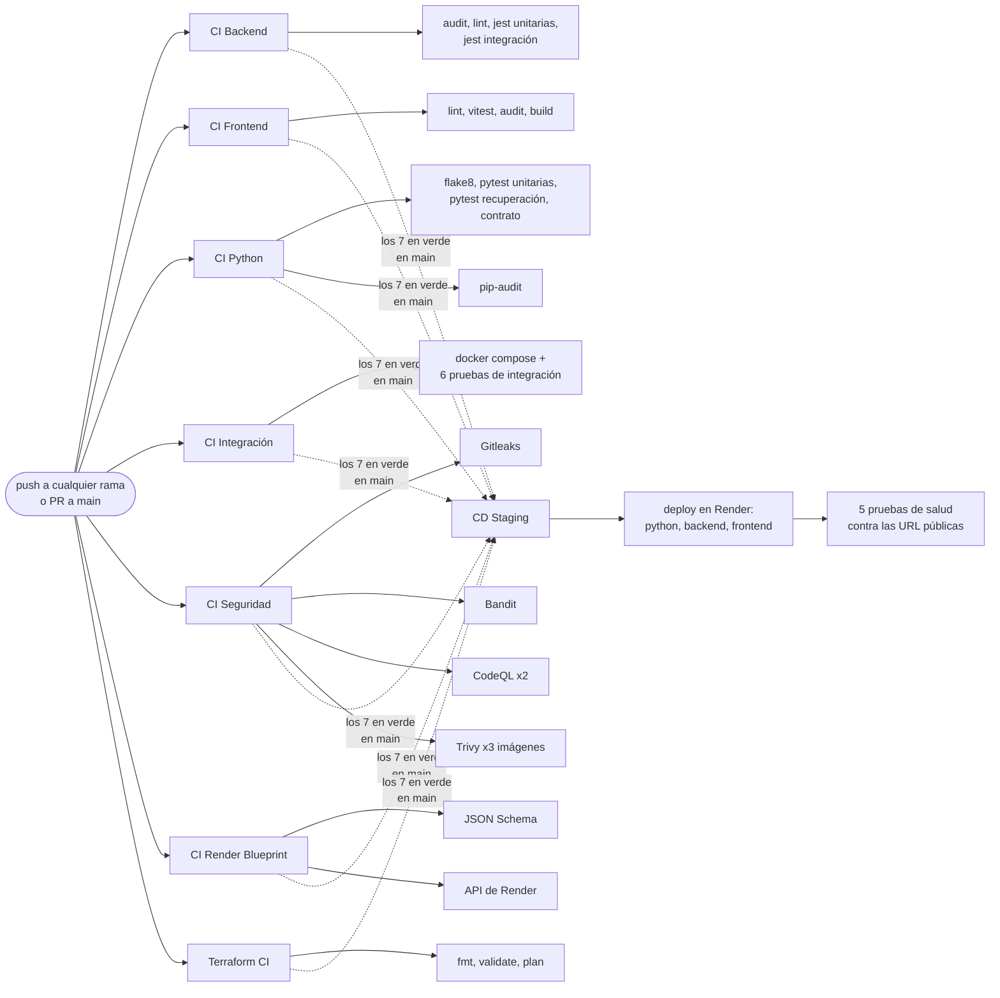

## Los workflows

### CI Backend (NestJS)

[`ci-backend.yml`](../.github/workflows/ci-backend.yml), un job: instala con
`npm ci`, corre `npm audit --audit-level=critical`, `npm run lint`,
`npm run test` (192 pruebas unitarias de Jest) y `npm run test:integration`
(36 pruebas de integración). Las de integración levantan la app NestJS
completa contra un FastAPI simulado y repositorios en memoria, sin Docker ni
PostgreSQL, y tardan unos 20 segundos. Falla si hay una dependencia con una
vulnerabilidad crítica, un error de lint o una prueba que no pasa.

### CI Frontend (Angular)

[`ci-frontend.yml`](../.github/workflows/ci-frontend.yml), un job: `npm ci`,
`npm run lint`, las 121 pruebas unitarias con Vitest
(`npm test -- --configuration ci`), `npm audit --audit-level=critical` y
`npm run build`. Que el build esté en el pipeline importa: un error de
plantilla de Angular a veces solo aparece al compilar para producción.

### CI Python (FastAPI)

[`ci-python.yml`](../.github/workflows/ci-python.yml), dos jobs:

- Lint, pruebas y contrato: `flake8 .`, luego las pruebas unitarias
  (`pytest -m "not recuperacion"`, 293), después las del proceso de
  recuperación (`pytest -m recuperacion`, 543) y al final
  `python scripts/export_openapi.py --check`, que falla si
  [`fastapi-openapi.json`](contratos/fastapi-openapi.json) no coincide con el
  código. Así el contrato que lee el backend nunca queda atrasado.
- Dependencias vulnerables: `pip-audit -r requirements-dev.txt`, que falla
  con cualquier vulnerabilidad conocida en las dependencias declaradas.

Separamos las pruebas en dos pasos para que en el log se vea de inmediato si
lo que falló es una prueba general del servicio o una del proceso de
recuperación de información, que es lo que pide la pauta.

### CI Integración (NestJS ↔ FastAPI)

[`ci-integracion.yml`](../.github/workflows/ci-integracion.yml) levanta la app
completa con Docker Compose, igual que en local, y prueba que los servicios
funcionen juntos:

1. Genera un `.env` de CI. Lo sensible sale de Secrets y lo demás de
   Variables; si los Secrets no existen, genera valores aleatorios para esa
   ejecución. `CLAVE_SERVICIO` siempre es aleatoria y la reciben el backend y
   FastAPI desde ese mismo `.env`, con `CLAVE_SERVICIO_OBLIGATORIA=true` como
   en staging. `OFF_BASE_URL` apunta a `http://off.invalid`, un dominio que
   nunca resuelve, para que ninguna prueba llame a Open Food Facts.
2. Construye las imágenes y carga productos de prueba ficticios en la caché
   con `scripts/cargar_fixtures.py`.
3. Levanta todo con `docker compose up --wait` y espera a que el backend
   responda `/api/health`.
4. Corre 6 pruebas:

| Prueba | Qué comprueba |
|---|---|
| 1 | `/health` del python-service responde `ok` o `degradado` (sin clave: es público) |
| 2 | `/api/health` del backend reporta PostgreSQL `ok` y FastAPI `ok` o `degradado` |
| 3 | Una búsqueda por NestJS devuelve los productos de prueba con `X-Fuente-Datos: fastapi`, el mismo `X-Request-ID` que se envió y los mismos resultados, en el mismo orden, que el `/search` de FastAPI. Con la clave obligatoria, esto también prueba que el backend envía la misma `CLAVE_SERVICIO` que tiene FastAPI |
| 4 | El `X-Request-ID` enviado a NestJS aparece en los logs JSON del python-service |
| 5 | FastAPI exige `X-Clave-Servicio`: 403 `FORBIDDEN` con una clave incorrecta, 403 sin clave y 200 con la correcta. Los dos rechazos quedan en el log como `clave_servicio_rechazada`, sin la clave recibida |
| 6 | Con el python-service detenido, NestJS sigue arriba y responde desde el respaldo (o con un error con el formato del contrato), y `/api/health` reporta FastAPI `error` |

Al principio las pruebas partían antes de que el backend terminara las
migraciones y fallaban sin razón. Por eso agregamos un healthcheck al backend
en `docker-compose.yml` y, como respaldo, un paso que espera a que
`/api/health` responda antes de la primera prueba.

### CI Seguridad

[`ci-security.yml`](../.github/workflows/ci-security.yml), con cuatro tipos de
análisis que corren en paralelo:

| Job | Herramienta | Qué busca | Falla si |
|---|---|---|---|
| Detección de secretos | Gitleaks | Contraseñas, tokens o claves en todo el historial de commits | Encuentra cualquier secreto |
| SAST Python | Bandit | Patrones inseguros en el código Python (`app/` y `scripts/`) | Hay un hallazgo de severidad alta |
| SAST CodeQL | CodeQL (Python y JavaScript/TypeScript) | Inyecciones, flujos de datos inseguros y similares | El análisis no termina (los hallazgos van a la pestaña Security) |
| Imagen Docker | Trivy (python-service, backend y frontend) | Vulnerabilidades conocidas en los paquetes de cada imagen | Hay una vulnerabilidad CRITICAL que ya tiene arreglo |

Bandit y Trivy suben su reporte completo (formato SARIF) a la pestaña
Security antes de aplicar el umbral, así quedan registrados también los
hallazgos que no hacen fallar el pipeline. Las excepciones de Bandit se
documentan en el código con `# nosec` y su justificación (por ejemplo, las
consultas SQL de la caché que arman nombres de columna desde constantes).

La acción de Trivy está fijada por commit y no por tag, porque en marzo de
2026 se reescribieron tags de las acciones de Trivy con código malicioso.

### CI Render Blueprint

[`ci-render.yml`](../.github/workflows/ci-render.yml) valida
[`render.yaml`](../render.yaml) sin crear nada en Render:

- contra el JSON Schema oficial de Render, siempre;
- con el endpoint *Validate Blueprint* de la API de Render, solo si existen
  `RENDER_OWNER_ID` y `RENDER_API_KEY`. Ese endpoint revisa el archivo como lo
  haría un sync real, pero no crea ni modifica recursos.

### Terraform CI

[`ci-terraform.yml`](../.github/workflows/ci-terraform.yml) revisa
[`terraform/`](../terraform/), que declara la configuración de GitHub del
repositorio (ver [Terraform](#terraform-la-configuración-de-github-como-código)):

- En todo push y PR, sin secretos: `fmt -check`, `init -backend=false` y
  `validate`. Si alguno falla, el check falla.
- En `main` y en PR desde este repositorio: `plan` con un token de GitHub de
  **solo lectura** y el estado en HCP Terraform. El resumen del workflow
  muestra cuántos recursos se importarían, crearían, cambiarían o
  destruirían. El plan no hace fallar el check por mostrar diferencias (se
  aplican en local), pero sí si no puede correr con los secretos
  configurados; si propone destruir algo, deja una advertencia. Sin los
  secretos (PR desde forks, Dependabot o antes de configurar HCP Terraform)
  se omite con un aviso.
- `apply` no corre nunca en CI: ningún token con escritura pasa por GitHub
  Actions.

### CD Staging (Render)

[`cd-staging.yml`](../.github/workflows/cd-staging.yml) se dispara cuando
termina cualquiera de los 7 workflows de CI en un push a `main`, y también a
mano (*Run workflow*). Tiene tres jobs:

- Verificar el CI del commit: con la API de GitHub revisa que los 7 hayan
  terminado bien para ese commit. Si falta alguno, falló alguno, `main` ya
  avanzó o el commit ya se desplegó, no sigue y deja el motivo en el resumen.
- Desplegar en Render: con el Environment `staging`, pide a la API de Render
  un deploy de ese commit para python-service, backend y frontend, en ese
  orden, y espera a que cada uno quede `live`. Falla si alguno termina en
  `build_failed`, `update_failed` o `canceled`.
- Pruebas posteriores al despliegue: contra las URL públicas, con reintentos
  hasta 5 minutos por prueba por el arranque en frío, y una tabla con el
  resultado en el resumen de la ejecución. Si todas pasan, marca el commit
  con el tag `staging-verificado-<commit>` (por eso este job tiene
  `contents: write`). Si algo falla, el resumen explica cómo hacer rollback.

El despliegue y las pruebas están en [`.github/scripts/`](../.github/scripts/)
(`desplegar-render.sh` y `pruebas-staging.sh`), y los usa también el rollback.
Las pruebas posteriores al despliegue son de dos tipos:

| Prueba | Pasa si |
|---|---|
| Salud de python-service, backend y frontend, y la búsqueda `galletas` por el backend con `X-Fuente-Datos: fastapi` | Ver [despliegue-staging.md](despliegue-staging.md#despliegue-automático) |
| python-service informa el commit desplegado | `commit` de `/health` es el commit que se acaba de desplegar |
| Búsqueda personalizada "chocolate sin leche" con alergia al maní, por FastAPI | La consulta suma `lacteos` al perfil, hay resultados y ninguno es `no_apto` ni tiene lácteos |
| Veredicto de un producto conocido de la semilla (Leche Semidescremada, 0400050270413) con alergia a lácteos | `no_apto`, con `lacteos` en conflicto y el aviso presente |
| Evaluación adaptativa (`GET /metrics/evaluation/adaptive`) | Todo el etiquetado está en el índice, ningún perfil tiene falsos "apto", la búsqueda personalizada no muestra no aptos y su P@5 supera a la base |
| Commit del backend | Informativa: si `/api/health` informa `commit`, debe ser el desplegado; si no, queda "Pendiente" |

El recorrido funcional no escribe nada: no crea usuarios ni ingestas, solo
consulta. Llama a FastAPI directo, porque el backend todavía no expone la
búsqueda personalizada, y se identifica con la clave entre servicios del
Secret `CLAVE_SERVICIO_STAGING`. La evaluación adaptativa sirve como
protección también en staging: si un cambio hiciera aparecer un falso "apto"
sobre el etiquetado, el CD falla.

### Rollback staging

[`rollback-staging.yml`](../.github/workflows/rollback-staging.yml) se corre
a mano (*Run workflow*, en `main`) con un motivo y, si se quiere, un commit
verificado. Sin commit, vuelve al último verificado anterior al que está
desplegado. Despliega con el mismo script que el CD, corre las mismas pruebas
posteriores al despliegue y comparte con el CD el grupo de concurrencia. La
estrategia por caso está en
[despliegue-staging.md](despliegue-staging.md#versión-desplegada-y-rollback).

## Quality gates

Un quality gate es una condición que, si no se cumple, detiene el pipeline.
Estos son los nuestros y por qué elegimos cada umbral:

| Gate | Umbral | Por qué ese umbral |
|---|---|---|
| Lint (ESLint, flake8) | Cero errores | Es barato de corregir y mantiene el código parejo entre los dos |
| Pruebas | Todas pasan | Una prueba que falla es un comportamiento roto |
| Contrato OpenAPI | Igual al código | El backend depende de él; un contrato atrasado rompe la integración sin que nadie se dé cuenta |
| `npm audit` | Sin vulnerabilidades críticas | Las dependencias de Node tienen muchas altas sin arreglo práctico; con un umbral más bajo el pipeline estaría siempre rojo y lo terminaríamos ignorando |
| `pip-audit` | Sin ninguna vulnerabilidad conocida | El servicio tiene pocas dependencias y todas fijadas, así que se puede exigir |
| Gitleaks | Cero secretos | Un secreto en el historial queda expuesto aunque se borre después |
| Bandit | Sin severidad alta | Lo medio y bajo se revisa en la pestaña Security |
| Trivy | Sin CRITICAL con arreglo disponible | Lo que no tiene arreglo no lo podemos corregir nosotros; las HIGH se reportan pero no bloquean |
| Integración | Las 6 pruebas de CI Integración y las 36 de integración del backend pasan | Son las que prueban los servicios juntos: con Docker Compose, y el backend completo contra un FastAPI simulado |
| Render Blueprint | Válido contra el esquema y la API | Un `render.yaml` roto solo se notaría al desplegar |
| Integración a `main` | Pull Request con los 15 checks de CI en verde (ver [Protección de main](#protección-de-main)) | Lo que falla no llega a `main`, y por lo tanto tampoco al CD |
| Despliegue a staging | Los 7 workflows de CI en verde para el commit de `main` | Lo que no pasó todos los gates anteriores no se publica |
| Pruebas posteriores al despliegue | Las 9 pasan dentro de 5 minutos cada una, incluido el commit desplegado y el recorrido funcional | Confirman que lo desplegado es la versión esperada y responde de punta a punta, no solo que el build terminó. Solo los commits que las pasan quedan como versión verificada para el rollback |

Las HIGH que dejamos pasar no las ignoramos: están listadas, con su plan, en
[limitaciones.md](limitaciones.md#5-seguridad-y-vulnerabilidades).

## Variables y Secrets de GitHub Actions

Lo no sensible va en Variables y lo sensible en Secrets
(*Settings → Secrets and variables → Actions*). Los workflows tienen un valor
por defecto para cada Variable, así el pipeline también corre en un fork o si
alguien borra una Variable. Ningún valor está en el repositorio.

| Nombre | Tipo | Lo usa | Por defecto si no existe | Para qué |
|---|---|---|---|---|
| `NODE_VERSION_BACKEND` | Variable | CI Backend | `22` | Versión de Node, la misma de `backend/Dockerfile` |
| `NODE_VERSION_FRONTEND` | Variable | CI Frontend | `22` | Versión de Node, la misma de `frontend/Dockerfile` |
| `PYTHON_VERSION` | Variable | CI Python, CI Seguridad, CI Render | `3.11` | Versión de Python, la misma de `python-service/Dockerfile` |
| `TRIVY_VERSION` | Variable | CI Seguridad | `v0.75.0` | Versión de Trivy |
| `TERRAFORM_VERSION` | Variable | Terraform CI | `1.16.5` | Versión de Terraform |
| `TF_CLOUD_ORGANIZATION` | Variable | Terraform CI | ninguno: sin ella se omite el plan | Organización de HCP Terraform donde está el estado |
| `DB_USER`, `DB_NAME` | Variable | CI Integración | `foodaware`, `foodaware_db` | Base de datos de CI |
| `LOG_LEVEL` | Variable | CI Integración | `INFO` | Nivel de logs del python-service |
| `OFF_USER_AGENT` | Variable | CI Integración | un User-Agent de ejemplo | Formato válido para que el cliente se cree (en CI nunca sale a la red) |
| `PYTHON_API_TIMEOUT_MS`, `PYTHON_API_REINTENTOS` | Variable | CI Integración | `2000`, `2` | Llamadas del backend al python-service |
| `RENDER_OWNER_ID` | Variable | CI Render | ninguno: sin ella se omite el job | ID del workspace de Render |
| `DB_PASSWORD` | Secret | CI Integración | aleatorio en cada ejecución | Contraseña de la base de CI |
| `JWT_SECRET` | Secret | CI Integración | aleatorio en cada ejecución | Firma de tokens en CI |
| `RENDER_API_KEY` | Secret | CI Render, CD Staging, Rollback staging | en CI Render se omite la validación con la API; los despliegues fallan | Validar el Blueprint y desplegar con la API de Render |
| `CLAVE_SERVICIO_STAGING` | Secret | CD Staging, Rollback staging | ninguno: las pruebas posteriores al despliegue fallan | La clave entre servicios de staging, para el recorrido funcional contra FastAPI |
| `TF_API_TOKEN` | Secret | Terraform CI | ninguno: sin él se omite el plan | Leer el estado de Terraform en HCP Terraform |
| `TF_GITHUB_TOKEN_LECTURA` | Secret | Terraform CI | ninguno: sin él se omite el plan | Token *fine-grained* de solo lectura para que el plan lea el ruleset de `main` y el Environment `staging` |
| `GITHUB_TOKEN` | Secret automático | Gitleaks, CD Staging, Rollback staging | lo crea GitHub | Leer los commits de un PR; revisar el CI y los despliegues de un commit; crear y leer los tags `staging-verificado-*` |
| `RENDER_SERVICE_ID_PYTHON`, `RENDER_SERVICE_ID_BACKEND`, `RENDER_SERVICE_ID_FRONTEND` | Variable del Environment `staging` | CD Staging, Rollback staging | ninguno: el despliegue falla | ID de cada servicio en Render (`srv-…`) |
| `STAGING_URL_PYTHON`, `STAGING_URL_BACKEND`, `STAGING_URL_FRONTEND` | Variable del Environment `staging` | CD Staging, Rollback staging | ninguno: las pruebas fallan | URL pública de cada servicio |

El Environment `staging` solo acepta despliegues desde `main`, así que
ningún workflow de otra rama puede leer sus Variables ni desplegar.

Los Secrets que llegan a un `.env` se enmascaran con `::add-mask::`, así que
si se imprimen por error en el log aparecen como `***`. Los secretos de
staging (contraseña de la base, `JWT_SECRET`, `INGESTA_CLAVE`,
`CLAVE_SERVICIO`) los genera Render (ver
[despliegue-staging.md](despliegue-staging.md#secretos-y-configuración)). La
única copia en GitHub es `CLAVE_SERVICIO_STAGING`, que necesitan las pruebas
posteriores al despliegue. Para crearla: en Render, servicio
`foodaware-staging-python` → *Environment* → copiar el valor de
`CLAVE_SERVICIO`; en GitHub, *Settings → Secrets and variables → Actions →
New repository secret*, con el nombre `CLAVE_SERVICIO_STAGING`. Va a nivel de
repositorio, como `RENDER_API_KEY`, porque el job de pruebas no usa el
Environment (si lo usara, cada ejecución registraría un segundo despliegue).
Si se regenera la clave en Render, hay que actualizar este Secret.

## Pruebas

| Grupo | Herramienta | Cantidad | Qué cubren |
|---|---|---:|---|
| Python, unitarias | pytest | 293 | Esquemas del contrato, errores, request id, logs, simulación de errores, cliente de Open Food Facts, limitador, clave de ingesta, caché, catálogo, salud, `/analizar` |
| Python, proceso de recuperación | pytest (`-m recuperacion`) | 543 | Ingesta por categorías y segunda ronda, mapeo, limpieza de ingredientes, alérgenos, calidad, planificador, semilla, reprocesamiento, BM25, endpoint de búsqueda, métricas y evaluación |
| Backend, unitarias | Jest | 192 (18 archivos) | Guard JWT, puerto y CORS, cliente de FastAPI y reintentos, respaldo, mapeo, repositorio, controlador y servicio de productos, métricas, salud, observabilidad, usuarios y alergias |
| Backend, integración | Jest (`npm run test:integration`) | 36 (4 archivos) | La app NestJS completa contra un FastAPI simulado: búsqueda y salud, detalle de producto, métricas, y perfil, alergias y compatibilidad con JWT |
| Frontend | Vitest | 121 (12 archivos) | Búsqueda (incluidos los avisos de respaldo y "Despertando el servidor…"), detalle de producto, métricas, login, registro y perfil, sesión, servicios y etiquetas de alérgenos |
| Integración | bash + curl en CI | 6 | Los servicios juntos, ver arriba |
| Posteriores al despliegue | bash + curl en CD Staging y Rollback staging | 9 (más 1 informativa) | Lo desplegado en Render, por sus URL públicas: salud, commit desplegado y un recorrido funcional que no escribe datos |

En total son 1185 pruebas automatizadas más las 6 de CI Integración y las 9
posteriores al despliegue. Las de Python las contamos el 25 de octubre de 2026 y
las del backend y el frontend el 24 de octubre de 2026, corriendo cada grupo;
todas pasaron.

Las pruebas de Python nunca llaman a Open Food Facts. Usan un cliente falso
(`ClienteOFFFalso` en [`conftest.py`](../python-service/tests/conftest.py))
que puede devolver páginas, 503, timeouts o un 503 que se recupera en el
reintento, y `respx` para simular la API en las pruebas del cliente HTTP.

### Cómo correrlas en local (PowerShell)

Python, con Python 3.11 instalado:

```powershell
cd python-service
python -m venv .venv
.\.venv\Scripts\Activate.ps1
pip install -r requirements-dev.txt
flake8 .
pytest -m "not recuperacion"
pytest -m recuperacion
python scripts/export_openapi.py --check
```

Python, sin instalar nada (con Docker):

```powershell
docker run --rm -e PYTHONDONTWRITEBYTECODE=1 -v "${PWD}:/repo" -w /repo/python-service python:3.11-slim sh -c "pip install -q -r requirements-dev.txt && pytest -p no:cacheprovider"
```

Backend y frontend, con Node instalado:

```powershell
cd backend
npm ci
npm test
npm run test:integration

cd ..\frontend
npm ci
npm run lint
npm test -- --configuration ci
npm run build
```

Ojo: en el backend, `npm run lint` usa `--fix` y puede modificar archivos.

La integración se puede repetir en local siguiendo los mismos pasos del
workflow, pero `cargar_fixtures.py` agrega productos de prueba a la caché del
volumen `python_cache`. Para no mezclarlos con los datos reales, conviene
hacerlo con un proyecto aparte (`docker compose -p foodaware-ci ...`) y
borrarlo al terminar con `docker compose -p foodaware-ci down -v`.

## Estado actual

En el último commit de `main` revisado (`545168e`, merge del PR #24), los 7
workflows terminaron en verde, incluidos los 7 jobs de CI Seguridad. La
captura [`ep2-ci-verde.png`](evidencia/ep2-ci-verde.png) muestra todos los
checks del pipeline en verde, y
[`ep2-cd-staging.png`](evidencia/ep2-cd-staging.png), el despliegue
automático en verde con la tabla de las pruebas de salud.

No siempre fue así: desde el PR #15 hasta el PR #17, Trivy bloqueó CI
Seguridad por una vulnerabilidad CRITICAL en la imagen del backend. El caso
completo está en
[Fallo de seguridad detectado, bloqueo del pipeline y corrección](#fallo-de-seguridad-detectado-bloqueo-del-pipeline-y-corrección).

## Protección de main

Una regla de GitHub (ruleset) que exige un Pull Request y los checks de CI en
verde antes de unir a `main`. Se creó a mano con los pasos de abajo y desde
la Parte 9C está declarada en
[`terraform/rulesets.tf`](../terraform/rulesets.tf) (ver
[Terraform](#terraform-la-configuración-de-github-como-código)): para
cambiarla se edita ese archivo y se aplica en local, no en la interfaz de
GitHub, o el próximo plan mostrará la diferencia. Los pasos quedan como
registro y para recrearla si se perdiera.

### Pasos

1. En el repositorio: *Settings → Rules → Rulesets → New ruleset → New branch
   ruleset*.
2. **Ruleset Name:** `Proteger main`. **Enforcement status:** `Active`.
3. **Bypass list:** vacía. Así nadie, ni los administradores, puede saltarse
   la regla; si hiciera falta en una emergencia, se desactiva el ruleset por
   un momento y queda registrado.
4. **Target branches → Add target → Include default branch** (`main`).
5. **Branch rules:**
   - `Restrict deletions` y `Block force pushes`: marcadas.
   - `Require a pull request before merging`: marcada. En
     **Required approvals**, `1` si el otro integrante puede revisar a tiempo
     (GitHub no deja aprobar el propio Pull Request), o `0` si no. Con `0`
     igual se exige el Pull Request y los checks.
   - `Require status checks to pass`: marcada, con
     `Require branches to be up to date before merging` también marcada
     (así los checks corren sobre lo que va a quedar en `main`). En
     **Add checks**, agregar los 15 de la tabla de abajo; GitHub los sugiere
     por nombre a medida que se escribe.
6. **Create**.

Para comprobarlo: abrir un Pull Request de prueba; el botón de merge queda
bloqueado hasta que los 15 checks terminen en verde, y un push directo a
`main` se rechaza.

La alternativa clásica es *Settings → Branches → Add branch protection rule*,
con el patrón `main` y las mismas opciones (`Require a pull request before
merging`, `Require status checks to pass before merging` con los mismos
checks, sin `Allow force pushes` ni `Allow deletions`).

### Checks obligatorios

Son los nombres de los jobs, que es como GitHub nombra los checks. Un check
aparece en el buscador recién después de haber corrido al menos una vez en la
última semana.

| Check | Workflow |
|---|---|
| `Lint, pruebas y auditoría` | CI Backend (NestJS) |
| `Lint, pruebas, auditoría y compilación` | CI Frontend (Angular) |
| `Lint, pruebas y contrato` | CI Python (FastAPI) |
| `Dependencias vulnerables (pip-audit)` | CI Python (FastAPI) |
| `Aplicación completa con docker compose` | CI Integración (NestJS ↔ FastAPI) |
| `Detección de secretos (Gitleaks)` | CI Seguridad |
| `SAST Python (bandit)` | CI Seguridad |
| `SAST CodeQL (python)` | CI Seguridad |
| `SAST CodeQL (javascript-typescript)` | CI Seguridad |
| `Imagen Docker (Trivy, python-service)` | CI Seguridad |
| `Imagen Docker (Trivy, backend)` | CI Seguridad |
| `Imagen Docker (Trivy, frontend)` | CI Seguridad |
| `render.yaml contra el JSON Schema oficial` | CI Render Blueprint |
| `render.yaml con la API de Render (sin crear recursos)` | CI Render Blueprint |
| `Terraform Validate & Plan` | Terraform CI |

No van como obligatorios CD Staging ni Rollback staging, porque no corren en
los Pull Requests, ni el check `CodeQL` que agrega la pestaña Security, que
duplica los dos de CodeQL. El job de la API de Render se salta si no existe la
Variable `RENDER_OWNER_ID`; GitHub cuenta un job saltado como aprobado, así que
no bloquea.

Si se renombra un job, hay que actualizar el check en el ruleset (en
`local.checks_requeridos` de [`terraform/rulesets.tf`](../terraform/rulesets.tf),
y aplicar): con el nombre viejo, el Pull Request queda esperando un check que
ya no existe.

## Terraform: la configuración de GitHub como código

[`terraform/`](../terraform/) declara la configuración de GitHub de la que
dependen el pipeline y el despliegue. Los servicios de Render no están aquí:
siguen en el Blueprint (ver
[despliegue-staging.md](despliegue-staging.md#por-qué-blueprint-y-no-terraform)).

| Recurso | Archivo | Origen |
|---|---|---|
| Ruleset `Proteger main` (PR y los 15 checks) | `rulesets.tf` | Existía (id 27586111): se importa |
| Environment `staging`, que solo acepta despliegues desde `main` | `staging.tf` | Existía: se importa, con su regla de rama (id 64326475) |
| Las 6 Variables del Environment `staging` (`STAGING_URL_*`, `RENDER_SERVICE_ID_*`) | `staging.tf` | Existían: se importan |

Quedan fuera a propósito:

- **Los Secrets** (`RENDER_API_KEY`, `CLAVE_SERVICIO_STAGING`, etc.):
  Terraform guardaría su valor en el estado.
- **Los Environments `main - foodaware-staging-*`**: los crea la integración
  de Render.
- **Las Variables a nivel de repositorio** (`NODE_VERSION_*`, `TRIVY_VERSION`,
  etc.): todas tienen un valor por defecto en los workflows, así que perderlas
  no rompe nada.

Lo que ya existía se adopta con bloques `import`
([`terraform/imports.tf`](../terraform/imports.tf)), sin recrearlo. El primer
`apply` importó los 9 recursos; desde entonces el plan debe decir
`No changes` mientras nadie cambie nada.

### Estado y credenciales

El estado vive en HCP Terraform (plan gratuito), en el workspace
`foodaware-github` con **modo de ejecución Local**: HCP Terraform guarda el
estado y lo bloquea durante el `apply`, pero `plan` y `apply` corren donde se
ejecutan, con las credenciales de ese lugar. El estado no tiene secretos (solo
URL, ID de servicios y la configuración del ruleset) y nunca se sube al
repositorio (`.gitignore` excluye `*.tfstate`, `*.tfvars` y `*.tfplan`).

| Credencial | Permisos | Dónde vive | Para qué |
|---|---|---|---|
| Token de GitHub de lectura | *Fine-grained*, solo `FoodAware-Project`: Administration y Environments en *Read-only* (Metadata se agrega solo) | Secret `TF_GITHUB_TOKEN_LECTURA` | El `plan` de CI |
| Token de HCP Terraform para CI | Token de usuario con vencimiento | Secret `TF_API_TOKEN` | Leer el estado en el `plan` de CI |
| Token de GitHub con escritura | *Fine-grained*, solo `FoodAware-Project`: Administration y Environments en *Read and write* | Solo en la sesión de PowerShell de quien aplica (variable de entorno), nunca en un archivo ni en GitHub | El `apply` local |
| Token de HCP Terraform local | Otro token de usuario, con vencimiento | Igual que el anterior | Leer y bloquear el estado en el `apply` |

La organización de HCP Terraform va en la Variable `TF_CLOUD_ORGANIZATION`
(no es secreta). Ningún token con escritura sobre GitHub pasa por CI: si se
filtrara el Secret de CI, solo serviría para leer.

### Aplicar un cambio (PowerShell, con Docker)

1. Cambiar el `.tf` en una rama y abrir el Pull Request. El resumen de
   "Terraform CI" muestra el plan (importar, crear, cambiar, destruir).
2. Después del merge, desde `main` actualizado, cargar las credenciales en la
   sesión (lo que se escribe en `Read-Host` no queda en el historial):

   ```powershell
   $env:TF_CLOUD_ORGANIZATION = "<organización>"
   $env:TF_TOKEN_app_terraform_io = [System.Net.NetworkCredential]::new('', (Read-Host 'Token HCP Terraform' -AsSecureString)).Password
   $env:GITHUB_TOKEN = [System.Net.NetworkCredential]::new('', (Read-Host 'Token GitHub con escritura' -AsSecureString)).Password
   function tf { docker run --rm -it -v "${PWD}\terraform:/w" -w /w -e TF_CLOUD_ORGANIZATION -e TF_TOKEN_app_terraform_io -e GITHUB_TOKEN hashicorp/terraform:1.16.5 @args }
   ```

3. `tf init`, luego `tf plan -out=cambio.tfplan` y revisar el plan. **Si
   propone destruir o reemplazar algo (`destroy`, `must be replaced`, `-/+`),
   no aplicar.**
4. `tf apply cambio.tfplan` (aplica exactamente el plan revisado), y después
   `tf plan` debe decir `No changes`.
5. Cerrar la sesión de PowerShell (o `Remove-Item Env:GITHUB_TOKEN,
   Env:TF_TOKEN_app_terraform_io`) y borrar `terraform\cambio.tfplan`.

Si alguien cambia un ruleset o una Variable de `staging` en la interfaz de
GitHub, el siguiente plan de CI lo muestra como diferencia. Se corrige
llevando el cambio al `.tf` o volviendo a aplicar.

## Evidencia

### Fallo de seguridad detectado, bloqueo del pipeline y corrección

Un caso real, no provocado: una vulnerabilidad grave en la imagen del
backend que el pipeline detectó, bloqueó y nos obligó a corregir.

| Etapa | Qué pasó | Evidencia |
|---|---|---|
| **1. Detección** (desde el 22 de octubre de 2026) | Con el PR #15 agregamos Trivy a CI Seguridad (commit `5b3a90e`). Desde ese PR, Trivy encontró en la imagen del backend `tar` 6.2.1 con la CVE-2026-59873, severidad CRITICAL ("Denial of Service via crafted gzip bomb"), con arreglo en la versión 7.5.19. No era una dependencia nuestra: venía dentro del npm que trae la imagen base `node:20-alpine` | [`ep2-trivy-backend-critical.png`](evidencia/ep2-trivy-backend-critical.png) |
| **2. Bloqueo** | El job "Imagen Docker (Trivy, backend)" falló en el paso "Fallar con vulnerabilidades CRITICAL con arreglo disponible", y CI Seguridad quedó en rojo en `main`. Los otros 6 jobs de CI Seguridad (Gitleaks, Bandit, CodeQL y Trivy sobre el python-service y el frontend) pasaron | La misma captura: el job en rojo, la tabla de Trivy con la CVE y `exit code 1` |
| **3. Corrección** (23 de octubre de 2026) | En el PR #17 (commit `e67fb0e`), la imagen final del backend pasó a `node:22-alpine` y dejó de incluir npm y npx, que no se usan para ejecutar la aplicación. Igual que con pip en el python-service, lo que no está en la imagen no puede tener vulnerabilidades | [`backend/Dockerfile`](../backend/Dockerfile) |
| **4. Verificación** | En el commit `545168e` de `main`, los 7 workflows terminaron en verde, incluidos los 7 jobs de CI Seguridad | [`ep2-ci-verde.png`](evidencia/ep2-ci-verde.png) |

**Lo que aprendimos.** El gate hizo su trabajo: detectó algo real y grave en
una dependencia que ni siquiera habíamos elegido. Pero también nos mostró un
hueco: los PR #15 y #16 se pudieron unir a `main` con CI Seguridad en rojo,
porque nada exigía los checks antes del merge. Por eso activamos el ruleset
que exige los 15 checks en verde
([Protección de main](#protección-de-main)). Hoy ese mismo fallo no podría
llegar a `main`, y el CD tampoco despliega un commit con algún CI en rojo.

El otro fallo controlado, provocado a propósito en la EP1, es el de Gitleaks
(abajo).

### EP1: Gitleaks bloqueando un secreto

Para comprobar que el pipeline bloquea el flujo ante un problema de
seguridad, subimos a propósito un secreto falso en una rama de prueba. El job
de Gitleaks lo detectó de inmediato y falló, indicando el archivo, la línea y
la regla.

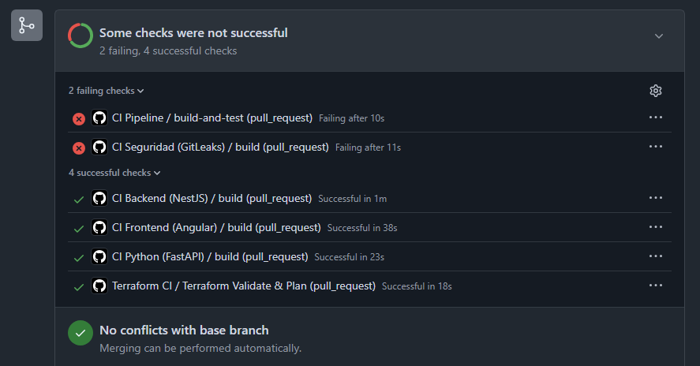
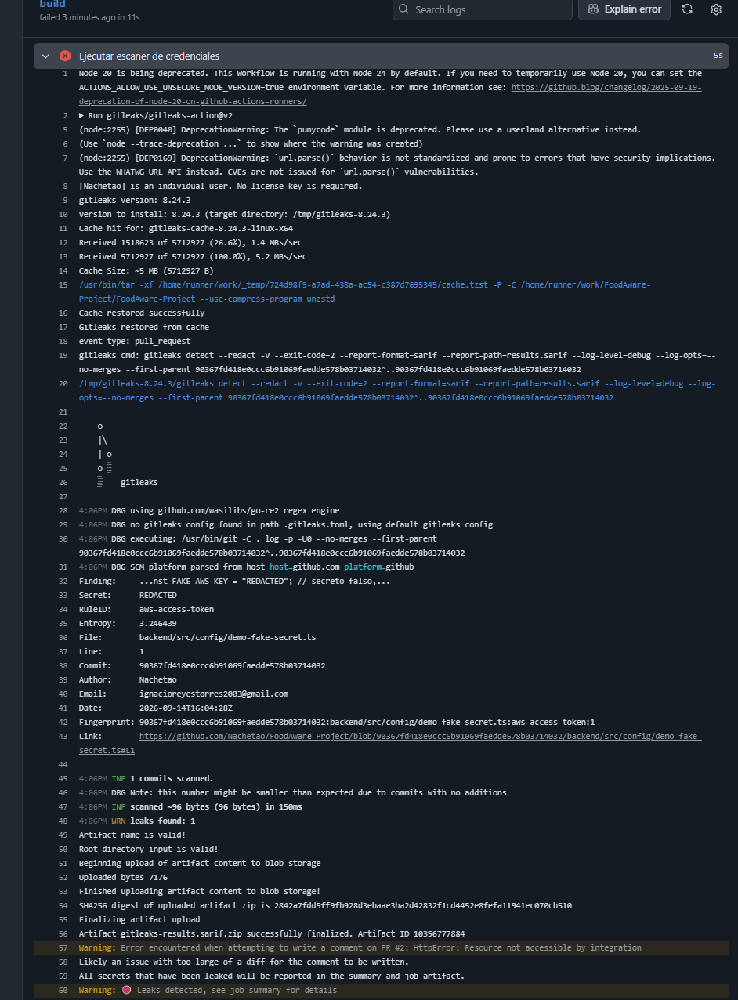
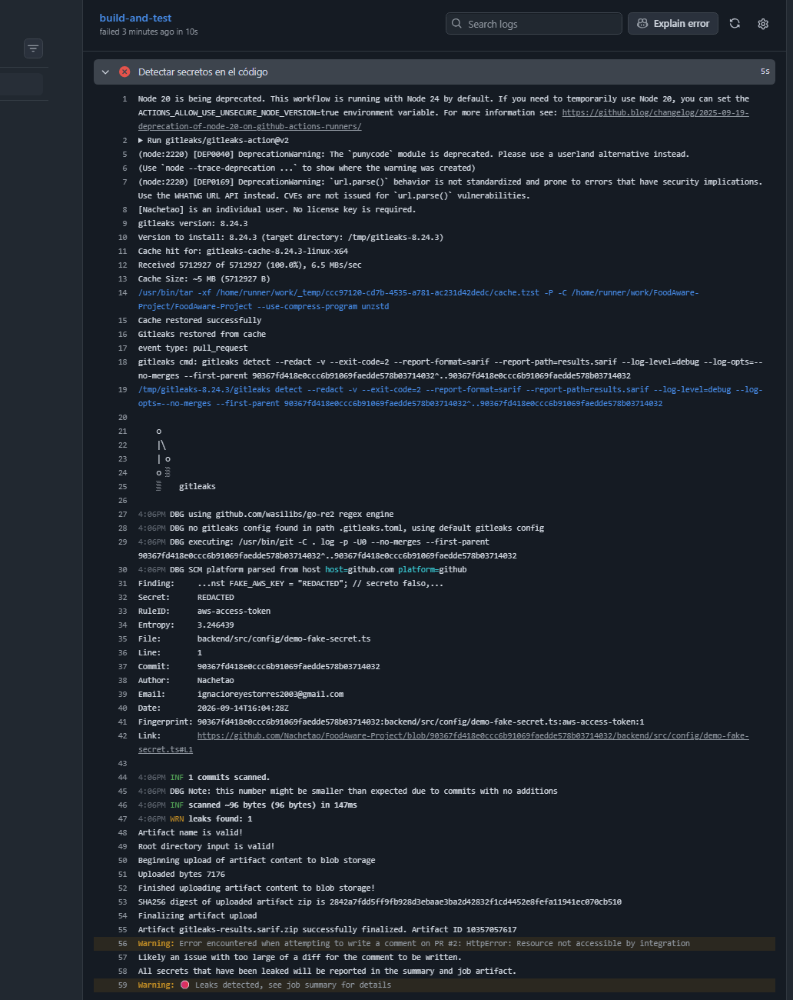

Después de eliminar el secreto (limpiando también el historial, porque
Gitleaks revisa los commits y no solo el código final), el pipeline volvió a
estar en verde.

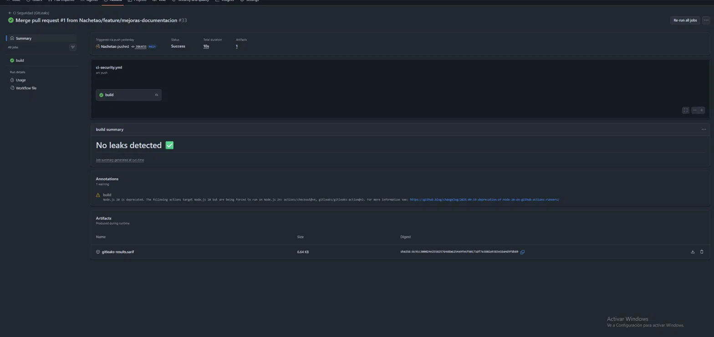

### EP2

Las capturas del pipeline de la EP2 están en [`docs/evidencia/`](evidencia/):

| Archivo | Qué muestra |
|---|---|
| `ep2-ci-verde.png` | Todos los checks del pipeline en verde |
| `ep2-trivy-backend-critical.png` | Trivy bloqueando el CRITICAL de `tar` en la imagen del backend, antes del PR #17 |
| `ep2-github-secrets.png` | Los Secrets de GitHub Actions (GitHub solo muestra los nombres) |
| `ep2-github-variables.png` | Las Variables de GitHub Actions (con el valor de `OFF_USER_AGENT` tapado, porque lleva un correo) |
| `ep2-render-servicios.png` | Los 4 recursos del Blueprint desplegados en Render |
| `ep2-cd-staging.png` | El workflow CD Staging en verde, con la tabla de las pruebas de salud |

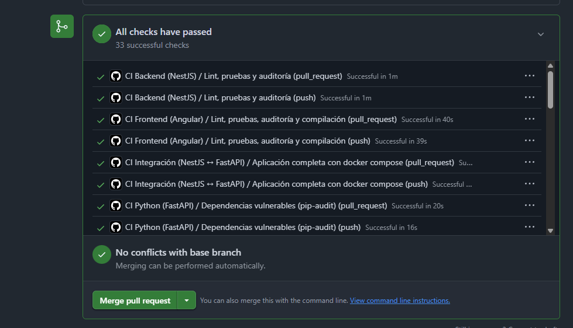
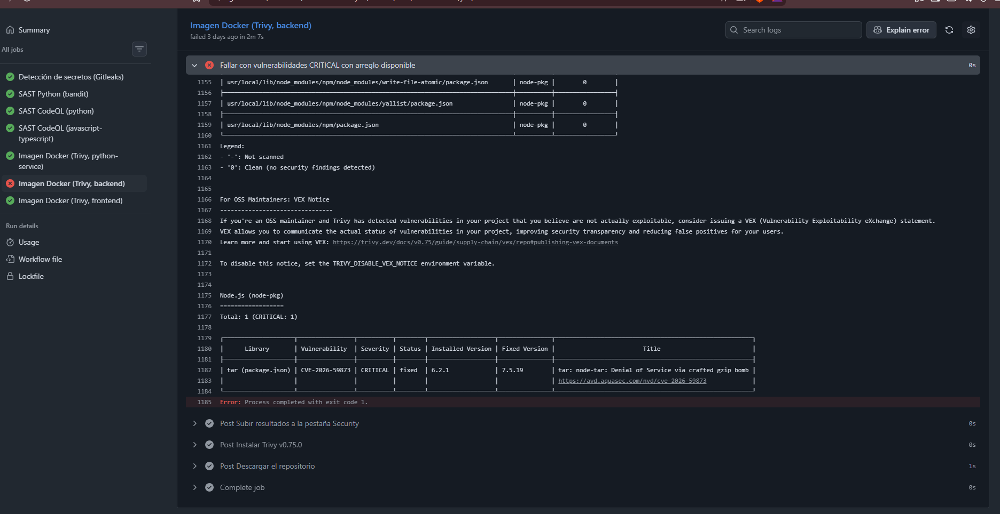
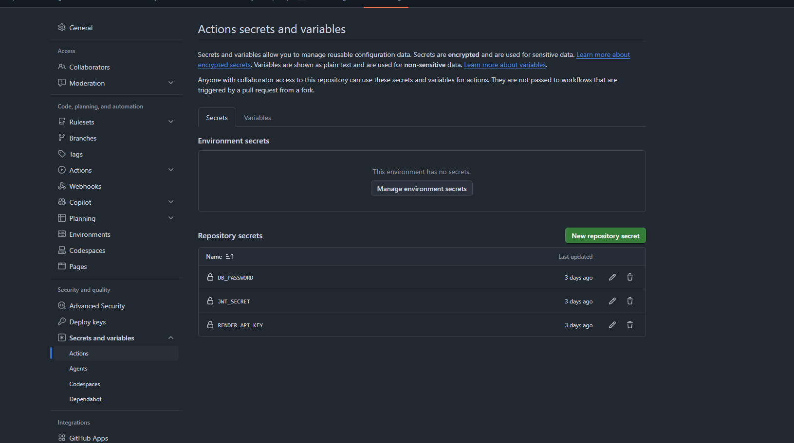
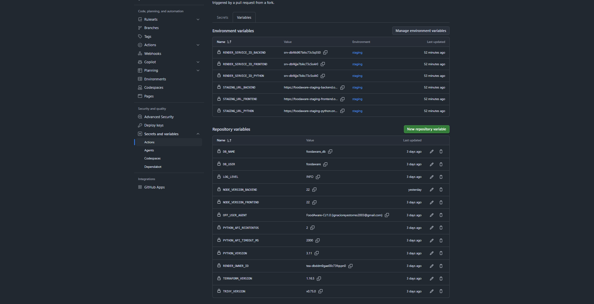
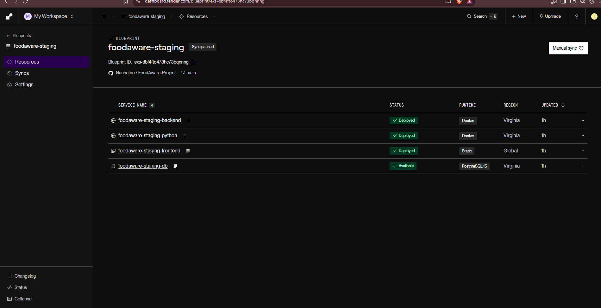
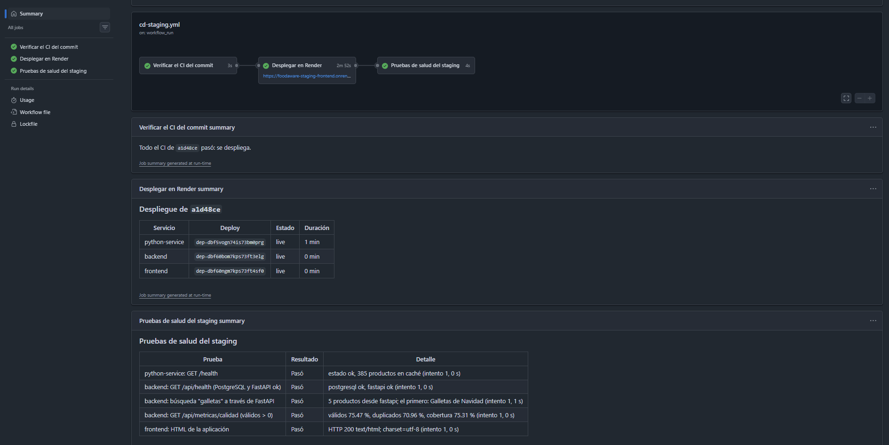

Las capturas de la aplicación (búsqueda con respaldo, panel de métricas,
detalle del producto y compatibilidad) están en
[frontend.md](frontend.md#evidencia) y [backend.md](backend.md#evidencia).

La evidencia de las métricas (salidas de `estadisticas_corpus.py` y
`evaluar_busqueda.py`) está como texto en
[recuperacion-y-evaluacion.md](recuperacion-y-evaluacion.md).
