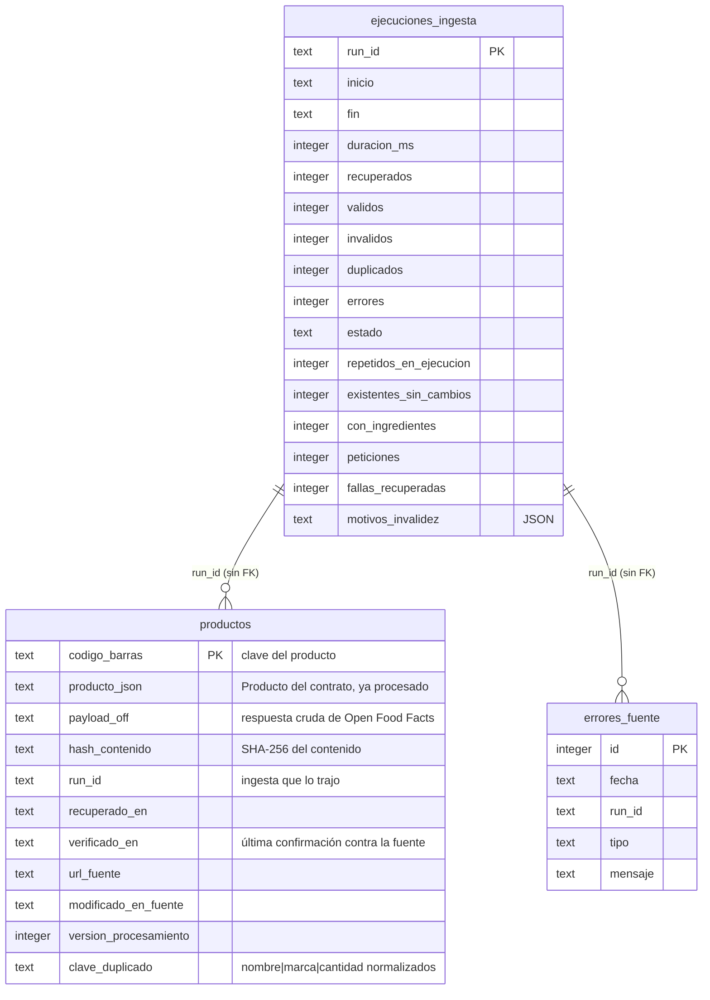

# Recuperación de información y evaluación

Este documento explica cómo guardamos los productos, cómo los buscamos y cómo
medimos si los datos y la búsqueda están funcionando bien. Cómo llegan los
productos a la caché está en [extraccion-y-preparacion.md](extraccion-y-preparacion.md);
los endpoints y sus campos, en el [contrato](contratos/README.md).

Todos los números salen de la caché real del python-service (383 productos,
4 ingestas), medidos el 23 de octubre de 2026 con
`scripts/estadisticas_corpus.py` y `scripts/evaluar_busqueda.py`. Al final
explicamos cómo reproducirlos.

## 1. Persistencia e indexación

Hay dos lugares donde se guardan datos, y cada uno tiene un dueño distinto:

| Dónde | Dueño | Qué guarda | Para qué |
|---|---|---|---|
| Caché SQLite (`foodaware-cache.sqlite3`) | python-service | Productos de Open Food Facts con su payload crudo, ejecuciones de ingesta y fallas de la fuente | Es la fuente de verdad del corpus; desde aquí se arma el índice de búsqueda |
| Índice BM25 en memoria | python-service | Índice invertido por campo, armado desde la caché | Responder `GET /search` sin tocar el disco ni la fuente |
| PostgreSQL | backend (NestJS) | Usuarios, alimentos analizados (EP1) y una copia de los productos que devolvió cada búsqueda | Perfiles, autenticación y un respaldo si FastAPI no responde |

### La caché SQLite



Los índices que tiene, y para qué sirve cada uno:

| Índice | Columna | Lo usa |
|---|---|---|
| Clave primaria de `productos` | `codigo_barras` | El upsert y `GET /products/{codigo}`; también garantiza que no haya dos filas con el mismo código |
| `idx_productos_verificado_en` | `verificado_en` | La antigüedad de la caché |
| `idx_productos_clave_duplicado` | `clave_duplicado` | Encontrar los posibles duplicados de un producto |
| `idx_ejecuciones_inicio` | `inicio` | La última ingesta y la próxima ingesta periódica |
| `idx_errores_fuente_fecha` | `fecha` | Las fallas recientes que revisa `/health` |

Guardamos el producto como JSON (`producto_json`) y no en columnas separadas
porque el python-service siempre lo lee y lo escribe completo, y así el
esquema no cambia cada vez que el contrato agrega un campo. Lo que sí
necesitamos filtrar u ordenar (código, fechas, versión, clave de duplicado)
va en columnas propias. El payload crudo se guarda para poder reprocesar sin
volver a llamar a Open Food Facts. La base usa modo WAL, que deja leer
mientras una ingesta escribe.

La deduplicación se apoya en esta estructura: el código de barras es la clave
primaria y cada guardado es un upsert, así que en la caché hay 0 códigos
repetidos. El detalle de cómo se cuentan los duplicados está en
[extraccion-y-preparacion.md](extraccion-y-preparacion.md#9-deduplicación) y
sus números, más abajo en las métricas.

### Por qué SQLite y un índice en memoria

Podríamos haber usado el mismo PostgreSQL del backend, pero preferimos que
el python-service fuera dueño de sus datos. Si compartieran base, un cambio en
una tabla del backend podría romper la ingesta, y el contrato entre los dos
servicios dejaría de ser solo HTTP. SQLite es un archivo, no necesita otro
servidor y para unos cientos de productos sobra. En Docker Compose vive en el
volumen `python_cache`, así que sobrevive a los reinicios.

El índice va en memoria porque el corpus es chico: 383 productos y 2.433
términos distintos. Armarlo y evaluarlo completo tarda unos 120 ms, así que
lo reconstruimos entero al arrancar y al terminar cada ingesta, en vez de
actualizarlo producto por producto. La reconstrucción arma un índice nuevo
aparte y recién al final reemplaza al anterior, así una búsqueda que está
corriendo nunca ve un índice a medio construir.

Con un corpus mucho más grande (decenas de miles de productos), esto habría
que cambiarlo por un motor de búsqueda dedicado; lo anotamos en
[limitaciones.md](limitaciones.md).

### Relación con PostgreSQL del backend

Las dos bases no se sincronizan entre sí. La relación es por el contrato:

1. El frontend busca en `GET /api/products/search` del backend.
2. El backend llama a `GET /search` del python-service y devuelve el
   resultado con el header `X-Fuente-Datos: fastapi`.
3. De paso, guarda en su tabla `products` los productos que vinieron en esa
   respuesta, con un upsert por `codigo_barras`. Solo pisa una fila si el
   producto que llega no es más antiguo (`recuperado_en`).
4. Si el python-service no responde después de los reintentos, el backend
   busca en su tabla `products` y responde con `X-Fuente-Datos: respaldo`.

O sea, PostgreSQL termina teniendo una copia parcial (solo lo que alguien
buscó) de los productos válidos de la caché, con las mismas columnas del
contrato: procedencia, calidad, alérgenos y trazas. El respaldo puntúa con
una regla más simple que BM25 (3 puntos si el término está en el nombre, 2 en
la marca y 1 en los ingredientes) y no usa las categorías. Sirve para que la
app no quede en blanco, no para reemplazar la búsqueda. Los detalles de esa
parte están en [backend.md](backend.md).

## 2. El corpus

Esta es la salida real de `scripts/estadisticas_corpus.py`, en la parte del
corpus:

```text
Productos en caché: 383
Productos válidos (indexados): 383
Productos por categoría:
  en:biscuits: 56
  en:dairies: 55
  en:breads: 31
  en:chocolates: 65
  en:breakfast-cereals: 100
  en:salty-snacks: 57
  en:plant-based-milk-alternatives: 32
  sin categoría configurada: 0
Categorías más frecuentes en OFF:
  en:plant-based-foods-and-beverages: 193
  en:plant-based-foods: 183
  en:snacks: 174
  en:cereals-and-potatoes: 156
  en:cereals-and-their-products: 140
  en:sweet-snacks: 120
  en:breakfasts: 100
  en:breakfast-cereals: 100
  en:cocoa-and-its-products: 66
  en:chocolates: 65
Términos distintos en el índice: 2433
Largo promedio (términos por producto): 63.1
  nombre: 2.8
  marca: 1.3
  ingredientes: 36.4
  categorias: 22.5
```

Algunas cosas que se ven aquí:

- Todos los productos de la caché son válidos porque los inválidos nunca se
  guardan.
- La suma por categoría (396) es mayor que 383 porque un producto puede
  estar en más de una (una galleta de chocolate está en `en:biscuits` y en
  `en:chocolates`).
- El reparto no es parejo (de 31 panes a 100 cereales), aunque cada ingesta
  reparte la cuota por igual. La caché junta lo que trajeron las 4 ingestas,
  la cuota que no usa una categoría pasa a las siguientes y las fallas de la
  fuente cortan páginas distintas en cada ejecución.
- El nombre tiene en promedio menos de 3 términos y los ingredientes más de
  36. Por eso BM25 normaliza por el largo de cada campo por separado (lo
  explicamos en la sección 5).

## 3. Tokenización

Para buscar, el texto se transforma en una lista de términos (tokens). La
regla más importante es que los productos y las consultas pasan por la misma
función, `tokenizar()` en
[`texto.py`](../python-service/app/procesamiento/texto.py). Si no fuera así,
"Galletas" en el producto y "galleta" en la consulta no coincidirían nunca.

Estos son los pasos, con la salida real para el nombre "Galletas de AVENA con
Pasas":

| Paso | Qué hace | Resultado |
|---|---|---|
| 1. Normalizar | Minúsculas, sin tildes, la puntuación pasa a espacio | `galletas de avena con pasas` |
| 2. Separar | Corta por espacios | `galletas`, `de`, `avena`, `con`, `pasas` |
| 3. Stopwords | Quita palabras vacías ("de", "con", "la", "the"...) y letras sueltas como "g" o "l" | `galletas`, `avena`, `pasas` |
| 4. Singular | Reglas simples del español: "galletas" pasa a "galleta", "nueces" a "nuez", "cereales" a "cereal" | `galleta`, `avena`, `pasa` |
| 5. Sinónimos | Lleva cada término a su forma canónica | `galleta`, `avena`, `pasa` |

La consulta "galleta avena" da exactamente `galleta`, `avena`, así que
coincide con ese nombre.

El paso 5 es el de los sinónimos de vocabulario, que agregamos después de la
primera evaluación. Son equivalencias de palabras que encontramos en el
corpus: variantes del español ("soja" y "soya", "cacahuete" y "maní", "fresa"
y "frutilla") y el inglés que mezcla Open Food Facts, sobre todo en las
categorías. Por ejemplo:

```text
"Bebida de Soja sabor Vainilla"  ->  bebida, soya, sabor, vainilla
"bebida de soya"                 ->  bebida, soya
"Biscuits, Oat biscuits"         ->  galleta, avena, galleta
"de la"                          ->  (nada: solo stopwords, no devuelve resultados)
```

Dejamos "sin" y "no" fuera de las stopwords a propósito, porque cambian el
sentido ("leche sin lactosa"). Más abajo se ve que eso no basta para
resolver las consultas con restricción.

## 4. Índice invertido

Un índice invertido es como el índice al final de un libro: para cada
término guarda en qué productos aparece y cuántas veces. Así una consulta
solo mira los productos que tienen alguno de sus términos, en vez de
recorrer los 383.

Tenemos un índice por campo, porque no vale lo mismo que "avena" aparezca en
el nombre que en los ingredientes:

| Campo | De dónde sale | Términos distintos | Largo promedio |
|---|---|---:|---:|
| nombre | `Producto.nombre` | 401 | 2,83 |
| marca | `Producto.marca` | 207 | 1,32 |
| ingredientes | `Producto.ingredientes` ya limpios | 1.877 | 36,44 |
| categorías | `categories` y `categories_tags` del payload crudo | 353 | 22,50 |

Cada índice guarda, además de las listas de productos por término, el largo
de cada producto en ese campo y el largo promedio. Son los datos que necesita
BM25. Solo se indexan productos válidos.

## 5. BM25 por campos

BM25 (Okapi BM25) es una fórmula clásica de recuperación de información que
da un puntaje a cada documento según los términos de la consulta que
contiene. Tiene tres ideas:

- Un término raro pesa más que uno común. Eso es el idf: "avena" aparece en
  27 nombres y vale 2,64; un término que aparece en casi todos los productos
  vale casi 0.
- Repetir un término suma cada vez menos (parámetro `k1 = 1.5`). La séptima
  vez que "galleta" aparece en las categorías de un producto no vale siete
  veces la primera.
- Una mención en un texto corto vale más que en uno largo (parámetro
  `b = 0.75`).

Usamos los valores de `k1` y `b` que se usan normalmente. Las fórmulas
completas están en el [contrato](contratos/README.md#búsqueda-score-bm25) y
en [`bm25.py`](../python-service/app/busqueda/bm25.py).

El puntaje final suma el BM25 de cada campo multiplicado por un peso:

| Campo | Peso | Por qué |
|---|---:|---|
| nombre | 3 | Es lo que mejor dice qué es el producto |
| marca | 2 | La gente busca por marca ("Costa", "Quaker") |
| categorías | 1,5 | Dicen el tipo de producto, y en inglés ayudan con los sinónimos |
| ingredientes | 1 | Son largos y mencionan muchas cosas: "avena" está en los ingredientes de 71 productos, pero solo en el nombre de 27 |

Los pesos los fijamos al crear el buscador y no los cambiamos después. No los
ajustamos con el conjunto de evaluación, porque con 20 consultas sería fácil
sobreajustarlos a esas consultas y no a la búsqueda en general.

### Ejemplo numérico real

Consulta "galletas de avena", que se tokeniza como `galleta`, `avena`. El
primer resultado es "Frutigran Avena y Pasas" (Granix, 7790045001188), con
puntaje 20,0895. Así se calcula, con N = 383 productos:

| Campo | Término | df | idf | tf | Largo / promedio | Peso tf | BM25 |
|---|---|---:|---:|---:|---|---:|---:|
| nombre | avena | 27 | 2,6365 | 1 | 3 / 2,83 | 0,9741 | 2,5683 |
| nombre | galleta | 21 | 2,8826 | 0 | | | 0 |
| ingredientes | avena | 71 | 1,6809 | 1 | 46 / 36,44 | 0,8944 | 1,5035 |
| categorías | galleta | 62 | 1,8155 | 7 | 16 / 22,50 | 2,1406 | 3,8863 |
| categorías | avena | 20 | 2,9302 | 1 | 16 / 22,50 | 1,1494 | 3,3679 |

Tomando el primero como ejemplo:

```text
idf(avena, nombre) = ln(1 + (383 − 27 + 0.5) / (27 + 0.5)) = ln(13.9636) = 2.6365
peso tf            = 1 · 2.5 / (1 + 1.5 · (0.25 + 0.75 · 3/2.83)) = 0.9741
BM25               = 2.6365 · 0.9741 = 2.5683
```

Y la suma ponderada:

```text
score = 3 · 2.5683            (nombre)
      + 2 · 0                 (marca)
      + 1 · 1.5035            (ingredientes)
      + 1.5 · (3.8863 + 3.3679) (categorías)
      = 7.7049 + 1.5035 + 10.8812 = 20.0895
```

Se ve el efecto de los pesos y de la normalización por largo. "avena" en un
nombre de 3 términos aporta 7,70, y la misma palabra en una lista de 46
ingredientes aporta 1,50. También se ve que "galleta" no está en el nombre
de este producto: lo encuentra por las categorías, que vienen en inglés
(`en:biscuits`) y el sinónimo convierte en "galleta".

## 6. Orden de los resultados y metadatos

Los resultados con puntaje mayor que 0 se ordenan así:

1. por `score`, de mayor a menor (redondeado a 4 decimales);
2. si empatan, por `calidad.completitud`, de mayor a menor, para mostrar
   primero el producto con más datos;
3. si siguen empatados, por código de barras, para que el orden sea siempre
   el mismo.

Una respuesta real de `GET /search?q=galletas de avena&limit=1`, recortada:

```json
{
  "consulta": "galletas de avena",
  "total": 130,
  "tiempo_ms": 17.623,
  "estado_fuente": "online",
  "resultados": [
    {
      "posicion": 1,
      "score": 20.0895,
      "producto": {
        "codigo_barras": "7790045001188",
        "nombre": "Frutigran Avena y Pasas",
        "marca": "Granix",
        "alergenos": ["gluten", "sulfitos", "lacteos"],
        "trazas": ["gluten", "soya"],
        "procedencia": {
          "fuente": "openfoodfacts",
          "url_fuente": "https://world.openfoodfacts.org/product/7790045001188",
          "recuperado_en": "2026-10-21T19:32:21.425674Z",
          "run_id": "ce991b44-96b7-44d1-bd6c-d62b37f83f3e",
          "hash_contenido": "ea594fde..."
        },
        "calidad": {
          "es_valido": true,
          "problemas": ["alergeno_detectado_en_texto:lacteos"],
          "completitud": 1.0
        }
      }
    }
  ]
}
```

| Campo | Qué significa |
|---|---|
| `total` | Todas las coincidencias antes de paginar (130 productos tienen "galleta" o "avena" en algún campo) |
| `posicion` | Posición global: con `offset=10`, el primero es el 11 |
| `score` | El puntaje BM25 ponderado |
| `tiempo_ms` | Lo que tardó la búsqueda dentro del servicio |
| `estado_fuente` | `online` si la última ingesta terminada no fue `fallido`; si no, `cache` |

Cada producto viaja con su procedencia y su calidad, así el frontend puede
mostrar de dónde salió y qué tan completo está.

## 7. Métricas

Medimos dos cosas distintas: si los datos que traemos sirven (calidad de los
datos) y si la búsqueda encuentra lo que la persona necesita (evaluación de
la búsqueda). Las definiciones formales de cada campo están en el
[contrato](contratos/README.md#métricas-de-calidad-get-metricsquality); aquí
explicamos por qué elegimos cada una y qué dicen los resultados.

### Calidad de los datos

Las métricas de ingesta se calculan sumando los conteos de todas las
ingestas terminadas, no promediando porcentajes, para que una ingesta de 400
productos pese más que una de 10.

| Métrica | Qué mide | Por qué la usamos | Valor actual |
|---|---|---|---:|
| Porcentaje de válidos | Válidos sobre recuperados | Dice cuánto de lo que entrega Open Food Facts nos sirve. Si baja, cambió la fuente o una regla está descartando de más | 75,91 % (1.043 de 1.374) |
| Porcentaje de duplicados | Válidos que no aportaron un producto nuevo, sobre válidos | Muestra si las ingestas traen cosas nuevas o solo confirman lo que ya teníamos | 63,18 % (659 de 1.043) |
| Cobertura de ingredientes | Recuperados con al menos un ingrediente después de limpiar | Sin ingredientes no hay detección de alérgenos: es la métrica más importante para el objetivo de la app | 75,10 % (549 de 731) |
| Antigüedad promedio | Horas desde la última verificación de cada producto | Dice qué tan al día está la caché | 25,09 h |
| Tasa de fallas de la fuente | Páginas que fallaron tras sus reintentos, sobre páginas pedidas | Separa los problemas nuestros de los de Open Food Facts | 52,94 % en la última ingesta (9 de 17) |
| Total de productos | Válidos en la caché | El tamaño del corpus que se busca | 383 |

Cómo leer cada número:

- Porcentaje de válidos. Casi 1 de cada 4 productos que llegan no sirve.
  En la última ingesta, de 86 inválidos, 83 no tenían ingredientes y 16 no
  tenían nombre. Es un problema de la fuente, no de la limpieza.
- Duplicados. El 63 % parece alto, pero no significa que tengamos datos
  repetidos. Se separa en dos tipos:
  - 8 repetidos dentro de una misma ingesta (el mismo producto en dos
    categorías);
  - 495 que ya estaban en la caché sin cambios.

  Ese desglose existe solo en las 2 ingestas más nuevas; los otros 156
  duplicados son de una ingesta anterior a que lo registráramos. Que domine
  el segundo tipo es lo esperable con ingestas periódicas: quiere decir que
  la caché ya estaba al día. La prueba de que no guardamos duplicados es que
  hay 0 códigos repetidos en la caché. Aparte, 5 productos están marcados
  como posible duplicado.
- Cobertura de ingredientes. Se calcula solo con las 2 ingestas que
  registran ese conteo. Coincide casi con el porcentaje de válidos porque la
  falta de ingredientes es justamente el motivo principal de invalidez.
- Antigüedad. Depende de cuándo se mida: la última ingesta fue el 23 de
  octubre a las 02:02 UTC, y medimos a las 16:56 UTC. Cada ingesta vuelve a
  verificar los productos que trae, pero los que Open Food Facts deja de
  devolver siguen envejeciendo, así que no esperamos que baje a cerca de 0.
  En staging va a crecer sin parar, porque ahí la ingesta periódica no corre.
- Tasa de fallas. En la ingesta anterior fue 35,29 % (6 de 17). Los 503 de
  las primeras ingestas nos llevaron a agregar la segunda ronda de
  reintentos, y estas tasas explican por qué también hizo falta la semilla
  del corpus: con Open Food Facts fallando en más de un tercio de las
  páginas, no podíamos depender de una ingesta para arrancar el servicio.

### Evaluación de la búsqueda

Para la búsqueda usamos Precision@5 y Recall@5, las métricas típicas para
evaluar un buscador cuando se mira solo el comienzo de la lista:

- Precision@5: de los 5 primeros resultados, qué parte le sirve a la persona.
- Recall@5: de todos los productos del corpus que le servirían, qué parte
  aparece en esos 5.

Elegimos 5 porque es lo que cabe en la pantalla de un celular sin hacer
scroll. Las informamos juntas porque cada una por separado se puede inflar:
mostrar un solo resultado seguro da buena precisión y mal recall, y mostrar
todo hace lo contrario. También medimos el tiempo de cada búsqueda.

Para saber qué es relevante armamos un conjunto de 20 consultas realistas
para una app de alergias en Chile
([`consultas.json`](../python-service/app/evaluacion/consultas.json)): 12 de
producto ("galletas de avena", "pan integral", "bebida de soya") y 8 con
restricción ("galletas sin gluten", "chocolate sin leche", "snack sin maní").
No marcamos a mano los códigos relevantes. En su lugar escribimos reglas que
se revisan sobre todo el corpus, por ejemplo: "galletas sin gluten" es
relevante si está en `en:biscuits` y no tiene gluten ni trazas de gluten.
Como la regla se aplica a todos los productos, sabemos exactamente cuántos
relevantes hay, y el recall es exacto. Promediamos cada consulta con el mismo
peso (promedio macro), tenga 2 o 40 relevantes.

Resultados actuales, sobre los 383 productos:

| Grupo | Consultas | P@5 | R@5 | Tiempo promedio |
|---|---:|---:|---:|---:|
| Producto | 12 | 0,75 | 0,66 | 0,20 ms |
| Restricción | 8 | 0,20 | 0,21 | 0,26 ms |
| Global | 20 | 0,53 | 0,48 | 0,22 ms |

`GET /metrics/evaluation` responde lo mismo para el índice vigente:
`precision_at_k` 0.53, `recall_at_k` 0.4818, 20 consultas evaluadas y
`tiempo_promedio_ms` 0.227. La tabla por consulta la imprime
`scripts/evaluar_busqueda.py`.

Estos valores dependen del corpus de la caché donde se mide. Las reglas de
relevancia se aplican sobre los productos que hay en esa caché, así que otra
caché (la de otro integrante, una con una ingesta más reciente o con
productos de prueba) tiene otros relevantes y da otro Precision@5. Por eso en
otros documentos del equipo puede aparecer un valor distinto, medido sobre
otra caché. El 0,53 de arriba es el de nuestra caché local de 383 productos,
medido el 23 de octubre de 2026. El valor de referencia del proyecto será el
que responda `GET /api/metricas/evaluacion` en staging: el python-service de
staging arranca siempre desde la semilla del corpus, así que da el mismo valor
en cada despliegue mientras no se regenere la semilla.

Sobre el tiempo, hay que distinguir dos números. Recorrer el índice BM25
toma alrededor de 0,2 ms, que es lo que mide la evaluación. El `tiempo_ms`
que devuelve `/search` fue de 12,5 ms de mediana en 100 búsquedas seguidas
(13,4 ms el percentil 95). La diferencia es que `/search` además lee de
SQLite el estado de la última ingesta para llenar `estado_fuente`. Las dos
cifras son de un contenedor Docker en un notebook con Windows; en Render, con
0,1 CPU, van a ser más altas.

### Línea base y el efecto de los sinónimos

La primera evaluación la hicimos con BM25 sin sinónimos y la guardamos como
línea base ([`linea_base.json`](../python-service/app/evaluacion/linea_base.json),
347 productos en ese momento). El script compara cada evaluación con ella,
consulta por consulta:

| Grupo | P@5 antes | P@5 ahora | R@5 antes | R@5 ahora |
|---|---:|---:|---:|---:|
| Producto | 0,62 | 0,75 | 0,59 | 0,66 |
| Restricción | 0,25 | 0,20 | 0,23 | 0,21 |
| Global | 0,47 | 0,53 | 0,44 | 0,48 |

Los cambios más grandes, consulta por consulta:

| Consulta | P@5 antes | P@5 ahora | Qué pasó |
|---|---:|---:|---|
| bebida de soya | 0,20 | 1,00 | Los productos decían "Soja" y la consulta "soya"; con el sinónimo coinciden |
| leche de almendras | 0,20 | 0,40 | Las categorías en inglés ("almond", "milk") ahora suman, aunque el primer resultado sigue siendo un "Chocolate de Leche con Almendras" |
| yogurt natural | 0,60 | 0,80 | "Yoghurt Natural" y "Yogurt Griego Protein Natural" ahora dan el mismo término `yogurt` |
| bebida vegetal sin soya | 0,40 | 0,00 | Empeoró: ahora "soya" también encuentra las bebidas de soja, que son justo las que hay que excluir |

El corpus creció de 347 a 383 productos entre la línea base y hoy, así que no
toda la diferencia es por los sinónimos. Igual, el patrón es claro: mejorar
cómo coinciden las palabras ayuda a las consultas de producto y no ayuda (o
perjudica) a las de restricción.

### Por qué las consultas con restricción rinden peor

Esta fue la conclusión más importante de la evaluación. Veamos los 5
primeros resultados reales de tres consultas con restricción:

| Consulta | Lo que la persona quiere | Lo que devuelve el buscador en el top 5 |
|---|---|---|
| chocolate sin leche | Chocolates sin lácteos | 5 de 5 tienen lácteos ("Chocolate de Leche" de Costa, "Trencito Chocolate de Leche", "Leche Semidescremada con Cacao"...) |
| snack sin maní | Snacks sin maní | 5 de 5 tienen maní ("Cacahuate salado", "Maní salado", "Turrón & Maní"...) |
| bebida vegetal sin soya | Bebidas vegetales sin soya | 5 de 5 tienen soya ("Leche De Soya", "Soja sabor Vainilla"...) |

No es un error de la implementación, es cómo funciona un ranking léxico.
BM25 trata "sin" como una palabra más. Los productos que más puntaje reciben
son los que tienen "leche", "maní" o "soya" en el nombre, justo los que la
persona quiere evitar. Y "sin" solo ayuda cuando el producto lo dice en el
nombre. En "galletas sin gluten" el primer resultado sí es "Galletas Sin
Gluten María", pero el tercero es "Galletitas Crackers Sin Sal", que tiene
gluten y sube solo porque su nombre dice "sin".

Por eso subir la precisión de estas consultas no se arregla con más
sinónimos ni ajustando pesos. Hay que entender que la consulta expresa una
restricción ("sin leche") y filtrar por los alérgenos y trazas que ya
detectamos en cada producto, en vez de buscar la palabra. Eso es lo que
aporta la capacidad adaptativa del Módulo 3: usar el perfil y las
restricciones de la persona para filtrar y reordenar. La especificación
preliminar está en [capacidad-adaptativa.md](capacidad-adaptativa.md).

La evaluación ya deja lista la forma de medirlo. Las 8 consultas con
restricción y su P@5 de 0,20 son la línea de comparación. Si la capacidad
adaptativa funciona, ese número tiene que subir sin que bajen las 12 de
producto.

## Cómo reproducir los números

Sobre la caché del contenedor, con Docker Compose levantado:

```powershell
docker compose exec python-service python scripts/estadisticas_corpus.py
docker compose exec python-service python scripts/evaluar_busqueda.py
docker compose exec python-service python scripts/evaluar_busqueda.py --markdown /tmp/reporte.md
```

O por HTTP, con el servicio en `http://localhost:8000`:

```powershell
Invoke-RestMethod http://localhost:8000/metrics/quality
Invoke-RestMethod http://localhost:8000/metrics/evaluation
Invoke-RestMethod "http://localhost:8000/search?q=galletas%20de%20avena&limit=5"
```

La antigüedad y los tiempos van a dar distinto según cuándo y dónde se
corran; los conteos y las métricas de búsqueda deberían dar lo mismo mientras
no cambie la caché. Las pruebas automáticas que cubren el índice, BM25 y la
evaluación están descritas en [pipeline-devsecops.md](pipeline-devsecops.md).
