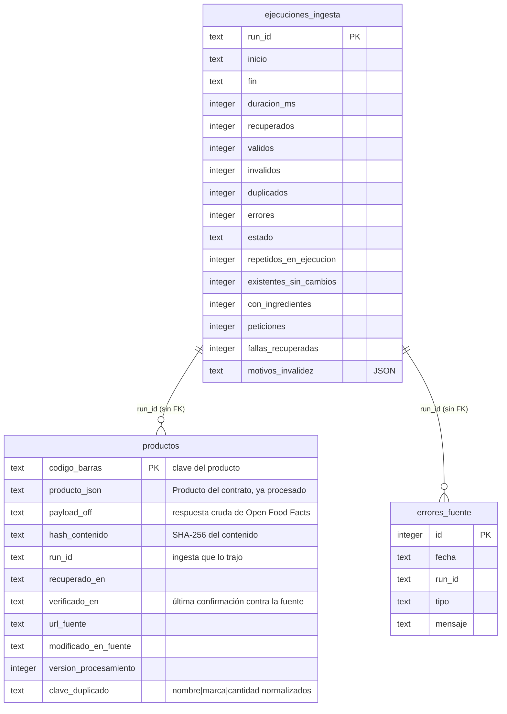

# Recuperación de información y evaluación

Este documento explica cómo guardamos los productos, cómo los buscamos y cómo
medimos si los datos y la búsqueda están funcionando bien. Cómo llegan los
productos a la caché está en [extraccion-y-preparacion.md](extraccion-y-preparacion.md);
los endpoints y sus campos, en el [contrato](contratos/README.md).

Todos los números salen de la caché real del python-service (383 productos,
4 ingestas), medidos el 23 de octubre de 2026 con
`scripts/estadisticas_corpus.py` y `scripts/evaluar_busqueda.py`. Al final
explicamos cómo reproducirlos.

## 1. Persistencia e indexación

Hay dos lugares donde se guardan datos, y cada uno tiene un dueño distinto:

| Dónde | Dueño | Qué guarda | Para qué |
|---|---|---|---|
| Caché SQLite (`foodaware-cache.sqlite3`) | python-service | Productos de Open Food Facts con su payload crudo, ejecuciones de ingesta y fallas de la fuente | Es la fuente de verdad del corpus; desde aquí se arma el índice de búsqueda |
| Índice BM25 en memoria | python-service | Índice invertido por campo, armado desde la caché | Responder `GET /search` sin tocar el disco ni la fuente |
| PostgreSQL | backend (NestJS) | Usuarios, alimentos analizados (EP1) y una copia de los productos que devolvió cada búsqueda | Perfiles, autenticación y un respaldo si FastAPI no responde |

### La caché SQLite



Los índices que tiene, y para qué sirve cada uno:

| Índice | Columna | Lo usa |
|---|---|---|
| Clave primaria de `productos` | `codigo_barras` | El upsert y `GET /products/{codigo}`; también garantiza que no haya dos filas con el mismo código |
| `idx_productos_verificado_en` | `verificado_en` | La antigüedad de la caché |
| `idx_productos_clave_duplicado` | `clave_duplicado` | Encontrar los posibles duplicados de un producto |
| `idx_ejecuciones_inicio` | `inicio` | La última ingesta y la próxima ingesta periódica |
| `idx_errores_fuente_fecha` | `fecha` | Las fallas recientes que revisa `/health` |

Guardamos el producto como JSON (`producto_json`) y no en columnas separadas
porque el python-service siempre lo lee y lo escribe completo, y así el
esquema no cambia cada vez que el contrato agrega un campo. Lo que sí
necesitamos filtrar u ordenar (código, fechas, versión, clave de duplicado)
va en columnas propias. El payload crudo se guarda para poder reprocesar sin
volver a llamar a Open Food Facts. La base usa modo WAL, que deja leer
mientras una ingesta escribe.

La deduplicación se apoya en esta estructura: el código de barras es la clave
primaria y cada guardado es un upsert, así que en la caché hay 0 códigos
repetidos. El detalle de cómo se cuentan los duplicados está en
[extraccion-y-preparacion.md](extraccion-y-preparacion.md#9-deduplicación) y
sus números, más abajo en las métricas.

### Por qué SQLite y un índice en memoria

Podríamos haber usado el mismo PostgreSQL del backend, pero preferimos que
el python-service fuera dueño de sus datos. Si compartieran base, un cambio en
una tabla del backend podría romper la ingesta, y el contrato entre los dos
servicios dejaría de ser solo HTTP. SQLite es un archivo, no necesita otro
servidor y para unos cientos de productos sobra. En Docker Compose vive en el
volumen `python_cache`, así que sobrevive a los reinicios.

El índice va en memoria porque el corpus es chico: 383 productos y 2.433
términos distintos. Armarlo y evaluarlo completo tarda unos 120 ms, así que
lo reconstruimos entero al arrancar y al terminar cada ingesta, en vez de
actualizarlo producto por producto. La reconstrucción arma un índice nuevo
aparte y recién al final reemplaza al anterior, así una búsqueda que está
corriendo nunca ve un índice a medio construir.

Con un corpus mucho más grande (decenas de miles de productos), esto habría
que cambiarlo por un motor de búsqueda dedicado; lo anotamos en
[limitaciones.md](limitaciones.md).

### Relación con PostgreSQL del backend

Las dos bases no se sincronizan entre sí. La relación es por el contrato:

1. El frontend busca en `GET /api/products/search` del backend.
2. El backend llama a `GET /search` del python-service y devuelve el
   resultado con el header `X-Fuente-Datos: fastapi`.
3. De paso, guarda en su tabla `products` los productos que vinieron en esa
   respuesta, con un upsert por `codigo_barras`. Solo pisa una fila si el
   producto que llega no es más antiguo (`recuperado_en`).
4. Si el python-service no responde después de los reintentos, el backend
   busca en su tabla `products` y responde con `X-Fuente-Datos: respaldo`.

O sea, PostgreSQL termina teniendo una copia parcial (solo lo que alguien
buscó) de los productos válidos de la caché, con las mismas columnas del
contrato: procedencia, calidad, alérgenos y trazas. El respaldo puntúa con
una regla más simple que BM25 (3 puntos si el término está en el nombre, 2 en
la marca y 1 en los ingredientes) y no usa las categorías. Sirve para que la
app no quede en blanco, no para reemplazar la búsqueda. Los detalles de esa
parte están en [backend.md](backend.md).

## 2. El corpus

Esta es la salida real de `scripts/estadisticas_corpus.py`, en la parte del
corpus:

```text
Productos en caché: 383
Productos válidos (indexados): 383
Productos por categoría:
  en:biscuits: 56
  en:dairies: 55
  en:breads: 31
  en:chocolates: 65
  en:breakfast-cereals: 100
  en:salty-snacks: 57
  en:plant-based-milk-alternatives: 32
  sin categoría configurada: 0
Categorías más frecuentes en OFF:
  en:plant-based-foods-and-beverages: 193
  en:plant-based-foods: 183
  en:snacks: 174
  en:cereals-and-potatoes: 156
  en:cereals-and-their-products: 140
  en:sweet-snacks: 120
  en:breakfasts: 100
  en:breakfast-cereals: 100
  en:cocoa-and-its-products: 66
  en:chocolates: 65
Términos distintos en el índice: 2433
Largo promedio (términos por producto): 63.1
  nombre: 2.8
  marca: 1.3
  ingredientes: 36.4
  categorias: 22.5
```

Algunas cosas que se ven aquí:

- Todos los productos de la caché son válidos porque los inválidos nunca se
  guardan.
- La suma por categoría (396) es mayor que 383 porque un producto puede
  estar en más de una (una galleta de chocolate está en `en:biscuits` y en
  `en:chocolates`).
- El reparto no es parejo (de 31 panes a 100 cereales), aunque cada ingesta
  reparte la cuota por igual. La caché junta lo que trajeron las 4 ingestas,
  la cuota que no usa una categoría pasa a las siguientes y las fallas de la
  fuente cortan páginas distintas en cada ejecución.
- El nombre tiene en promedio menos de 3 términos y los ingredientes más de
  36. Por eso BM25 normaliza por el largo de cada campo por separado (lo
  explicamos en la sección 5).

## 3. Tokenización

Para buscar, el texto se transforma en una lista de términos (tokens). La
regla más importante es que los productos y las consultas pasan por la misma
función, `tokenizar()` en
[`texto.py`](../python-service/app/procesamiento/texto.py). Si no fuera así,
"Galletas" en el producto y "galleta" en la consulta no coincidirían nunca.

Estos son los pasos, con la salida real para el nombre "Galletas de AVENA con
Pasas":

| Paso | Qué hace | Resultado |
|---|---|---|
| 1. Normalizar | Minúsculas, sin tildes, la puntuación pasa a espacio | `galletas de avena con pasas` |
| 2. Separar | Corta por espacios | `galletas`, `de`, `avena`, `con`, `pasas` |
| 3. Stopwords | Quita palabras vacías ("de", "con", "la", "the"...) y letras sueltas como "g" o "l" | `galletas`, `avena`, `pasas` |
| 4. Singular | Reglas simples del español: "galletas" pasa a "galleta", "nueces" a "nuez", "cereales" a "cereal" | `galleta`, `avena`, `pasa` |
| 5. Sinónimos | Lleva cada término a su forma canónica | `galleta`, `avena`, `pasa` |

La consulta "galleta avena" da exactamente `galleta`, `avena`, así que
coincide con ese nombre.

El paso 5 es el de los sinónimos de vocabulario, que agregamos después de la
primera evaluación. Son equivalencias de palabras que encontramos en el
corpus: variantes del español ("soja" y "soya", "cacahuete" y "maní", "fresa"
y "frutilla") y el inglés que mezcla Open Food Facts, sobre todo en las
categorías. Por ejemplo:

```text
"Bebida de Soja sabor Vainilla"  ->  bebida, soya, sabor, vainilla
"bebida de soya"                 ->  bebida, soya
"Biscuits, Oat biscuits"         ->  galleta, avena, galleta
"de la"                          ->  (nada: solo stopwords, no devuelve resultados)
```

Dejamos "sin" y "no" fuera de las stopwords a propósito, porque cambian el
sentido ("leche sin lactosa"). Más abajo se ve que eso no basta para
resolver las consultas con restricción.

## 4. Índice invertido

Un índice invertido es como el índice al final de un libro: para cada
término guarda en qué productos aparece y cuántas veces. Así una consulta
solo mira los productos que tienen alguno de sus términos, en vez de
recorrer los 383.

Tenemos un índice por campo, porque no vale lo mismo que "avena" aparezca en
el nombre que en los ingredientes:

| Campo | De dónde sale | Términos distintos | Largo promedio |
|---|---|---:|---:|
| nombre | `Producto.nombre` | 401 | 2,83 |
| marca | `Producto.marca` | 207 | 1,32 |
| ingredientes | `Producto.ingredientes` ya limpios | 1.877 | 36,44 |
| categorías | `categories` y `categories_tags` del payload crudo | 353 | 22,50 |

Cada índice guarda, además de las listas de productos por término, el largo
de cada producto en ese campo y el largo promedio. Son los datos que necesita
BM25. Solo se indexan productos válidos.

## 5. BM25 por campos

BM25 (Okapi BM25) es una fórmula clásica de recuperación de información que
da un puntaje a cada documento según los términos de la consulta que
contiene. Tiene tres ideas:

- Un término raro pesa más que uno común. Eso es el idf: "avena" aparece en
  27 nombres y vale 2,64; un término que aparece en casi todos los productos
  vale casi 0.
- Repetir un término suma cada vez menos (parámetro `k1 = 1.5`). La séptima
  vez que "galleta" aparece en las categorías de un producto no vale siete
  veces la primera.
- Una mención en un texto corto vale más que en uno largo (parámetro
  `b = 0.75`).

Usamos los valores de `k1` y `b` que se usan normalmente. Las fórmulas
completas están en el [contrato](contratos/README.md#búsqueda-score-bm25) y
en [`bm25.py`](../python-service/app/busqueda/bm25.py).

El puntaje final suma el BM25 de cada campo multiplicado por un peso:

| Campo | Peso | Por qué |
|---|---:|---|
| nombre | 3 | Es lo que mejor dice qué es el producto |
| marca | 2 | La gente busca por marca ("Costa", "Quaker") |
| categorías | 1,5 | Dicen el tipo de producto, y en inglés ayudan con los sinónimos |
| ingredientes | 1 | Son largos y mencionan muchas cosas: "avena" está en los ingredientes de 71 productos, pero solo en el nombre de 27 |

Los pesos los fijamos al crear el buscador y no los cambiamos después. No los
ajustamos con el conjunto de evaluación, porque con 20 consultas sería fácil
sobreajustarlos a esas consultas y no a la búsqueda en general.

### Ejemplo numérico real

Consulta "galletas de avena", que se tokeniza como `galleta`, `avena`. El
primer resultado es "Frutigran Avena y Pasas" (Granix, 7790045001188), con
puntaje 20,0895. Así se calcula, con N = 383 productos:

| Campo | Término | df | idf | tf | Largo / promedio | Peso tf | BM25 |
|---|---|---:|---:|---:|---|---:|---:|
| nombre | avena | 27 | 2,6365 | 1 | 3 / 2,83 | 0,9741 | 2,5683 |
| nombre | galleta | 21 | 2,8826 | 0 | | | 0 |
| ingredientes | avena | 71 | 1,6809 | 1 | 46 / 36,44 | 0,8944 | 1,5035 |
| categorías | galleta | 62 | 1,8155 | 7 | 16 / 22,50 | 2,1406 | 3,8863 |
| categorías | avena | 20 | 2,9302 | 1 | 16 / 22,50 | 1,1494 | 3,3679 |

Tomando el primero como ejemplo:

```text
idf(avena, nombre) = ln(1 + (383 − 27 + 0.5) / (27 + 0.5)) = ln(13.9636) = 2.6365
peso tf            = 1 · 2.5 / (1 + 1.5 · (0.25 + 0.75 · 3/2.83)) = 0.9741
BM25               = 2.6365 · 0.9741 = 2.5683
```

Y la suma ponderada:

```text
score = 3 · 2.5683            (nombre)
      + 2 · 0                 (marca)
      + 1 · 1.5035            (ingredientes)
      + 1.5 · (3.8863 + 3.3679) (categorías)
      = 7.7049 + 1.5035 + 10.8812 = 20.0895
```

Se ve el efecto de los pesos y de la normalización por largo. "avena" en un
nombre de 3 términos aporta 7,70, y la misma palabra en una lista de 46
ingredientes aporta 1,50. También se ve que "galleta" no está en el nombre
de este producto: lo encuentra por las categorías, que vienen en inglés
(`en:biscuits`) y el sinónimo convierte en "galleta".

## 6. Orden de los resultados y metadatos

Los resultados con puntaje mayor que 0 se ordenan así:

1. por `score`, de mayor a menor (redondeado a 4 decimales);
2. si empatan, por `calidad.completitud`, de mayor a menor, para mostrar
   primero el producto con más datos;
3. si siguen empatados, por código de barras, para que el orden sea siempre
   el mismo.

Una respuesta real de `GET /search?q=galletas de avena&limit=1`, recortada:

```json
{
  "consulta": "galletas de avena",
  "total": 130,
  "tiempo_ms": 17.623,
  "estado_fuente": "online",
  "resultados": [
    {
      "posicion": 1,
      "score": 20.0895,
      "producto": {
        "codigo_barras": "7790045001188",
        "nombre": "Frutigran Avena y Pasas",
        "marca": "Granix",
        "alergenos": ["gluten", "sulfitos", "lacteos"],
        "trazas": ["gluten", "soya"],
        "procedencia": {
          "fuente": "openfoodfacts",
          "url_fuente": "https://world.openfoodfacts.org/product/7790045001188",
          "recuperado_en": "2026-10-21T19:32:21.425674Z",
          "run_id": "ce991b44-96b7-44d1-bd6c-d62b37f83f3e",
          "hash_contenido": "ea594fde..."
        },
        "calidad": {
          "es_valido": true,
          "problemas": ["alergeno_detectado_en_texto:lacteos"],
          "completitud": 1.0
        }
      }
    }
  ]
}
```

| Campo | Qué significa |
|---|---|
| `total` | Todas las coincidencias antes de paginar (130 productos tienen "galleta" o "avena" en algún campo) |
| `posicion` | Posición global: con `offset=10`, el primero es el 11 |
| `score` | El puntaje BM25 ponderado |
| `tiempo_ms` | Lo que tardó la búsqueda dentro del servicio |
| `estado_fuente` | `online` si la última ingesta terminada no fue `fallido`; si no, `cache` |

Cada producto viaja con su procedencia y su calidad, así el frontend puede
mostrar de dónde salió y qué tan completo está.

## 7. Métricas

Medimos dos cosas distintas: si los datos que traemos sirven (calidad de los
datos) y si la búsqueda encuentra lo que la persona necesita (evaluación de
la búsqueda). Las definiciones formales de cada campo están en el
[contrato](contratos/README.md#métricas-de-calidad-get-metricsquality); aquí
explicamos por qué elegimos cada una y qué dicen los resultados.

### Calidad de los datos

Las métricas de ingesta se calculan sumando los conteos de todas las
ingestas terminadas, no promediando porcentajes, para que una ingesta de 400
productos pese más que una de 10.

| Métrica | Qué mide | Por qué la usamos | Valor actual |
|---|---|---|---:|
| Porcentaje de válidos | Válidos sobre recuperados | Dice cuánto de lo que entrega Open Food Facts nos sirve. Si baja, cambió la fuente o una regla está descartando de más | 75,91 % (1.043 de 1.374) |
| Porcentaje de duplicados | Válidos que no aportaron un producto nuevo, sobre válidos | Muestra si las ingestas traen cosas nuevas o solo confirman lo que ya teníamos | 63,18 % (659 de 1.043) |
| Cobertura de ingredientes | Recuperados con al menos un ingrediente después de limpiar | Sin ingredientes no hay detección de alérgenos: es la métrica más importante para el objetivo de la app | 75,10 % (549 de 731) |
| Antigüedad promedio | Horas desde la última verificación de cada producto | Dice qué tan al día está la caché | 25,09 h |
| Tasa de fallas de la fuente | Páginas que fallaron tras sus reintentos, sobre páginas pedidas | Separa los problemas nuestros de los de Open Food Facts | 52,94 % en la última ingesta (9 de 17) |
| Total de productos | Válidos en la caché | El tamaño del corpus que se busca | 383 |

Cómo leer cada número:

- Porcentaje de válidos. Casi 1 de cada 4 productos que llegan no sirve.
  En la última ingesta, de 86 inválidos, 83 no tenían ingredientes y 16 no
  tenían nombre. Es un problema de la fuente, no de la limpieza.
- Duplicados. El 63 % parece alto, pero no significa que tengamos datos
  repetidos. Se separa en dos tipos:
  - 8 repetidos dentro de una misma ingesta (el mismo producto en dos
    categorías);
  - 495 que ya estaban en la caché sin cambios.

  Ese desglose existe solo en las 2 ingestas más nuevas; los otros 156
  duplicados son de una ingesta anterior a que lo registráramos. Que domine
  el segundo tipo es lo esperable con ingestas periódicas: quiere decir que
  la caché ya estaba al día. La prueba de que no guardamos duplicados es que
  hay 0 códigos repetidos en la caché. Aparte, 5 productos están marcados
  como posible duplicado.
- Cobertura de ingredientes. Se calcula solo con las 2 ingestas que
  registran ese conteo. Coincide casi con el porcentaje de válidos porque la
  falta de ingredientes es justamente el motivo principal de invalidez.
- Antigüedad. Depende de cuándo se mida: la última ingesta fue el 23 de
  octubre a las 02:02 UTC, y medimos a las 16:56 UTC. Cada ingesta vuelve a
  verificar los productos que trae, pero los que Open Food Facts deja de
  devolver siguen envejeciendo, así que no esperamos que baje a cerca de 0.
  En staging va a crecer sin parar, porque ahí la ingesta periódica no corre.
- Tasa de fallas. En la ingesta anterior fue 35,29 % (6 de 17). Los 503 de
  las primeras ingestas nos llevaron a agregar la segunda ronda de
  reintentos, y estas tasas explican por qué también hizo falta la semilla
  del corpus: con Open Food Facts fallando en más de un tercio de las
  páginas, no podíamos depender de una ingesta para arrancar el servicio.

### Evaluación de la búsqueda

Para la búsqueda usamos Precision@5 y Recall@5, las métricas típicas para
evaluar un buscador cuando se mira solo el comienzo de la lista:

- Precision@5: de los 5 primeros resultados, qué parte le sirve a la persona.
- Recall@5: de todos los productos del corpus que le servirían, qué parte
  aparece en esos 5.

Elegimos 5 porque es lo que cabe en la pantalla de un celular sin hacer
scroll. Las informamos juntas porque cada una por separado se puede inflar:
mostrar un solo resultado seguro da buena precisión y mal recall, y mostrar
todo hace lo contrario. También medimos el tiempo de cada búsqueda.

Para saber qué es relevante armamos un conjunto de 20 consultas realistas
para una app de alergias en Chile
([`consultas.json`](../python-service/app/evaluacion/consultas.json)): 12 de
producto ("galletas de avena", "pan integral", "bebida de soya") y 8 con
restricción ("galletas sin gluten", "chocolate sin leche", "snack sin maní").
No marcamos a mano los códigos relevantes. En su lugar escribimos reglas que
se revisan sobre todo el corpus, por ejemplo: "galletas sin gluten" es
relevante si está en `en:biscuits` y no tiene gluten ni trazas de gluten.
Como la regla se aplica a todos los productos, sabemos exactamente cuántos
relevantes hay, y el recall es exacto. Promediamos cada consulta con el mismo
peso (promedio macro), tenga 2 o 40 relevantes.

Resultados actuales, sobre los 383 productos:

| Grupo | Consultas | P@5 | R@5 | Tiempo promedio |
|---|---:|---:|---:|---:|
| Producto | 12 | 0,75 | 0,66 | 0,20 ms |
| Restricción | 8 | 0,20 | 0,21 | 0,26 ms |
| Global | 20 | 0,53 | 0,48 | 0,22 ms |

`GET /metrics/evaluation` responde lo mismo para el índice vigente:
`precision_at_k` 0.53, `recall_at_k` 0.4818, 20 consultas evaluadas y
`tiempo_promedio_ms` 0.227. La tabla por consulta la imprime
`scripts/evaluar_busqueda.py`.

Estos valores dependen del corpus de la caché donde se mide. Las reglas de
relevancia se aplican sobre los productos que hay en esa caché, así que otra
caché (la de otro integrante, una con una ingesta más reciente o con
productos de prueba) tiene otros relevantes y da otro Precision@5. Por eso en
otros documentos del equipo puede aparecer un valor distinto, medido sobre
otra caché. El 0,53 de arriba es el de nuestra caché local de 383 productos,
medido el 23 de octubre de 2026. El valor de referencia del proyecto es el
que responde `GET /api/metricas/evaluacion` en staging: el python-service de
staging arranca siempre desde la semilla del corpus, así que da el mismo valor
en cada despliegue mientras no se regenere la semilla. Con la semilla del 25
de octubre de 2026 (385 productos), staging da también Precision@5 = 0,53.

Sobre el tiempo, hay que distinguir dos números. Recorrer el índice BM25
toma alrededor de 0,2 ms, que es lo que mide la evaluación. El `tiempo_ms`
que devuelve `/search` fue de 12,5 ms de mediana en 100 búsquedas seguidas
(13,4 ms el percentil 95). La diferencia es que `/search` además lee de
SQLite el estado de la última ingesta para llenar `estado_fuente`. Las dos
cifras son de un contenedor Docker en un notebook con Windows; en Render, con
0,1 CPU, van a ser más altas.

### Línea base y el efecto de los sinónimos

La primera evaluación la hicimos con BM25 sin sinónimos y la guardamos como
línea base ([`linea_base.json`](../python-service/app/evaluacion/linea_base.json),
347 productos en ese momento). El script compara cada evaluación con ella,
consulta por consulta:

| Grupo | P@5 antes | P@5 ahora | R@5 antes | R@5 ahora |
|---|---:|---:|---:|---:|
| Producto | 0,62 | 0,75 | 0,59 | 0,66 |
| Restricción | 0,25 | 0,20 | 0,23 | 0,21 |
| Global | 0,47 | 0,53 | 0,44 | 0,48 |

Los cambios más grandes, consulta por consulta:

| Consulta | P@5 antes | P@5 ahora | Qué pasó |
|---|---:|---:|---|
| bebida de soya | 0,20 | 1,00 | Los productos decían "Soja" y la consulta "soya"; con el sinónimo coinciden |
| leche de almendras | 0,20 | 0,40 | Las categorías en inglés ("almond", "milk") ahora suman, aunque el primer resultado sigue siendo un "Chocolate de Leche con Almendras" |
| yogurt natural | 0,60 | 0,80 | "Yoghurt Natural" y "Yogurt Griego Protein Natural" ahora dan el mismo término `yogurt` |
| bebida vegetal sin soya | 0,40 | 0,00 | Empeoró: ahora "soya" también encuentra las bebidas de soja, que son justo las que hay que excluir |

El corpus creció de 347 a 383 productos entre la línea base y hoy, así que no
toda la diferencia es por los sinónimos. Igual, el patrón es claro: mejorar
cómo coinciden las palabras ayuda a las consultas de producto y no ayuda (o
perjudica) a las de restricción.

### Por qué las consultas con restricción rinden peor

Esta fue la conclusión más importante de la evaluación. Veamos los 5
primeros resultados reales de tres consultas con restricción:

| Consulta | Lo que la persona quiere | Lo que devuelve el buscador en el top 5 |
|---|---|---|
| chocolate sin leche | Chocolates sin lácteos | 5 de 5 tienen lácteos ("Chocolate de Leche" de Costa, "Trencito Chocolate de Leche", "Leche Semidescremada con Cacao"...) |
| snack sin maní | Snacks sin maní | 5 de 5 tienen maní ("Cacahuate salado", "Maní salado", "Turrón & Maní"...) |
| bebida vegetal sin soya | Bebidas vegetales sin soya | 5 de 5 tienen soya ("Leche De Soya", "Soja sabor Vainilla"...) |

No es un error de la implementación, es cómo funciona un ranking léxico.
BM25 trata "sin" como una palabra más. Los productos que más puntaje reciben
son los que tienen "leche", "maní" o "soya" en el nombre, justo los que la
persona quiere evitar. Y "sin" solo ayuda cuando el producto lo dice en el
nombre. En "galletas sin gluten" el primer resultado sí es "Galletas Sin
Gluten María", pero el tercero es "Galletitas Crackers Sin Sal", que tiene
gluten y sube solo porque su nombre dice "sin".

Por eso subir la precisión de estas consultas no se arregla con más
sinónimos ni ajustando pesos. Hay que entender que la consulta expresa una
restricción ("sin leche") y filtrar por los alérgenos y trazas que ya
detectamos en cada producto, en vez de buscar la palabra. Eso es lo que
aporta la capacidad adaptativa del Módulo 3: usar el perfil y las
restricciones de la persona para filtrar y reordenar. La especificación
preliminar está en [capacidad-adaptativa.md](capacidad-adaptativa.md).

La evaluación ya deja lista la forma de medirlo. Las 8 consultas con
restricción y su P@5 de 0,20 son la línea de comparación. Si la capacidad
adaptativa funciona, ese número tiene que subir sin que bajen las 12 de
producto.

## 8. Evaluación de la capacidad adaptativa

La capacidad adaptativa clasifica cada producto como `apto`,
`apto_con_advertencia` o `no_apto` según el perfil de la persona, y la búsqueda
personalizada usa esa clasificación (las reglas están en el
[contrato](contratos/README.md#capacidad-adaptativa)). Aquí medimos si eso
funciona y si mejora la búsqueda base.

### El problema de evaluarla con sus propios datos

La forma fácil de evaluarla sería usar las reglas de relevancia de la sección
anterior: "galletas sin gluten" son las galletas sin gluten en `alergenos` ni
en `trazas`. Pero esos campos los llena la misma detección que usa el
veredicto. Si la detección se equivoca y no ve el gluten de una galleta, el
veredicto dice "apto" y la regla dice "relevante": la evaluación sale perfecta
justo cuando el sistema falla de la peor forma. Es una evaluación circular.

Por eso la separamos en tres partes:

1. **Veredictos contra un etiquetado manual**, hecho sin mirar la detección
   del sistema. Mide lo que más importa: los falsos "apto".
2. **Detección de alérgenos contra el mismo etiquetado**: dónde se equivoca
   la detección y hacia qué lado.
3. **Búsqueda base contra personalizada** en las 8 consultas con restricción.
   Esta parte sí usa las reglas de la sección anterior, así que mide el
   ranking dada la detección; la seguridad de la detección la miden las dos
   primeras.

### El etiquetado manual

Está en
[`etiquetado_manual.json`](../python-service/app/evaluacion/etiquetado_manual.json):
30 productos reales del corpus, con sus alérgenos y trazas revisados a mano a
partir del texto de ingredientes. Hay que decir tres cosas sobre cómo se hizo:

- **Lo propuso un asistente de IA y lo revisó el equipo.** El asistente leyó
  solo `ingredientes_texto` y propuso los alérgenos, las trazas y una nota por
  producto. Después una sola persona del equipo revisó los 30 productos,
  corrigió 4 (Pocky, Trencito, Pan Integral Multigrano y Crackers Sin Sal) y
  marcó cada uno con `revisado_por_equipo: true`. Solo cuentan los revisados.
- **El asistente vio parcialmente los resultados del sistema en un paso
  previo.** Al armar el archivo imprimió una tabla de control con los
  alérgenos y trazas que detecta el sistema para estos productos. Después
  etiquetó leyendo solo el texto, pero no podemos asegurar que esa tabla no
  haya influido.
- **La muestra no es al azar.** Elegimos los productos por ser difíciles: 9
  con nombres que engañan (Not Milk, Crackers Sin Sal, "Sin Gluten", Zero
  Lacto...), 7 con alérgenos que solo aparecen en el texto, 5 en que el
  sistema no detecta nada, 5 con trazas, 3 con datos difíciles y el único
  producto del corpus con un indicio de lecitina. No hay productos sin
  ingredientes porque la ingesta los descarta. Las tasas de esta muestra no
  son las del corpus completo: los productos difíciles deberían fallar más.

Criterios del etiquetado: una traza que ya es ingrediente no se repite en
`trazas`; lo ambiguo ("lecitina" sin origen, "harina" sin tipo, aromas como
"sabor leche", aceite de soya refinado) va a las notas y no a la lista; y
`null` significa que no se pudo decidir. Solo las trazas de Pocky quedaron en
`null`, por el OCR ilegible.

### Método

Para cada producto revisado, el **veredicto esperado** sale del etiquetado con
las mismas reglas del veredicto, pero sin mirar la detección: `no_apto` si
contiene algo que el perfil evita (sus alergias o los alérgenos que prohíben
sus dietas); si no y tiene una traza de algo que evita, `apto_con_advertencia`
(`no_apto` en modo estricto); si no, `apto`. Lo comparamos con el veredicto
del sistema para 6 perfiles de prueba (alergia a lácteos, al gluten, al maní, a
la soya y a frutos secos, y dieta vegana), en modo normal y estricto:

| Medida | Definición |
|---|---|
| Falso "apto" | El sistema dice `apto` y el producto contiene algo que el perfil evita. Tasa = falsos apto / productos que lo contienen |
| Falso "apto" por traza | El sistema dice `apto`, el producto no lo contiene, pero el etiquetado tiene una traza |
| Falso "no apto" | El sistema dice `no_apto` y el esperado no lo es. Tasa = falsos no apto / productos cuyo esperado no es `no_apto` |
| Matriz de confusión | Veredicto esperado contra el del sistema |
| Precisión y exhaustividad de la detección | Contando pares producto-alérgeno, en `alergenos` y en `trazas` (las del sistema que no son ya ingrediente) |

Un campo en `null` deja fuera al producto solo de los cálculos que lo
necesitan: las trazas de Pocky no impiden contar sus alérgenos. Que el sistema
diga `apto_con_advertencia` cuando se esperaba `apto` no cuenta como error: es
la regla de "ante la duda, advertir".

### Resultados

Primera medición, del 18 de noviembre de 2026, sobre la semilla del corpus
(385 productos, el mismo corpus de staging) con `VERSION_PROCESAMIENTO` 2, con
`scripts/evaluar_adaptativo.py --semilla`. Después corregimos la detección de
frases de trazas; los valores actuales están en
[Corrección de las frases de trazas](#corrección-de-las-frases-de-trazas).

**Veredictos.** Ningún perfil tuvo falsos "apto", ni por ingrediente ni por
traza:

| Perfil | Modo | Contienen | Falsos apto | Falsos no apto | Coinciden con el esperado |
|---|---|---:|---:|---|---:|
| Alergia a lácteos | normal | 5 | 0 | 5 de 25 (0,20) | 20 de 30 |
| Alergia a lácteos | estricto | 5 | 0 | 7 de 19 (0,37) | 23 de 30 |
| Alergia al gluten | normal | 14 | 0 | 1 de 16 (0,06) | 26 de 30 |
| Alergia al gluten | estricto | 14 | 0 | 3 de 14 (0,21) | 27 de 30 |
| Alergia al maní | normal | 1 | 0 | 2 de 28 (0,07) | 22 de 29 |
| Alergia al maní | estricto | 1 | 0 | 5 de 26 (0,19) | 24 de 29 |
| Alergia a la soya | normal | 7 | 0 | 3 de 22 (0,14) | 21 de 29 |
| Alergia a la soya | estricto | 7 | 0 | 6 de 19 (0,32) | 23 de 29 |
| Alergia a frutos secos | normal | 3 | 0 | 3 de 26 (0,12) | 22 de 29 |
| Alergia a frutos secos | estricto | 3 | 0 | 4 de 21 (0,19) | 25 de 29 |
| Dieta vegana | normal | 5 | 0 | 6 de 25 (0,24) | 11 de 30 |
| Dieta vegana | estricto | 5 | 0 | 7 de 19 (0,37) | 14 de 30 |

Cero falsos "apto" no es lo mismo que demostrar que no existen. Con 0 errores
en n casos, la cota superior aproximada de la tasa real al 95 % es 3/n (la
"regla de tres"): con los 14 productos con gluten la tasa podría llegar a cerca
de 21 %, con los 5 con lácteos a 60 %, y con un solo producto con maní el
resultado casi no dice nada. Lo que sí muestra es que en los casos difíciles
que elegimos el sistema se equivoca hacia el lado seguro.

En la dieta vegana coinciden pocos (11 de 30) porque 13 productos que el
etiquetado deja como `apto` el sistema los deja en `apto_con_advertencia`: no
tienen la etiqueta vegana que lo confirme, y el veredicto solo da `apto` con
esa etiqueta. Es lo esperado (ver [limitaciones.md](limitaciones.md)).

**Detección de alérgenos:**

| Campo | Productos | Correctos | De más | Faltantes | Precisión | Exhaustividad |
|---|---:|---:|---:|---:|---:|---:|
| Alérgenos | 30 | 35 | 22 | 0 | 0,61 | 1,00 |
| Trazas | 29 | 11 | 10 | 15 | 0,52 | 0,42 |

La detección no dejó pasar ningún alérgeno del etiquetado (exhaustividad 1,00),
pero marca de más. Revisamos los 22 marcados de más caso por caso, mirando de
dónde sale cada uno:

| Causa | Marcados de más |
|---|---:|
| Open Food Facts declara como alérgeno, en `allergens_tags`, lo que el texto dice que es traza (Wafers trisabor, Fitnessbrot y la barra de cereal). No corregimos las etiquetas de la fuente | 6 |
| Una frase de trazas que nuestra detección no reconocía: "…y sal. Puede contener soya, leche…" dentro de un paréntesis sin cerrar (papas Lays) y "…Plant also processes eggs, …, sulphites" (barra de cereal); corregido en la versión 3 | 3 |
| Lo ambiguo que el etiquetado dejó fuera a propósito: el aroma de manteca (Crackers), "sabor leche y crema" (Not Milk, que Open Food Facts etiqueta con leche), el lupino del texto descriptivo (Pan Integral), el huevo y la soya que Open Food Facts declara en el Molde Integral y lo ilegible del Pocky | 7 |
| "Almendras, maní, gluten" al final del Trencito, sin ninguna frase: el equipo los dejó como trazas | 3 |
| "Manteca de palmiste" leída como lácteo (Mini Tritón y Triton); corregido en la versión 4 | 2 |
| "Lecitina de maravilla" leída como soya (leche vegetal): maravilla es girasol; corregido en la versión 4 | 1 |

Las 15 trazas que faltan son el espejo de los primeros grupos: el mismo
alérgeno que el etiquetado tiene como traza y el sistema como ingrediente. En
una primera versión de este documento atribuimos los 15 a frases de trazas no
reconocidas; al revisar de dónde sale cada uno vimos que solo 3 lo eran. Las
10 trazas de más no aparecen en el texto que leímos; pueden venir de la
etiqueta de Open Food Facts, que el etiquetado no revisó, y sin ver la foto no
sabemos cuál tiene razón.

Por eso los falsos "no apto" vienen casi todos de la detección y no de las
reglas del veredicto. Con alergia a lácteos en modo normal, los 5 son: las
papas Lays ("puede contener … leche" leído como ingrediente), la manteca de
palmiste del Mini Tritón y del Triton, el aroma de manteca de los Crackers y el
Not Milk etiquetado con leche. En modo estricto se suman los productos con
trazas que el etiquetado no encontró en el texto (Wafers chocolate 0 %, Pan con
Romero y Molde Integral) y los que tienen datos insuficientes porque Open Food
Facts declara alérgenos que no reconocemos.

**Búsqueda base contra personalizada.** `GET /search` contra `POST
/search/personalized` con perfil vacío (la restricción sale de la consulta) y
modo `filtrar`:

| Consulta | Relevantes | P@5 base | P@5 personalizada | No aptos en el top 5 base | No aptos personalizada |
|---|---:|---:|---:|---:|---:|
| galletas sin gluten | 8 | 0,20 | 1,00 | 2 | 0 |
| chocolate sin leche | 6 | 0,00 | 0,60 | 5 | 0 |
| snack sin maní | 46 | 0,00 | 1,00 | 5 | 0 |
| leche sin lactosa | 2 | 0,40 | 0,20 | 0 | 0 |
| pan sin gluten | 6 | 0,60 | 1,00 | 1 | 0 |
| cereal sin gluten | 7 | 0,00 | 0,80 | 2 | 0 |
| bebida vegetal sin soya | 22 | 0,00 | 1,00 | 5 | 0 |
| galletas sin huevo | 36 | 0,40 | 1,00 | 3 | 0 |
| Promedio | | 0,20 | 0,83 | 23 | 0 |

La Precision@5 de las consultas con restricción sube de 0,20 a 0,83, y de 23
productos no aptos en los top 5 de la búsqueda base no queda ninguno. Ese 0 es
por construcción (el modo `filtrar` oculta los `no_apto`); lo que importa es
cuántos había en la base. La única consulta que empeora es "leche sin
lactosa". "Sin lactosa" se interpreta como la dieta `sin_lactosa`, que solo se
confirma con la etiqueta de Open Food Facts: suben primero los productos que
la tienen (kéfir, yogur), aunque no sean los que la regla busca, y la Leche
Descremada Zero Lacto, que no tiene esa etiqueta, queda en
`apto_con_advertencia` y baja del puesto 1 al 46. Además, al sacar "sin
lactosa" del texto que busca BM25, el nombre del producto deja de ayudar
(ver [limitaciones.md](limitaciones.md#3-búsqueda)).

### Corrección de las frases de trazas

La detección ya separaba las trazas cuando la frase ("puede contener",
"trazas de", "elaborado en líneas que…") abría un fragmento de la lista, pero
no cuando aparecía a mitad de uno, sin coma antes. Pasa cuando el texto trae
un punto donde no lo espera, un paréntesis sin cerrar o una frase pegada al
ingrediente anterior: en "…(antioxidante: TBHQ y sal. Puede contener soya,
leche y productos lácteos", la soya quedaba como traza y la leche, que viene
después de la coma, como ingrediente.

La corrección es general, por patrones de frases y no por producto
(`VERSION_PROCESAMIENTO` 3):

- Una frase de trazas a mitad de un fragmento, fuera de paréntesis, corta la
  lista: lo de antes es ingrediente y lo que sigue, aunque venga después de
  comas, es parte de la declaración. Para no cortar un ingrediente como
  "aceite elaborado en Chile", "elaborado en" solo cuenta si sigue una línea,
  planta o equipo.
- Se reconocen más variantes: "también procesa(n)", "also processes" y las
  frases de trazas en alemán, francés y portugués que aparecen en Open Food
  Facts ("Kann Spuren von", "Peut contenir", "Pode conter").

En el etiquetado se corrigen los 3 casos de la tabla de causas que eran frases
de trazas: los lácteos de las papas Lays y el huevo y los sulfitos de la barra
de cereal. Los demás marcados de más tienen otra causa y siguen igual. En todo
el corpus cambian 8 de los 385 productos; los revisamos uno por uno y en los 8
el alérgeno que deja de ser ingrediente viene de una frase de trazas real (por
ejemplo, "Puede contener trazas de: almendra, pasas, nuez, soya" en un yogur o
"PODE CONTER AVEIA, SOJA E TRIGO" en unos corn flakes). Ningún ingrediente
pasó a traza por error.

Después hicimos una segunda corrección (`VERSION_PROCESAMIENTO` 4):

- Dentro de un fragmento, "elaborado en", "fabricado en" y las demás
  variantes (también en inglés, como "produced in") solo cuentan como frase
  de trazas si sigue una línea, planta, instalación o equipo. Antes, en
  "Producto fabricado en Argentina con harina de trigo" el trigo quedaba como
  traza: un ingrediente real bajaba a advertencia. No cambió ningún producto
  del corpus, pero ese error iba en la dirección peligrosa y ahora lo cubre un
  test.
- Excepciones nuevas: "manteca de palmiste" (y de almendra o avellana) no es
  lácteo, y "lecitina de maravilla" (maravilla es girasol), "de semillas de
  girasol" o "rapeseed lecithin" no es soya. En el corpus cambian 4 productos:
  la leche vegetal y Moroketo dejan de marcar soya, y Mini Tritón y Triton
  dejan de marcar lácteos como ingrediente, pero los conservan como traza por
  su "puede contener leche".

Antes de cada cambio guardamos los resultados como línea base. Sobre el
etiquetado:

| Medida | Versión 2 | Versión 3 | Versión 4 |
|---|---:|---:|---:|
| Falsos "apto" (6 perfiles, 2 modos) | 0 | 0 | 0 |
| Falsos "no apto", alergia a lácteos, normal | 5 de 25 (0,20) | 4 de 25 (0,16) | 2 de 25 (0,08) |
| Falsos "no apto", alergia a la soya, normal | 3 de 22 (0,14) | 3 de 22 (0,14) | 2 de 22 (0,09) |
| Falsos "no apto", dieta vegana, normal | 6 de 25 (0,24) | 5 de 25 (0,20) | 3 de 25 (0,12) |
| Falsos "no apto", demás perfiles y modos | | sin cambios | sin cambios |
| Alérgenos: precisión | 0,61 (22 de más) | 0,65 (19 de más) | 0,69 (16 de más) |
| Alérgenos: exhaustividad | 1,00 | 1,00 | 1,00 |
| Trazas: precisión | 0,52 | 0,58 | 0,63 |
| Trazas: exhaustividad | 0,42 (15 faltantes) | 0,54 (12 faltantes) | 0,65 (9 faltantes) |
| P@5 de las consultas con restricción, base y personalizada | 0,20 y 0,83 | 0,20 y 0,83 | 0,20 y 0,83 |

Los reportes completos de cada versión, generados con
`scripts/evaluar_adaptativo.py --semilla` sobre el código de cada versión,
están como evidencia en
[`evidencia/evaluacion-adaptativa/`](evidencia/evaluacion-adaptativa/):
[versión 2](evidencia/evaluacion-adaptativa/version-2.md) (antes de las
correcciones), [versión 3](evidencia/evaluacion-adaptativa/version-3.md) y
[versión 4](evidencia/evaluacion-adaptativa/version-4.md) (la actual). Los
tres se regeneraron el mismo día con el mismo script, así que tienen el mismo
formato.

Con la caché y la semilla no hay que hacer nada: al arrancar, el servicio
reprocesa desde el payload guardado los productos de una versión anterior, y
la semilla se procesa con la versión actual cada vez que se carga.

### Limitaciones de esta evaluación

- El etiquetado lo propuso un asistente de IA y lo revisó una sola persona del
  equipo. No medimos el acuerdo entre dos revisores.
- El asistente vio parcialmente la salida del sistema antes de etiquetar, así
  que el etiquetado no es del todo independiente.
- 30 productos elegidos por ser difíciles: sirve para encontrar errores, no
  para estimar la tasa real en el corpus. Hay pocos casos positivos por
  alérgeno (uno solo con maní).
- Se etiquetó desde el texto de ingredientes, sin las fotos de la etiqueta.
  Lo que la etiqueta declara y el texto no trae no está en el etiquetado.
- La comparación de la búsqueda usa las reglas de relevancia, que dependen de
  la detección del sistema (la circularidad de arriba).
- La dieta vegana se evalúa solo por alérgenos, igual que la revisa el
  sistema: la carne, la miel o la gelatina no son alérgenos.
- Las correcciones de las versiones 3 y 4 las hicimos después de ver los
  resultados sobre este mismo conjunto, así que su mejora está medida con los
  datos que la motivaron y es optimista. Para acotarlo, son correcciones por
  patrones generales y revisamos su efecto en los 385 productos del corpus, no
  solo en los 30 del etiquetado; aun así, una medición limpia necesitaría un
  conjunto etiquetado nuevo.

### Cómo se calcula en el servicio

`GET /metrics/evaluation/adaptive` devuelve estos resultados (detalle de los
campos en el [contrato](contratos/README.md#get-metricsevaluationadaptive)).
Igual que la evaluación de la búsqueda, se calcula al reconstruir el índice y
no en cada petición, sobre el corpus que está respondiendo. Además, una prueba
del CI corre la evaluación sobre la semilla y falla si algún perfil de prueba
tiene un falso "apto" en el etiquetado revisado.

## Cómo reproducir los números

Sobre la caché del contenedor, con Docker Compose levantado:

```powershell
docker compose exec python-service python scripts/estadisticas_corpus.py
docker compose exec python-service python scripts/evaluar_busqueda.py
docker compose exec python-service python scripts/evaluar_busqueda.py --markdown /tmp/reporte.md
docker compose exec python-service python scripts/evaluar_adaptativo.py
```

La evaluación adaptativa de la sección 8 se midió sobre la semilla del corpus
(el corpus de staging). Para repetirla igual, sin depender de la caché local:

```powershell
docker compose exec python-service python scripts/evaluar_adaptativo.py --semilla --markdown /tmp/reporte_adaptativo.md
```

O por HTTP, con el servicio en `http://localhost:8000`. Estos endpoints exigen
`X-Clave-Servicio` con el valor de `CLAVE_SERVICIO` de `.env`
(`CLAVE_SERVICIO_OBLIGATORIA` es `true` por defecto, también en local); sin
ella responden 403:

```powershell
# Lee CLAVE_SERVICIO del .env de la raíz del repositorio.
$h = @{ "X-Clave-Servicio" = ((Select-String -Path .env -Pattern '^CLAVE_SERVICIO=(.*)$').Matches[0].Groups[1].Value) }
Invoke-RestMethod http://localhost:8000/metrics/quality -Headers $h
Invoke-RestMethod http://localhost:8000/metrics/evaluation -Headers $h
Invoke-RestMethod http://localhost:8000/metrics/evaluation/adaptive -Headers $h
Invoke-RestMethod "http://localhost:8000/search?q=galletas%20de%20avena&limit=5" -Headers $h
Remove-Variable h
```

La antigüedad y los tiempos van a dar distinto según cuándo y dónde se
corran; los conteos y las métricas de búsqueda deberían dar lo mismo mientras
no cambie la caché. Las pruebas automáticas que cubren el índice, BM25 y la
evaluación están descritas en [pipeline-devsecops.md](pipeline-devsecops.md).
